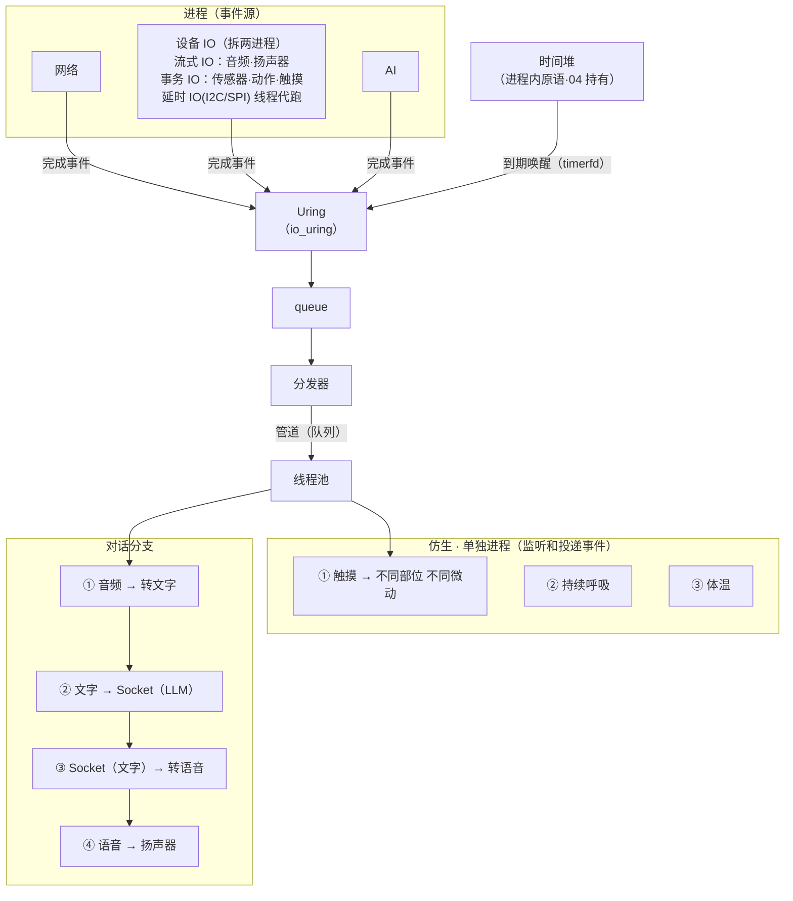

# 智能玩偶


## 环境
运行环境：Ubuntu24
语言：c++24，lua

## 功能
1. 对话
2. 仿生
    - 触摸反馈
    - 体温
    - 呼吸

## 设计

### 整体架构

主进程采用**Proactor**,控制网络、设备 IO、AI 等子进程（设备 IO 拆**流式 IO**/**事务 IO** 两个进程）；定时用进程内时间堆原语（不设独立定时器进程）
延时设备 IO(I2C,SPI)等由线程代跑、完成后回流事件，防止内核阻塞

#### 架构图



图注：

- **进程**：主进程（Proactor）控制网络、设备 IO、AI 子进程；设备 IO 拆**流式 IO**（音频、扬声器）与**事务 IO**（传感器、动作、触摸）两个进程，边界按时延预算与内核阻塞特性划（判据见 [modules/05-device-io.md](modules/05-device-io.md)）。其中延时 IO（I2C、SPI）由线程代跑、完成后回流事件，防止内核阻塞。
- **定时**：时间堆是进程内原语（04 持有时间堆与定时语义），各进程 04 按堆顶 `timerfd_settime` 设时、到期读完成进事件循环，不设独立定时器进程。
- **事件汇聚**：各子进程的异步完成事件统一进入 `Uring`（io_uring），经 `queue` 排队。
- **分发**：`分发器` 从队列取出事件，写入管道（队列），由 `线程池` 消费执行，避免阻塞事件循环。
- **业务**：线程池驱动两路业务——对话分支（语音进语音出）与仿生（触摸、呼吸、体温）。

#### 进程间通信

主进程与 AI 进程 / 仿生进程之间按数据特征分通道：

| 通道 | 机制 | 用途 |
|---|---|---|
| 控制面 | Unix Domain Socket（UDS） | 主进程 ↔ AI 进程 / 仿生进程的控制指令 |
| 数据面 | 共享内存（Zero-copy） | 音频流等大块数据传递，避免内存拷贝 |
| 唤醒信号 | eventfd | 数据就绪后唤醒对端事件循环 |

规则：

- 控制面与数据面分离：UDS 只传控制指令，音频流等大块数据走共享内存。
- 共享内存写入完成后，通过 eventfd 唤醒接收方事件循环，读取数据。

### 技术选型

见 [tech-stack.md](./tech-stack.md)。底座力学件（io_uring 事件源、无锁队列、线程池、时间堆）全部使用开源库，自研代码只做编排与业务。

### 业务逻辑

#### 对话分支

语音进、语音出的四步流水线：

1. 音频 → 转文字
2. 文字 → Socket（LLM）
3. Socket（文字）→ 转语音
4. 语音 → 扬声器

```
音频 → 转文字 → 文字 → Socket(LLM) → 文字 → 转语音 → 语音 → 扬声器
```

#### 仿生

1. 触摸 → 不同部位，不同微动
2. 持续呼吸
3. 体温

> 由单独进程运行：监听和投递事件。

### 模块设计

自底向上编写：从下往上写，为逻辑调用提供平台。每个模块独立成文，带 C++ 接口定义。

| 层 | 模块 | 文档 | 状态 |
|---|---|---|---|
| M0 基础层 | 01 事件分发核心（Dispatcher） | [modules/01-dispatcher.md](modules/01-dispatcher.md) | ✅ |
| M0 基础层 | 02 进程间通信（IPC） | [modules/02-ipc.md](modules/02-ipc.md) | ✅ |
| M0 基础层 | 04 定时器（Timer，原语级时间堆·语义层） | [modules/04-timer.md](modules/04-timer.md) | ✅ |
| M1 子进程 | 03 网络（Network） | [modules/03-network.md](modules/03-network.md) | ✅ |
| M1 子进程 | 05 设备 IO（Device IO·流式 IO + 事务 IO 两进程） | [modules/05-device-io.md](modules/05-device-io.md) | ✅ |
| M1 子进程 | 06 AI（ASR/TTS/LLM 对接） | [modules/06-ai.md](modules/06-ai.md) | ✅ |
| M1 子进程 | 07 仿生进程（Bionic） | modules/07-bionic.md | ⬜ |
| M2 业务层 | 对话分支 | modules/biz-dialog.md | ⬜ |
| M2 业务层 | 仿生行为 | modules/biz-bionic.md | ⬜ |

> 共享语音契约 `media.h`（音频参数、语音元数据、块 `kind`/`qos`；03/05/06/M2 共用）见 [media.md](./media.md)——纯头文件，不是模块、不占编号。
> 机械性切面 `with.h`（lambda 模拟 AOP around：守护/登记/结案/撤单/重挂/拦截/计数收编进切面，切面统一 `Aspect` 数据形，业务本体只写 lambda）见 [with.md](./with.md)——纯头文件，不是模块、不占编号。
> 策略注册表 `policy.h`（策略 = 行不写分支，`EventDef` 常量即行 + `static_assert` 审查套件）见 [policy.md](./policy.md)——纯头文件，不是模块、不占编号。

