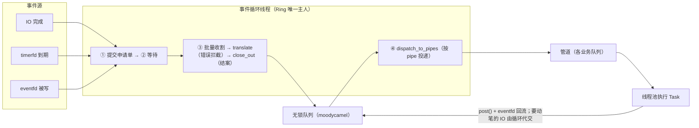

# 01 事件分发核心（Dispatcher）

> 自底向上第一层：为逻辑调用提供平台。力学件全部用开源库（见 [../tech-stack.md](../tech-stack.md)），本模块只做编排与契约。

## 职责

调度中枢：向上提供统一的事件/任务入口，向下把开源库编排成流水线。

1. **定义契约**：`Event` / `Task` 与 `disp::post()/submit()/submit_op()/run()` 等门面自由函数；上层只见契约与门面，不见库类型、不见类。
2. **统一事件源**：IO 完成项（liburing，含 timerfd 的读）、eventfd 跨线程/跨进程唤醒，全以完成项形式汇入同一队列；时间堆与 timerfd 归 04，到期读完成与其它完成项同路。
3. **路由分发**：按事件自带的 `pipe`（收件地址）投到对应管道，01 不持归属表。
4. **执行回流**：线程池消费 `Task`（BS::thread_pool），结果以 `Event` 回流，闭环。
5. **薄封装**：三个开源库各包一层（liburing、moodycamel、BS::thread_pool；Boost.Heap 封装归 04），统一错误码与生命周期；库类型不出模块边界。
6. **背压与错误拦截**：队列满按类型分策略（阻塞/丢弃/降级）；库错误在本层截获。

**不负责**：业务逻辑（M2）、IPC 协议语义（02）、时间堆与定时语义（04；timerfd 与设时归 04，读申请单走本层收货口）、设备与网络（03/05）。

## 数据结构

分**契约类型**（应用层可见）与**内部类型**（封在实现文件）。设计约定：**外壳函数式、类退居资源聚合体**——门面 = `disp` 命名空间下的自由函数操作集（`disp::func(Dispatcher&, …)`，资源引用作第一参数，`create()`/`stop()` 管资源生死），应用层只见契约与门面，不见类、不调方法；类只做**资源聚合体**（RAII 资源成员，操作全在门面自由函数）与**库薄壳**（RAII + 不可再拆的 syscall/库封装），原语就是门面函数本身——判据见规则"门面准入"，类的规模只减不增；封装靠文件边界——**头文件** = 契约类型 + 门面函数声明（应用层唯一可见面），**实现文件** = 类定义 + 内脏自由函数，不用 `private`/`friend`，模块边界即封装边界。内脏自由函数分**纯函数**（查询/变换，无副作用，可直接单测）与**编排函数**（带副作用：投队列、写 eventfd、提交申请单、唤醒线程池；动词用命令式命名），住 `disp` 命名空间（模块内脏，不跨模块直调）。**机械性切面**：与业务无关且复写 ≥ 2 处的机械动作（守护/登记/结案/撤单/重挂/拦截/计数）一律 `with(切面…, 本体)` 包裹——lambda 模拟 AOP around：机械住切面、业务住 lambda，见 [../with.md](../with.md)。

```cpp
// ===== disp.h：契约类型 + 门面（应用层唯一可见面） =====

// 事件类型：弱类型 + 号段约定——上层模块在自己文档里定义本号段的行（EventDef）与负载结构，无需改 01
using EventType = uint32_t;

// 事件定义 = 策略行（policy.h，声明即注册，编译期审查）：id + 归属 + 满时策略一处定死
inline constexpr EventDef kTypeIoReadDone {1, kDisp, Qos::kBlock};   // 01 基础层保留 0–99；完成项关乎在飞结账，不许丢
inline constexpr EventDef kTypeIoWriteDone{2, kDisp, Qos::kBlock};
inline constexpr EventDef kTypeWake       {3, kDisp, Qos::kBlock};   // eventfd 对端唤醒（数据就绪；source 定位对端）
inline constexpr EventDef kTypeError      {4, kDisp, Qos::kBlock};   // 错误事件（本层拦截后上报）：错误不许丢
inline constexpr EventDef kTypeTimeout    {5, kDisp, Qos::kBlock};   // 定时唤醒：timerfd 读完成，通知提交方（04）
// 号段注册表（policy.h）= 模块号 × 100：02→100–199、03→200–299、04→300–399、05→400–499、
//        06→500–599、07→600–699；M2 业务层 1000 起。0 = 无效。段间不重叠由 static_assert 审。
// 语义事件（眨眼指令、触摸点、IPC 控制指令、动作指令、LLM 回复等）住这些号段。

using SourceId = uint32_t;     // 来源编号：fd / 设备 / 进程
constexpr SourceId kInternalWakeSource = 0;   // 保留：内部唤醒专用，永不分配给业务/对端
using PipeId   = uint32_t;     // 管道编号（各业务队列的收件地址）

struct Event {
    EventType type;
    SourceId  source;
    PipeId    pipe;              // 收件地址：该进哪条管道（IO 完成从 OpCtx 抄来，post() 由投递方声明）
    uint64_t  ts_ns;
    std::any   payload;          // 弱类型负载：传输层放 IoResult（字节数/错误码，数据在缓冲区）或空；
                                 // 语义事件放模块自定义结构，消费方 any_cast 取回
};

struct Task {
    std::function<void()> fn;   // 干完活自行 post() 结果回流
    uint8_t priority;           // 决定进哪条管道
};

// 申请单：一张未完成 IO/唤醒/等待的档案。提交方填内容、声明回执地址；
// 提交时把 OpCtx* 塞进完成项票根，收割时查回。
struct OpCtx {
    OpKind   kind;                // SocketRead / SocketWrite / DeviceIo / TimerWait / EventFdWake
    SourceId source;
    PipeId   pipe;                // 回执地址：提交方声明，完成项翻成事件后投回这条管道
    void*    buf;  size_t len;
    std::atomic<int> inflight;    // 在飞计数：归零才许销毁
    bool     cancelled = false;   // 取消后迟到的完成项据此丢弃
};

class Dispatcher;               // 资源聚合体（定义在实现文件）：应用层只见名字，用指针/引用持有

// ===== 门面：自由函数操作集，资源引用作第一参数 =====
namespace disp {
std::unique_ptr<Dispatcher> create();   // 资源出生（RAII）
void post(Dispatcher&, Event);          // 入队并写 eventfd 唤醒循环
void submit(Dispatcher&, Task);         // 任务进管道，线程池消费
void submit_op(Dispatcher&, OpCtx);     // 申请单提交口：登记账本 + 上环（仅循环线程，其他线程 post() 代交）
void run(Dispatcher&);                  // 进入事件循环，阻塞到 stop
void stop(Dispatcher&);                 // 资源死：置位 → 唤醒 → drain 队列 → 等在飞结清 → 释放；之后门面调用一律拒绝
}
```

```cpp
// ===== disp.cc：内部类型（实现文件） =====

class Ring {                // 库薄壳：liburing RAII + 不可再拆的库封装（SQE/CQE 封在壳内，不出边界）
public:
    void submit_and_wait(int);               // 提交申请单，等 ≥1 完成
    void for_each_cqe(unsigned& head, F&&);  // 批量遍历完成项
    void advance(unsigned n);                // 收割完归还槽位
};

class MpmcQueue {           // 库薄壳：moodycamel RAII + 不可再拆的库封装（多生产者安全）
public:
    bool enqueue(Event&&);
    bool try_dequeue(Event&);
};

class ThreadPool {          // 库薄壳：BS::thread_pool RAII + 不可再拆的库封装
public:
    void push(Task);
};

struct OpTable { /* 票根 → OpCtx*；登记/摘除由自由函数完成 */ };
```

```cpp
// ===== disp.cc：资源聚合体（实现文件） =====

// 资源聚合体：资源出生与生死归 create/stop，操作全在门面自由函数
class Dispatcher {
public:
    Ring       ring;      // liburing 薄壳：仅循环线程访问（单提交者）
    MpmcQueue  queue;     // moodycamel 薄壳：多生产者安全
    ThreadPool pool;      // BS::thread_pool 薄壳
    OpTable    ops;       // 账本
    int        wake_fd;   // eventfd 唤醒通道
    std::atomic<bool> running{true};
};
```

```cpp
// ===== disp.cc：内脏自由函数（实现文件，不跨模块直调） =====
namespace disp {   // 门面 post/submit/submit_op/run/stop 的实现体即编排

// ===== 纯函数：查询/变换，无副作用，可直接单测 =====

// 票根 + 完成项 → 事件：翻译、错误拦截都在此，不碰账本（取消丢弃住 settle 切面的拒绝路径）；时间戳作参数，确定可测
std::optional<Event> translate(const Cqe& c, const OpCtx& ctx, uint64_t now_ns);
bool                 should_drop(const Event& ev, size_t qlen);  // 背压判定（查 EventDef.qos 行，policy.h）：backpressure 切面调用的纯函数

// ===== 编排函数：带副作用，动词用命令式 =====

void close_out(OpTable& ops, OpCtx& ctx); // 结案记账（ticket/settle 切面的 exit 体）：inflight--，归零才许销毁
void harvest_into_queue(Dispatcher& d);   // 批量收割：with(settle(…)) → translate → 入队
void enqueue_event(Dispatcher&, Event&&); // 入队点：with(backpressure(d, ev), 入队)——ev 是点上局部量，切面在此就地套（唯一允许二起 with 处）
void dispatch_to_pipes(Dispatcher& d);    // 排空队列 → with(backpressure(…)) 按 ev.pipe 投管道
}  // namespace disp
```

## 接口与流水线

### 门面操作集（disp.h）

| 操作 | 调用线程 | 语义 |
|---|---|---|
| `create()` | 启动时 | 资源出生（RAII，类定义在实现文件构造） |
| `post(Dispatcher&, Event)` | 任意线程 | 入队并写 eventfd 唤醒循环 |
| `submit(Dispatcher&, Task)` | 任意线程 | 任务进管道，线程池消费，结果由 `fn` 自行 `post()` 回流 |
| `submit_op(Dispatcher&, OpCtx)` | 循环线程 | 登记账本并上环：读写/超时/唤醒申请单统一入口 |
| `run(Dispatcher&)` | 循环线程 | 进入事件循环，阻塞到 stop |
| `stop(Dispatcher&)` | 任意线程 | 置位 → 唤醒 → drain 队列 → 等在飞结清 → 释放退出；之后门面调用一律拒绝（返回 `false` / 断言） |

各门面实现体一律以 `with(live(d), …)` 起手——"stop 后一律拒绝"不靠每个函数自查（`live` 切面见 [../with.md](../with.md)）。

**单提交者**：io_uring 申请单只由事件循环线程经 `submit_op()` 提交；其他线程要发起申请单一律 `post()`，由循环代交。并发提交由 moodycamel 队列接住。阻塞型设备调用不经申请单：走 `submit()` 进线程池代跑、完成后 `post()` 回流（05 事务侧，见 [05](./05-device-io.md)）；事件型设备的常驻读申请单照常经 `submit_op`。

### 收割循环

每圈四步：**提交 → 等待 → 收割 → 分发**。等待时睡眠，不空转。门面 `run` 的实现体：

```cpp
void disp::run(Dispatcher& d) {
    while (d.running) {
        d.ring.submit_and_wait(1);                     // ①② 提交申请单，等 ≥1 完成

        unsigned head = 0, n = 0;
        uint64_t now_ns = clock_ns();                   // 每圈取一次时钟，整批同刻
        d.ring.for_each_cqe(head, [&](const Cqe& c) {  // ③ 批量收割
            with(settle(d.ops, *(OpCtx*)c.user_data, 该单的 OpPolicy 行), [&](OpCtx& ctx) {  // 机械：票根找回 + 取消丢弃 + 结案恒一次
                if (auto ev = translate(c, ctx, now_ns))                // 业务：翻译定形 + 错误拦截
                    enqueue_event(d, std::move(*ev));                   // 业务：入队（背压判定套在入队点，见下）
            });
            ++n;
        });
        d.ring.advance(n);                             // 收割完立刻归还槽位

        dispatch_to_pipes(d);                            // ④ 队列 → 按 ev.pipe 投管道 → 线程池
    }
}
```

### 唤醒来源

| 事件源 | 怎么进来 | 收割后 |
|---|---|---|
| 网络/IPC/事件型设备读 | 读写申请单完成 | 翻译成 `IoReadDone` / `IoWriteDone`（域看 source） |
| 定时到期 | 04 按堆顶 `timerfd_settime` 设时，01 对 timerfd 挂读申请单 | 读完成项翻成 `kTypeTimeout`，按回执管道投 04 的 `inbox`；弹堆、重设、交付归 04 |
| 进程内其他线程 | `post()` 写 eventfd | 排空队列里回流的事件（含 05 事务侧代跑完成回流） |
| 对端进程 | 共享内存写完，写 eventfd | 翻译成 `Wake`，按回执地址投回 02 的管道 |

四路来源（归 io_uring 完成项与 eventfd 两类机制）都以完成项形式从**同一个收货口**出来。

### 翻译与结案（错误拦截点）

```cpp
// 纯函数：不碰账本。翻译、错误拦截都在此定形（取消丢弃住 settle 切面的拒绝路径，不进本函数）。
std::optional<Event> disp::translate(const Cqe& c, const OpCtx& ctx, uint64_t now_ns) {
    if (c.res < 0)                                  // 内核错误码就地拦截
        return Event{kTypeError, ctx.source, ctx.pipe, now_ns, IoResult{-c.res}};
    if (ctx.kind == OpKind::EventFdWake) {
        if (ctx.source == kInternalWakeSource)      // 内部唤醒：只叫醒循环，丢弃
            return std::nullopt;
        return Event{kTypeWake, ctx.source, ctx.pipe, now_ns};   // 对端唤醒：回执照抄 ctx.pipe
    }
    if (ctx.kind == OpKind::TimerWait)                        // timerfd 到期：通知提交方（04），交付归 04
        return Event{kTypeTimeout, ctx.source, ctx.pipe, now_ns, 过期计数};  // 8 字节 uint64 负载透传，01 不解释
    // 其余按 ctx.kind 构造 kTypeIoReadDone / kTypeIoWriteDone，回执地址照抄 ctx.pipe
}

// 编排函数：结案记账，副作用只在这一处
void disp::close_out(OpTable& ops, OpCtx& ctx) {
    if (--ctx.inflight == 0) ops.try_erase(ctx);    // 归零才许销毁
}
```

**先翻译后结账**：销账后单子可能被销毁，翻译必须赶在 `close_out` 之前——`settle` 切面的 exit（= `close_out`）恒在本体（翻译 + 入队）之后，顺序条款变成结构。

`EventFdWake` 在此分两路，判据是 `ctx.source`：`kInternalWakeSource`（保留值 0，永不分配给业务/对端）是内部唤醒，返回空——它只起唤醒循环、让循环排空队列的作用；其余是对端 eventfd，翻成 `Wake` 事件，按回执地址（`ctx.pipe`）投回 02 的管道（数据在共享内存，映射归 02）。

`TimerWait`（04 的 timerfd 读）到期即完成：翻成 `kTypeTimeout` 事件按回执管道（`ctx.pipe`）投给提交方——04 的 `inbox`。时间堆、timerfd 设时、弹堆与用户事件交付全在 04，01 不认识时间堆、不认识时刻。读申请单缓冲是固定 8 字节 `uint64` 过期计数，作事件负载透传——01 不解释其含义（积压语义归 04）。

### 流程图



### 例子：摸头 → 耳朵动

```cpp
// 启动（应用层只见各模块头文件：契约 + 门面，不见类；各门面分属不同进程，跨进程处经 02，此处按事件流连贯展示）
auto d = disp::create();            auto timer = tmr::create(*d);
auto ip = ipc::create(*d, *timer);  auto io = txio::create(*d, *timer, *ip);   // 05 事务侧门面
auto body = bio::create(*d);
txio::watch（*io, 触摸传感器，0, 每 10ms, 触摸管道）;   // 05 门面：读数以 kTypeSensorSample 投管道（GPIO 边沿型换 `txio::watch_edge`，事件 = `kTypeDeviceEvent`）
tmr::every(*timer, 每 500ms, Event{.type = 呼吸 tick, .pipe = 仿生管道});   // 04 门面，到期原样投递，仿生收到的就是这条
disp::run(*d);

// 业务侧（线程池里）：只 disp::post()，不碰 io_uring
// 触摸管道消费者：any_cast<SensorSample> 解析出触摸点 → on_touch
void bio::on_touch(Bionic& b, 触摸点 t) {
    disp::post(d, Event{.type = 动作指令，.pipe = 电机管道，.payload = 决策(t)});   // 摸头 → 耳朵动
}
```

| 圈 | 醒因 | 收割 | 动作 |
|---|---|---|---|
| 1 | 触摸读完成（05 代跑回流） | `kTypeSensorSample`：摸了左耳 | 线程池跑 `on_touch` |
| 2 | eventfd 被写 | 动作指令 | 05 组单代跑电机写 + 挂 04 看门狗 |
| 3 | 电机写完成（`post()` 回流） | `kTypeActuatorDone` | 撤看门狗、摘账 |
| 4 | 呼吸 tick 到期 | 04 弹堆投出原样 `呼吸 tick` | 线程池算呼吸曲线 → `post()` |
| 5 | eventfd 被写 | 呼吸结果 | 05 组单代跑 I2C 写 + 挂 04 看门狗 |
| 6 | I2C 写完成（`post()` 回流） | `kTypeActuatorDone` | 撤看门狗、摘账 |

没事发生时循环睡在等待里，不占 CPU。

## 规则

- **风格**：外壳函数式、类退居资源聚合体——门面 = `disp` 自由函数操作集（契约与门面声明在头文件，应用层唯一可见面），内脏住实现文件、住 `disp`（不跨模块直调）：纯函数（`translate` / `should_drop`）无副作用、可单测；编排函数（`harvest_into_queue` / `close_out` / `dispatch_to_pipes` …）带副作用，动词用命令式 + 宾语。类只做资源聚合体与库薄壳；契约/账本结构体不带方法。
- **门面准入**：新操作先问能否用既有门面组合实现——能则写成门面语法糖（参数适配、无新不变量），不能才新增门面原语；门面只增原语，不增类方法（演进防火墙）。
- **机械性切面**：与业务无关且重复的机械动作一律 `with(切面…, 本体)` 包裹（切面 = `Aspect` 数据形：state 挂机械状态与策略行，见 [../with.md](../with.md)）——门面 `live`（停机守护）、提交/收割 `ticket`/`settle`（票根登记与结案恒一次）、投递 `backpressure`（背压判定）；"stop 后一律拒绝""先翻译后结账"等顺序条款由切面吸收；新增机械动作先过切面准入（工厂 + 参数审查），业务数据不进切面。
- **扩展（号段约定）**：`EventType` 是弱类型 `uint32_t`（`enum class` 封死扩展，不用），01 只占 0–99（`kType*` 常量）；语义事件号段 = **模块号 × 100**（02→100、03→200、04→300、05→400、06→500、07→600，M2 业务层 1000 起），各模块在自己文档定义本号段的行（`EventDef`，见 [../policy.md](../policy.md)）与负载结构，无需改 01；负载同样弱类型（`std::any`，消费方 `any_cast`）。02 的 `IpcMessage`、05 的触摸点/传感器读数都不在 01 预置。
- **寻址**：事件自带收件地址——IO 完成的回执地址由提交方声明（记在 `OpCtx.pipe`，`translate` 抄进 `Event.pipe`），语义事件由投递方在 `post()` 时声明；01 不持有 source→管道 归属表，管道是普通队列、单投递，谁登记谁收货。
- **线程安全**：门面操作任意线程可调（`submit_op` 由循环线程执行，其他线程 `post()` 代交）；io_uring 环、账本、管道投递只在循环线程。库类型（SQE、CQE、队列迭代器）不出模块边界。
- **生命周期**：账本条目带在飞计数，归零才许销毁；`OpCtx` 统一由账本持有，禁裸 `new/delete`。
- **取消**：摘账本条目/取消在飞申请单，条目里存的事件随之作废、永不投出；迟到的完成项走 `settle` 切面的拒绝路径（丢弃并计数，不进翻译、不产生事件），结账照常。定时器取消语义归 04。
- **定时器**：机制只有一张 timerfd 读申请单（`TimerWait` → `kTypeTimeout`）；时间堆、timerfd 设时、语义句柄、到期交付全在 04。
- **背压**：不写分支、写行——每事件的满时策略就是它的 `EventDef` 行（`Qos::kBlock` 关键阻塞 / `kDropCount` 丢弃计数 / `kKeepLatest` 留最新，见 [../policy.md](../policy.md)），`should_drop` 查表；新增事件不出行就定义不出来（编译期审查），号段主人在自己契约块出行。
- **错误拦截**：负错误码在 `translate` 转 `kTypeError` 事件或丢弃，不把库错误抛给上层。
- **stop()**：置位 → 唤醒 → drain 队列 → 等在飞结清 → 释放退出；之后门面调用一律拒绝（返回 `false` / 断言）。
- **优化预留**：回流争用高时可换"每生产者 SPSC 邮箱 + 分发器汇总"，`post()` 契约不变。
