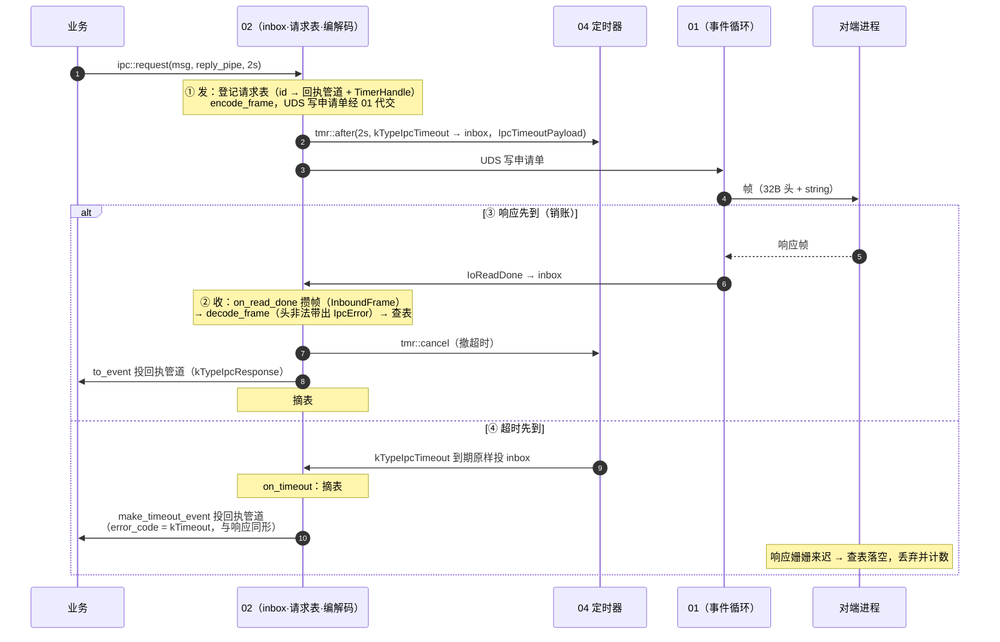
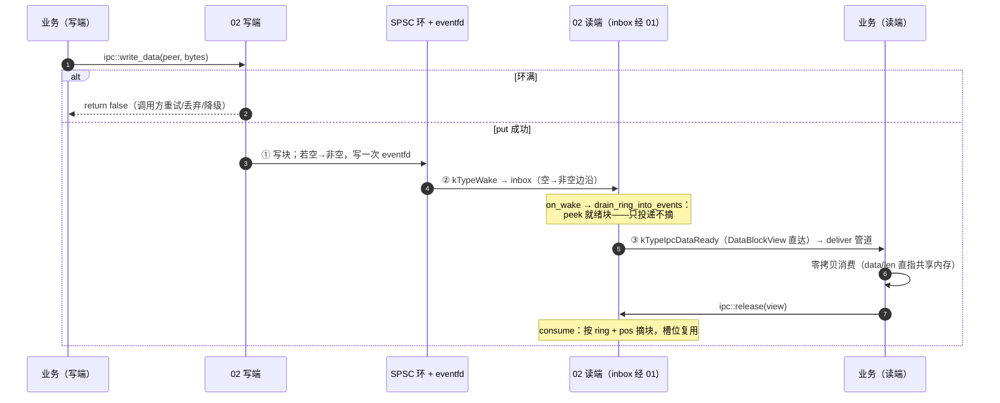
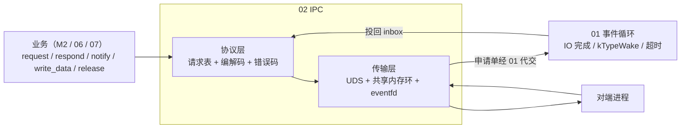

# 02 进程间通信（IPC）

> 自底向上第二层：IPC 传输与协议语义层。控制面走 UDS，数据面走 memfd + mmap 共享内存环（薄层自研），eventfd 只做"环从空到非空"的唤醒（选型见 [../tech-stack.md](../tech-stack.md)）。消息格式、号段 100–199、请求/响应与错误语义在本模块定死；事件循环与投递归 [01](01-dispatcher.md)，01 只把 IO 完成和 `kTypeWake` 事件投回 02 的管道。

## 职责

让主进程与子进程（或对端进程）之间传控制指令和大块数据：

1. **定义契约**：`IpcMessage`（32 字节定长头 + string 负载）与 `ipc::request()/respond()/notify()/write_data()/release()` 等门面自由函数；上层只见契约与门面，不见 fd / mmap / msghdr、不见类。
2. **控制面（UDS）**：主进程 `listen`、子进程 `connect`；控制指令走 UDS，按头里 `payload_len` 做长度前缀分帧。
3. **数据面（共享内存）**：memfd_create + mmap 的 SPSC 环薄层（自研），音频流等大块数据零拷贝过进程；eventfd 只做"环从空到非空"的唤醒，数据搬运不经 socket。
4. **请求/响应**：`request_id` 关联请求与响应，请求表记账（id → 回执管道 + 超时 TimerHandle）；超时挂 04 门面 `tmr::after()`，到期事件原样投回 `inbox`；单向通知另立一类。
5. **两层错误语义**：传输层错误由 01 拦截（`kTypeError`），本层归纳成连接状态（`kTypeIpcBroken`）；协议层错误走响应头 `error_code` 字段。
6. **对接 01**：UDS 读写以申请单形式经 01 代交（单提交者约定），完成项与 `kTypeWake` 都由 01 投回 `inbox`；02 只做分帧、编解码与协议分发。

**不负责**：业务语义（M2）、事件循环与投递（01）、定时器语义（04）、网络与设备（03/05）、对端进程内部逻辑。

## 数据结构

沿用 01 的设计约定（**外壳函数式、类退居资源聚合体**）：门面 = `ipc` 命名空间自由函数操作集（资源引用作第一参数，`create()`/`stop()` 管资源生死），应用层只见契约与门面、不见类；类只做**资源聚合体**（RAII 资源成员，操作全在门面自由函数）与**库薄壳**（RAII + 不可再拆的 syscall/库封装），原语就是门面函数本身；封装靠文件边界——**头文件** = 契约类型 + 门面声明（应用层唯一可见面），**实现文件** = 类定义 + 内脏自由函数（纯函数 + 编排函数），不用 `private`/`friend`；内脏住 `ipc` 命名空间（不跨模块直调）。机械性动作一律 `with(切面…, 本体)` 包裹（lambda 模拟 AOP around，见 [../with.md](../with.md)），编排函数本体只写业务。

```cpp
// ===== ipc.h：契约类型 + 门面（应用层唯一可见面） =====

using RequestId = uint64_t;   // 请求-响应关联号；通知类 = 0
using PeerId    = uint32_t;   // 对端进程编号（accept/connect 时分配）；兼任 SourceId，0 = 无效
using RingId    = uint32_t;   // 环编号：每对进程、每方向一条；建环时 02 分配，重连复用（同 PeerId）

// 02 号段 100–199：消息类型 = 事件类型，线上 head.type 与 Event.type 同值。
// 事件定义 = 策略行（policy.h，声明即注册）；本号段的行与负载结构由 02 定义（01 不预置），消费方 any_cast 取回。
inline constexpr EventDef kTypeIpcRequest   {100, kIpc, Qos::kBlock};  // 收到请求（需响应）
inline constexpr EventDef kTypeIpcResponse  {101, kIpc, Qos::kBlock};  // 收到响应（head.error_code 有效）
inline constexpr EventDef kTypeIpcNotify    {102, kIpc, Qos::kBlock};  // 收到通知（request_id = 0）
inline constexpr EventDef kTypeIpcDataReady {103, kIpc, Qos::kBlock};  // 数据面：环空→非空，负载 = DataBlockView（直达）
inline constexpr EventDef kTypeIpcBroken    {104, kIpc, Qos::kBlock};  // 传输层断连/错误，本层归纳后上报
inline constexpr EventDef kTypeIpcTimeout   {105, kIpc, Qos::kBlock};  // 内部：请求超时触发，只回 02 自己的 inbox——业务看不到它，
                                                                       // 业务看到的是 error_code = kTimeout 的响应
inline constexpr EventDef kTypeIpcDataLost  {106, kIpc, Qos::kBlock};  // 数据面：seq 对账发现丢块（崩溃/重建后），投该环 deliver 管道
inline constexpr EventDef kTypeIpcReconnect {107, kIpc, Qos::kBlock};  // 内部：重连退避到期，只回 02 自己的 inbox——业务看不到它，
                                                                       // 到点重试 connect（失败再挂下一档退避，退避等待挂 04 的 after）

constexpr uint32_t kMaxPayload = 1u << 20;   // 负载上限 1MiB：decode 先验长度再分配，防对端骗分配

// 定长头：控制面消息的线上格式，32 字节 POD，UDS/共享内存上直接 memcpy
struct IpcHeader {
    uint32_t magic;         // 协议指纹：异种流/残留流（传错 fd、对端重启的半截连接），不符即 kBadMagic 断连
    uint16_t version;
    uint16_t type;          // 消息类型：取 02 号段常量值（100–199），与 EventType 同值可直接互转
    uint64_t request_id;    // 请求-响应关联；通知类 = 0
    uint32_t payload_len;   // 负载长度 = UDS 分帧依据；上限 kMaxPayload
    int32_t  error_code;    // 响应里回填：0 = 成功；请求/通知忽略
    uint64_t seq;           // 消息序号：防丢/乱序检测、崩溃对账
};
static_assert(sizeof(IpcHeader) == 32);

struct IpcMessage {
    IpcHeader   head;
    std::string body;       // 文本负载（如 JSON），语义由 head.type 决定；序列化约定由 02 定死
};

// 错误码：协议层专用（响应头回填），独立常量空间——不占 EventType 号段，避免撞号。
// kBroken 是"未决请求的回填码"，与 kTypeIpcBroken 事件两回事：事件报连接状态，错误码填响应。
enum class IpcError : int32_t {
    kOk          = 0,
    kBadMagic    = 1,       // 头校验失败
    kUnsupported = 2,       // 版本或类型不识别
    kRejected    = 3,       // 对端业务拒绝
    kTimeout     = 4,       // 响应超时（本层合成）
    kBusy        = 5,       // 背压拒绝
    kBroken      = 6,       // 连接断开（断连时回填未决请求）
    kTooLarge    = 7,       // 负载超 kMaxPayload
};

// ===== 事件负载（02 号段事件的 std::any 载荷） =====

struct IpcMessageView {     // 请求/响应/通知的送达形态
    PeerId      from;
    IpcHeader   head;       // request_id / error_code / seq 都在头里
    std::string body;
};

struct IpcTimeoutPayload {  // kTypeIpcTimeout 负载（只回 inbox）
    RequestId id;             // 只带 id 够用：reply 查请求表（销账都在 inbox 侧）
};

struct IpcBrokenPayload {   // kTypeIpcBroken 负载
    PeerId  peer;
    int32_t why;            // 传输层原因码（来自 IoResult 错误码）
};

struct IpcLostPayload {     // kTypeIpcDataLost 负载：seq 对账丢块区间
    RingId   ring;
    uint64_t from, to;      // 丢的 seq 区间（左闭右开）
};

struct IpcReconnectPayload { // kTypeIpcReconnect 负载（只回 inbox）
    PeerId peer;             // 哪个对端的重连状态机到点
};

struct DataBlockView {      // 数据面块视图：事件负载直达，零拷贝指向共享内存
    const void* data;  size_t len;
    RingId      ring;       // 哪条环：release 据此定位 consume
    PeerId      from;
    uint64_t    seq;        // 块序号：崩溃对账
    size_t      pos;        // 环上位置：release 时据此 consume
};                          // 用完必须 release()，见"生命周期"

class Ipc;                  // 资源聚合体（定义在实现文件）：应用层只见名字，用指针/引用持有

// ===== 门面：自由函数操作集，资源引用作第一参数 =====
namespace ipc {
std::unique_ptr<Ipc> create(Dispatcher&, Timer&);                    // 资源出生（RAII）
void      listen(Ipc&, const std::string& path);    // 主进程 listen + 收连接：每 accept 即提交首张读申请单（经 01 代交）
PeerId    connect(Ipc&, const std::string& path);   // 子进程 connect：建立即提交首张读申请单；断线重连（指数退避，见 kTypeIpcReconnect）
RequestId request(Ipc&, PeerId to, IpcMessage, PipeId reply, uint64_t timeout_ns); // 发请求：登记 + 挂超时 + 发
void      respond(Ipc&, PeerId to, RequestId, IpcMessage, int32_t err);            // 回响应：头填 id 与 error_code
void      notify(Ipc&, PeerId to, IpcMessage);                                     // 单向通知：id = 0，不登记不等待
bool      write_data(Ipc&, PeerId to, std::span<const std::byte>);                 // 写环，环满返回 false
void      release(Ipc&, DataBlockView&);                                           // 归还即 consume
void      stop(Ipc&);                                                              // 资源死：摘请求表（未决 kBroken 回填）→ 关连接拆环，之后门面调用一律拒绝

// ===== 门面糖：数据面块切面（定义见 ../with.md） =====
Aspect block(Ipc&, DataBlockView&);   // 返回 Aspect 值：state = Ipc + 块视图；with(block(ip, view), 本体)——本体只读 data/len，exit 恒 release()
}
```

```cpp
// ===== ipc.cc：内部类型（实现文件） =====

struct InboundFrame {       // 每对端一份：UDS 粘包/半包的分帧状态
    IpcHeader   head;
    std::string body;
    size_t      got = 0;
};

class UdsPeer {             // 库薄壳：UDS 连接 RAII + 不可再拆的 syscall 封装（accept/connect + 读写缓冲 + 分帧状态）
public:
    PeerId id() const;      // fd、msghdr、iovec 封在壳内，不出边界
};

struct PeerRecord {         // 每对端一份，PeerHub：PeerId → PeerRecord
    PeerId   id;            // = SourceId（02 域约定），重连复用不变
    PipeId   events;        // 入站事件收件管道：请求/通知/断连投这（注册时声明）
    UdsPeer  uds;           // 连接 + 分帧状态
};

class ShmRing {             // 库薄壳：共享内存 SPSC 环薄层（自研）RAII + 不可再拆的 syscall 封装（memfd_create + mmap）
public:
    bool          put(std::span<const std::byte>);  // 环满返回 false，不阻塞
    DataBlockView peek();                           // 取下一块只投递不摘（投递游标前移）
    void          consume(const DataBlockView&);    // release 时摘块（消费游标前移），槽位复用
};

struct RingRecord {         // 每条环一份，RingHub：RingId → RingRecord
    RingId   id;
    PipeId   deliver;       // kTypeIpcDataReady / kTypeIpcDataLost 投递管道（注册时声明）
    ShmRing  ring;          // 环 + eventfd
    SpinLock wlock;         // 写侧收敛：同环多线程 write_data 在此串行，环本体仍 SPSC
};

struct RequestEntry {
    PeerId     to;
    PipeId     reply;       // 回执管道：响应与超时错误都投这里
    TimerHandle timer;      // 04 的语义句柄：响应先到要撤
};

struct RequestTable { /* request_id → RequestEntry；内部一把锁：调用线程登记、inbox 线程销账，多写单读 */ };
```

```cpp
// ===== ipc.cc：资源聚合体（实现文件） =====

// 资源聚合体：资源出生与生死归 create/stop，操作全在门面自由函数
class Ipc {
public:
    PipeId        inbox;    // 02 收件管道：01 投回的 IO 完成 / kTypeWake / kTypeError，内部超时也进这
    Dispatcher&   d;        // 01：投递、代交都走它
    Timer&        timer;    // 04：请求超时挂它的门面（after()），到期事件原样投回 inbox
    PeerHub       peers;    // PeerId → PeerRecord（连接 + 分帧 + 入站管道）
    RingHub       rings;    // RingId → RingRecord（环 + eventfd + 投递管道）
    RequestTable  pending;  // 请求账本
};
```

```cpp
// ===== ipc.cc：内脏自由函数（实现文件，不跨模块直调） =====
namespace ipc {   // 门面 request/respond/notify/listen/connect/write_data/release 的实现体即编排

// ===== 纯函数：查询/变换，无副作用，可直接单测 =====

IpcError                            check_header(const IpcHeader&);           // 校验头 → kOk 或错误码
std::expected<IpcMessage, IpcError> decode_frame(std::span<const std::byte>); // 一帧 → 消息；头非法带出错误码
std::vector<std::byte>              encode_frame(const IpcMessage&);          // 消息 → 一帧
Event                               to_event(const IpcMessage&, PeerId from, PipeId to, uint64_t now_ns); // 消息 → 事件（type 同值，pipe = to）
Event                               make_timeout_event(RequestId, PipeId, uint64_t);

// ===== 编排函数：带副作用，动词用命令式 =====

void      on_ipc_event(Ipc&, const Event&);       // inbox 消费者：按 Event.type 分流（见"与 01 的对接"）
void      on_read_done(Ipc&, const Event&);       // 读完成 → 分帧 → 按类型分流
void      on_write_done(Ipc&, const Event&);      // 写完成 → 释放发送缓冲
void      on_wake(Ipc&, const Event&);            // Wake → 投环上就绪块
void      on_broken(Ipc&, const Event&);          // 传输错误 → kTypeIpcBroken + 进重连
void      on_reconnect(Ipc&, PeerId);             // 退避到期（kTypeIpcReconnect）→ 重试 connect，成功即首挂读申请单
void      on_timeout(Ipc&, RequestId);            // 摘表 + 合成 kTimeout 投回执管道
void      drain_ring_into_events(Ipc&, PeerId);   // 就绪块 peek 投事件，seq 跳号投 DataLost；consume 等 release
void      close_peer(Ipc&, PeerId);               // 未决请求 kBroken 回填 + 关连接
}  // namespace ipc
```

## 接口与流水线

两层结构：**协议层**（消息语义、请求/响应、超时、错误码）住 `IpcMessage`/`RequestTable`/`IpcError`；**传输层**（连接、分帧、共享内存环、eventfd 唤醒）住 `UdsPeer`/`InboundFrame`/`ShmRing`。业务只见协议层，传输层换实现不惊动上层。

### 门面操作集（ipc.h）

| 操作 | 层 | 调用线程 | 语义 |
|---|---|---|---|
| `create(Dispatcher&, Timer&)` | — | 启动时 | 资源出生（RAII，类定义在实现文件构造） |
| `listen(Ipc&, path)` | 传输 | 启动时 | 主进程监听 UDS，每个 accept 分配 `PeerId`；连接建立即提交首张读申请单（经 01 代交），读完成投回 `inbox` |
| `connect(Ipc&, path)` | 传输 | 启动时 | 子进程连接，建立即提交首张读申请单；断线自动重连（指数退避，退避挂 04 `after` → `kTypeIpcReconnect`） |
| `request(Ipc&, to, msg, reply_pipe, timeout)` | 协议 | 任意线程 | 发请求：登记请求表 + 挂超时，返回 `RequestId` |
| `respond(Ipc&, to, id, msg, err)` | 协议 | 任意线程 | 回响应：头里填 `request_id` 与 `error_code` |
| `notify(Ipc&, to, msg)` | 协议 | 任意线程 | 单向通知：`request_id = 0`，不登记不等待 |
| `write_data(Ipc&, to, bytes)` | 传输 | 任意线程 | 写环（SPSC 布局，同环多线程写由 02 写侧自旋锁收敛）；环满返回 `false`，调用方决定重试/丢弃；空→非空写 eventfd |
| `release(Ipc&, view)` | 传输 | 读端单线程 | 归还块视图，此刻才 `consume`，槽位方可复用（SPSC 单消费者，见规则"数据面"） |
| `stop(Ipc&)` | — | 停机时 | 摘请求表（未决请求 `kBroken` 回填）→ 关连接拆环；之后门面调用一律拒绝（返回 `false` / 断言） |

### 控制面流水线（请求 → 响应 / 超时）

入站统一走 `on_ipc_event`：请求/通知投该对端 `events` 管道，响应走销账（下图走响应路）。

发送侧与收尾侧的机械动作（停机守护、登记/挂超时、结案销账恒一次）全住切面——`request` 的实现体是 `Aspect` 链平铺的标准形（切面数据形见 [../with.md](../with.md)）：

```cpp
RequestId ipc::request(Ipc& ip, PeerId to, IpcMessage msg, PipeId reply, uint64_t timeout_ns) {
    return with(live(ip), ticket(ip.pending, {to, reply}, kOpIpcRequest, ip.timer, timeout_ns, 超时模板),  // 机械：stop 后拒绝 + 登记/挂超时
                [&](auto& e) {
        return 发帧(ip, to, msg, e.id);                        // 业务：编解码 + 写（发送失败即销账 = exit 提前）
    });   // ticket 的 exit：结案销账 + 撤超时——响应先到/超时先到/断连/发送失败哪条路收尾都恰好一次
}
```



### 数据面流水线（零拷贝）



### 与 01 的对接

| 01 投回的事件 | 02 怎么处理 |
|---|---|
| `IoReadDone`（UDS 读完成） | 喂分帧器 → `decode_frame` → 按消息类型分流 |
| `IoWriteDone`（UDS 写完成） | `on_write_done`：释放发送缓冲；负错误码按传输层错误处理 |
| `kTypeWake`（对端 eventfd） | `on_wake` → `drain_ring_into_events`：投环上就绪块 |
| `kTypeError`（传输层拦截） | `on_broken`：归纳成 `kTypeIpcBroken` 事件（投该对端 `events` 管道）+ 进重连状态机 |

01 投回的事件都进 `inbox`——02 启动时把 `on_ipc_event` 登记为 `inbox` 管道的消费者，由它统一按 `Event.type` 分流：

```cpp
void ipc::on_ipc_event(Ipc& ip, const Event& ev) {
    with(ev, {   // 机械：按 Event.type 查表分流，查无丢弃并计数
        {kTypeIoReadDone,   [&](const Event& e){ on_read_done(ip, e); }},
        {kTypeIoWriteDone,  [&](const Event& e){ on_write_done(ip, e); }},
        {kTypeWake,         [&](const Event& e){ on_wake(ip, e); }},
        {kTypeError,        [&](const Event& e){ on_broken(ip, e); }},
        {kTypeIpcTimeout,   [&](const Event& e){ on_timeout(ip, any_cast<IpcTimeoutPayload>(e.payload).id); }},
        {kTypeIpcReconnect, [&](const Event& e){ on_reconnect(ip, any_cast<IpcReconnectPayload>(e.payload).peer); }},
    });
}
```

**寻址约定（SourceId ↔ PeerId）**：02 提交 UDS 读写申请单时 `OpCtx.source` 填 `PeerId`——**`PeerId` 即 02 域的 `SourceId`**，事件回来 `ev.source` 直接当 `PeerId` 查 `PeerHub`，无需映射表（01 不持归属表，"域看 source"）；`OpCtx.pipe` 填 `inbox`（`translate` 照抄进 `Event.pipe`）。合成事件（超时触发等）`source` 填 0——永不分配给真实对端，与 01 的 `kInternalWakeSource` 保留值一致。数据在共享内存，映射归 02。

### 错误两层

| 层 | 载体 | 谁定义 |
|---|---|---|
| 传输层（断连、读写失败、对端崩溃） | 01 的 `kTypeError` → 02 归纳成 `kTypeIpcBroken`；未决请求以 `IpcError::kBroken` 回填 | 机制归 01，状态归纳归 02 |
| 协议层（消息非法、对端拒绝、超时、背压） | 响应头 `error_code` 字段（`IpcError` 常量） | 02 |

### 流程图



### 例子：主进程让 AI 进程转文字（请求 → 响应/超时）

```cpp
// 启动：auto ip = ipc::create(*d, *timer);   // 02 资源（业务侧持有引用）

// 主进程业务（线程池里）
RequestId id = ipc::request(ip, AI进程, IpcMessage{.head{.type = kTypeIpcRequest}, R"({"audio":"shm://blk-1"})"},
                           .reply = 对话管道, .timeout = 2s);
// 对话管道等 kTypeIpcResponse：any_cast<IpcMessageView> 看 head.error_code

// AI 进程侧：收到 kTypeIpcRequest → 干活 → ipc::respond(ip, 主进程, id, 接受, IpcError::kOk)
```

| 圈 | 醒因 | 02 处理 | 动作 |
|---|---|---|---|
| 1 | 业务调 `request()` | 登记请求表 + 挂 2s 超时 | UDS 写申请单经 01 代交 |
| 2 | UDS 写完成 | `IoWriteDone` | 结案，释放发送缓冲 |
| 3 | 对端响应到达 | `IoReadDone` → decode → 查表 | 撤超时，响应事件投对话管道 |
| 3′ | （无响应）超时到期 | `kTypeIpcTimeout` 进 `inbox` | 摘表，合成 `kTimeout` 投对话管道 |

数据面更直：设备进程 `write_data()` 写环（空→非空）写 eventfd → 01 翻 `kTypeWake` 投 `inbox` → 02 投 `kTypeIpcDataReady`（视图直达）→ 业务用完 `release()`。

## 规则

- **风格**：沿用 01 约定——外壳函数式、类退居资源聚合体：门面 = `ipc` 自由函数（头文件），内脏分纯/编排住 `ipc`（实现文件，不跨模块直调）；类只做资源聚合体与库薄壳，原语就是门面函数；契约/账本是纯结构体，不带方法。
- **门面准入**：新操作先问能否用既有门面组合实现——能则写成门面语法糖（参数适配、无新不变量），不能才新增门面原语；门面只增原语，不增类方法（演进防火墙）。
- **机械性切面**：与业务无关且重复的机械动作一律 `with(切面…, 本体)` 包裹（切面 = `Aspect` 数据形：state 挂机械状态与策略行，见 [../with.md](../with.md)）——门面 `live`、请求表与超时挂撤 `ticket`/`settle`、数据面块 `block`、inbox 分流 `with(ev, …)`、UDS 常驻读单 `rearm`；"用完必 release""发送失败即销账"等顺序条款由切面吸收；新增机械动作先过切面准入（工厂 + 参数审查）。
- **消息格式**：线上格式以 `IpcHeader`/`IpcMessage` 定死（见数据结构）；`seq` 全局递增；`IpcError` 与 `EventType` 分两套常量空间，不撞号。
- **号段**：02 占 100–199，新增消息类型在此扩展并出行（`EventDef` 声明即注册，策略随行出生，见 [../policy.md](../policy.md)）；body 里装什么由消息双方的模块文档约定，02 只定封装、寻址、请求/响应与错误。
- **请求/响应**：任何一边只投一次——响应先到撤超时；超时先到投 `kTimeout`，迟到响应丢弃并计数（流程见控制面流水线）。**销账唯一裁决点 = `inbox` 消费线程**：响应销账与超时销账在此串行（都走 `settle` 切面，汇到同一 exit：撤超时 + 销账恒一次），"同时到达"的竞态窗口由单线程消费天然闭合——04 的 `cancel` 只作废未投出的到期，已入 `inbox` 的靠查表落空兜底。**发送失败即销账**：写失败/被背压丢弃的发送申请单，02 在 write-done 负错误码处即时回填销账（`kBroken`/`kBusy`），不等请求超时——不留死条目白挂。
- **连接**：连接建立即提交首张读申请单（经 01 代交，读完成投回 `inbox`），此后读完成即重挂、每对端常驻一张在飞；重连重建连接后同样由 `on_reconnect` 首挂。重连由 connect 方负责（指数退避：档位 = `Backoff` 行，见 [../policy.md](../policy.md)；退避等待挂 04 的 `tmr::after`，到期 `kTypeIpcReconnect` 回 `inbox` 触发 `on_reconnect`）；`PeerId` 在对端进程生命周期内稳定，重连复用；每对端的连接与分帧状态独立维护。
- **数据面**：eventfd 只做"空→非空"唤醒——tech-stack 记录的双向唤醒暂不采用，环满由调用方决定重试/丢弃（`write_data` 返回 `false`），"满→非空"唤醒留作优化；每对进程、每方向一条 SPSC 环，fd 走 `SCM_RIGHTS` 或 fork 继承。**SPSC = 单写单读**：写侧多线程由自旋锁收敛，读端消费与 `release` 须在同一线程（或业务外部串行化）——deliver 管道单投递即隐含单消费者，读游标不做锁。
- **生命周期**：`DataBlockView` 用完必须 `release()`（结构形 = `with(block(…))`，exit 恒 `release()`）——drain 只 peek 不 consume，release 才 consume（视图带环标识与位置）；请求表条目随响应/超时/发送失败/断连摘除；RAII 管 fd 与映射，禁裸 `new/delete`。
- **线程安全**：门面操作（`listen`/`connect`/`request`/`respond`/`notify`/`write_data`）任意线程可调；`release` 例外——**读端单线程**（SPSC 单消费者，见"数据面"）。`RequestTable` 多写单读：登记在调用线程（`request()` 同步发号返回，不走 inbox 排队），摘除/销账只在 `inbox` 消费线程，表内一把锁护增删查。环本体仍是 SPSC（单写游标、单读游标）：同环多线程 `write_data` 由写侧自旋锁收敛，跨进程内存序（release/acquire）由环薄层保证；分帧状态每对端单线程（`inbox` 消费侧）。
- **库类型不出边界**：fd、msghdr、iovec、mmap 指针都封在 02 内部。
- **背压**：不写分支、写行——事件满时策略 = 契约块的 `EventDef` 行（本号段全 `kBlock`：控制面消息与状态都不许丢），UDS 发送缓冲满按事件行分策略；环满 = `write_data` 返 `false`（块 qos 声明制，见 [../media.md](../media.md)），调用方决定重试/丢弃/降级。
- **错误两层**：不写分支——错误源的归属与处置是 `ErrPolicy` 行（见 [../policy.md](../policy.md)，下表即行的文档形），传输层走 `kTypeIpcBroken`、协议层走 `error_code`；`intercept` 切面查行，库错误不抛上层。
- **崩溃与恢复**：断连 → 未决请求以 `IpcError::kBroken` 回填、`kTypeIpcBroken` 上报；**seq 对账**：读端 `drain` 与重建对账时发现 `seq` 跳号（丢块），合成 `kTypeIpcDataLost`（丢块区间）投该环 `deliver` 管道，业务决定重采或忽略；connect 方重连后重建环（`RingId` 复用）。
- **stop()**：摘请求表（未决请求 `kBroken` 回填）→ 关连接拆环；之后门面调用一律拒绝（返回 `false` / 断言）。
- **优化预留**：小消息可合并批量帧；环可换 MPSC 实现，`release()` 契约不变。
