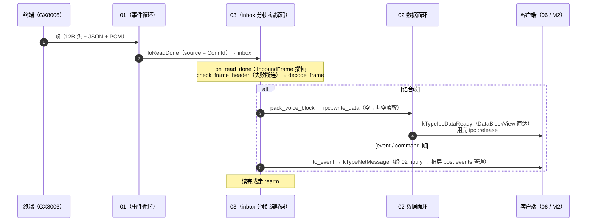
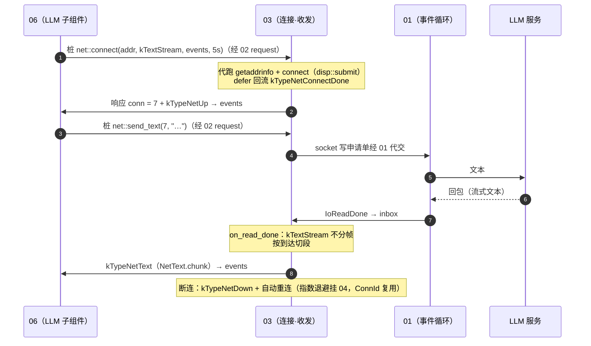

# 03 网络（Network）

> 自底向上第三层（M1 子进程层，与 05 并列）：网络域，一份文档、一个进程——**全部外部 socket 的唯一出口**，服务两类对端：**终端**（server 侧，线格式）与**出站服务**（client 侧，文本流，LLM 等）。本层只管"字节怎么走、连接活不活"：报文语义归 06，路由归 M2，本地声卡归 [05](./05-device-io.md)。线格式、号段 200–299、客户端 RPC 契约在本模块定死；事件循环与投递归 [01](./01-dispatcher.md)，IPC 归 [02](./02-ipc.md)，定时语义归 [04](./04-timer.md)；选型（原生 socket + nlohmann/json）见 [../tech-stack.md](../tech-stack.md)。

## 职责

对外收发字节与消息，对内交统一契约：

1. **定义契约**：`ConnId`/`TerminalId`、终端线格式与消息结构、文本流块 `NetText`、语音环块 `NetVoiceBlock` 与 `net::` 门面自由函数；上层只见契约与门面，不见 socket/fd/分帧状态、不见类。
2. **连接管理**：终端侧 `listen`/`accept`，出站侧 `connect`（供 LLM 等）；每连接独立分帧状态与读写缓冲；出站断连自动重连（指数退避挂 04）；终端按 `TerminalId` 记归属，每终端一条活连接。
3. **终端线格式与分帧**：帧布局（12B 大端帧头 + JSON + 裸 PCM）；粘包/半包攒帧、帧头先校验、长度上限防骗分配。
4. **文本流门面（经 02 RPC）**：`connect`/`send_text`/`close_conn` 供 06 的 LLM 子组件等调用；入站按到达切段投文本块，**不断句、不拼报文**。
5. **编解码与投递**：终端 `MessageHeader`/`MessageBody` ↔ `Frame`（nlohmann/json）；语音不进 JSON——元数据 + PCM 打包 `NetVoiceBlock` 走 02 数据面；入站翻语义事件（200–299）投登记管道，出站按 `target` 投对应终端。
6. **错误与背压**：两层错误语义（01 拦传输层 → 03 归纳连接状态）；发送失败即销账；语音块丢旧留新 + 计数，文本块/消息/状态关键阻塞。

**不负责**：LLM/ASR/TTS 协议语义（归 06——ASR/TTS 是本地推理（sherpa-onnx）不经本层，LLM 只经本层收发字节）；路由/转发决策（归 M2，不上线格式、不进本层）；本地声卡 IO（05）；01/02/04/05 机制本体；TLS/HTTP 等安全与应用层协议（二期，见规则"优化预留"）。

## 线格式（终端协议）

```
[4B total_len（大端）]        // = 12 + json_len + audio_len
[4B json_len（大端）]         // JSON 元数据长度
[4B audio_len（大端）]        // 裸 PCM 字节长度，无音频时为 0
【JSON: 元数据（Header + Body），不含音频字节】
[audio: 裸 PCM，长度可为 0]
```

- 整数统一大端（网络序）；所有帧都写 `audio_len`，非语音为 0，帧结构统一。
- 校验 `total_len == 12 + json_len + audio_len`；`json_len`/`audio_len` 设上限，超限即断连，防畸形长度骗巨额分配。
- JSON 不含音频字节，PCM 挂帧尾；出站帧 JSON 顶层含 `target`（终端 ID），网络层消费后投递，入站帧不含。
- **帧头校验失败即断连**——定界不可信，与 02 的 `kBadMagic` 同理；单帧 JSON 解析失败丢弃该帧（帧界仍可信），字节不流入消息层。
- 语音元数据 `VoiceMeta`：`format` 固定 "pcm"，不作字段。

## 数据结构

沿用 01 的设计约定（**外壳函数式、类退居资源聚合体**）：门面 = `net` 命名空间自由函数操作集（资源引用作第一参数，`create()`/`stop()` 管资源生死），应用层只见契约与门面、不见类；类只做**资源聚合体**（RAII 资源成员，操作全在门面自由函数）与**库薄壳**（RAII + 不可再拆的 syscall/库封装），原语就是门面函数本身；封装靠文件边界——**头文件** = 契约类型 + 门面声明（应用层唯一可见面），**实现文件** = 类定义 + 内脏自由函数（纯函数 + 编排函数），不用 `private`/`friend`；内脏住 `net` 命名空间（不跨模块直调）。机械性动作一律 `with(切面…, 本体)` 包裹（lambda 模拟 AOP around，见 [../with.md](../with.md)），编排函数本体只写业务。

```cpp
// ===== net.h：契约类型 + 门面（应用层唯一可见面） =====

// 03 号段 200–299。客户端经 02 RPC 调门面（桩函数），入站事件经 02 投回声明的管道。
// 事件定义 = 策略行（policy.h，声明即注册）。
inline constexpr EventDef kTypeNetText       {200, kNet, Qos::kBlock};  // 文本流入站块（负载 = NetText）：出站连接按到达切段
inline constexpr EventDef kTypeNetMessage    {201, kNet, Qos::kBlock};  // 终端消息入站（负载 = NetMessage）：event/command，线格式已解好
inline constexpr EventDef kTypeNetUp         {202, kNet, Qos::kBlock};  // 连接建立（负载 = NetConnInfo）：终端 accept / 出站 connect 成功
inline constexpr EventDef kTypeNetDown       {203, kNet, Qos::kBlock};  // 连接断开（负载 = NetConnInfo，why 有效）：对端断 / 错误 / close
inline constexpr EventDef kTypeNetReconnect  {204, kNet, Qos::kBlock};  // 内部：出站重连退避到期，只回 03 自己的 inbox——业务看不到它
inline constexpr EventDef kTypeNetConnectDone{205, kNet, Qos::kBlock};  // 内部：代跑 connect 完成回流，只回 03 自己的 inbox——业务看不到它

using ConnId     = uint64_t;   // 连接编号：accept/connect 分配，重连复用（同 02 的 PeerId 语义），0 = 无效；
                               // 兼任 SourceId（03 域约定，域看 source）
using TerminalId = uint32_t;   // 终端编号 = 消息的 source/target 标识；每终端一条活连接，0 = 无效

constexpr uint8_t kTextStream = 1;   // 连接形：文本流，不拼报文（LLM 等）
constexpr uint8_t kFramed     = 2;   // 连接形：线格式，分帧收发（终端）

struct NetText {              // kTypeNetText 负载
    ConnId      conn;
    std::string chunk;        // UTF-8 文本段：按到达切段，断句归 06（按行/SSE 自己拼）
};

struct VoiceMeta {            // 语音元数据：线上进 JSON
    uint32_t sample_rate;     // Hz
    uint16_t channels;
    uint16_t bits_per_sample;
    uint32_t sequence;        // 分块序号，从 0 开始
    uint8_t  is_final;        // 整句结束标志（非块结束标志）
};

// ===== 终端消息契约（voice 不入消息事件，走数据面） =====
struct MessageHeader {
    std::string source;       // 来源标识（终端 ID）
    std::string msg_type;     // "event" / "command"
    int64_t     timestamp;    // 毫秒时间戳
};
struct EventPayload   { std::string event_name; std::string payload_json; };
struct CommandPayload { std::string command;    std::string params_json; };
using MessageBody = std::variant<EventPayload, CommandPayload>;

struct NetMessage {           // kTypeNetMessage 负载：线格式已解好，业务只见语义
    TerminalId    from;
    MessageHeader header;
    MessageBody   body;
};

struct OutgoingMessage {      // 出站消息（send_message 参数）
    TerminalId    target;     // 线格式顶层 "target"，网络层据此投递
    MessageHeader header;
    MessageBody   body;
};

struct NetConnInfo {          // kTypeNetUp / kTypeNetDown 负载
    ConnId     conn;
    TerminalId terminal;      // 终端连接有效；出站连接 = 0
    int32_t    why;           // kTypeNetDown：传输层原因码；kTypeNetUp = 0
};

struct NetVoiceBlock {        // 02 数据面块格式（终端语音，双向共用）：块 = 定长 POD 头 + 裸 PCM
    TerminalId peer;          // 哪个终端
    VoiceMeta  meta;          // 采样参数 + 序号 + 整句标志
    uint32_t   pcm_len;
    // uint8_t pcm[pcm_len];  // 紧随其后：DataBlockView.data 指向块首，零拷贝消费，用完 ipc::release
};

class Net;                    // 资源聚合体（定义在实现文件）：应用层只见名字，用指针/引用持有

// ===== 门面：自由函数操作集，资源引用作第一参数 =====
// create 双形态，同一契约两个半边：03 进程内 = 本体；客户端进程 = 桩（02 对端引用 + 事件分派）。
namespace net {

// ---- 03 进程内（网络进程启动时装配） ----
std::unique_ptr<Net> create(Dispatcher&, Timer&, Ipc&);   // 资源出生（RAII）
void listen(Net&, uint16_t port, PipeId events);          // 终端侧：accept 分配 ConnId、首挂读申请单
void serve(Net&);                                         // 登记 RPC 处理器：客户端门面的对端半边
void stop(Net&);                                          // 资源死：未决请求 kBroken 回填 → 关连接，之后门面调用一律拒绝（`live`）

// ---- 客户端（任意进程，桩函数内部经 02 到 03；事件经 02 投回声明的管道） ----
ConnId connect(Net&, const std::string& addr, uint8_t shape, PipeId events, uint64_t timeout_ns);
bool   send_text(Net&, ConnId, std::string_view);                            // 文本流出站：追加写，不拼报文
bool   close_conn(Net&, ConnId);                                             // 主动关闭并停止自动重连
bool   send_message(Net&, const OutgoingMessage&);                           // 终端消息出站：装帧按 target 投递
bool   send_voice(Net&, TerminalId, VoiceMeta, std::span<const std::byte>);  // 语音出站：NetVoiceBlock 上 02 数据面
}
```

```cpp
// ===== net.cc：内部类型（实现文件） =====

struct FrameHeader {          // 线格式帧头：12 字节，全大端
    uint32_t total_len;       // = 12 + json_len + audio_len
    uint32_t json_len;
    uint32_t audio_len;
};

struct Frame {                // 一帧的形态（解帧产物 / 装帧原料）
    FrameHeader        head;
    std::string        json;
    std::vector<uint8_t> audio;
};

struct InboundFrame {         // 每连接一份：TCP 粘包/半包的分帧状态
    FrameHeader        head;
    std::string        json;
    std::vector<uint8_t> audio;
    size_t             got = 0;
};

class TcpPeer {               // 库薄壳：TCP 连接 RAII + 不可再拆的 syscall 封装（socket/connect/accept + 读写缓冲 + 分帧状态）
public:
    ConnId id() const;        // fd、sockaddr 封在壳内，不出边界
};

struct ConnRecord {           // 每连接一份，ConnHub：ConnId → ConnRecord
    ConnId     id;            // = SourceId（03 域约定），重连复用不变
    uint8_t    shape;         // kTextStream / kFramed
    TerminalId terminal;      // 终端连接才有；出站 = 0
    PipeId     events;        // 入站事件收件管道（注册时声明）
    TcpPeer    tcp;           // 连接 + 分帧状态
};

struct ConnHub { /* ConnId → ConnRecord + TerminalId 归属索引；一把锁护增删查 */ };

struct ConnectTicket {        // 代跑档案：getaddrinfo + connect 阻塞体（defer，同 05 代跑机制）
    ConnId      id;
    std::string addr;
};

struct NetReconnectPayload   { ConnId conn; };                    // kTypeNetReconnect 负载（只回 inbox）
struct NetConnectDonePayload { ConnId conn; int32_t err; };       // kTypeNetConnectDone 负载（只回 inbox）
```

```cpp
// ===== net.cc：内脏自由函数（实现文件，不跨模块直调） =====
namespace net {   // 门面 connect/send_text/close_conn/send_message/send_voice 的实现体即编排

// ===== 纯函数：查询/变换，无副作用，可直接单测 =====

bool                            check_frame_header(const FrameHeader&);    // 恒等式 + 上限校验
std::expected<Frame, int32_t>   decode_frame(std::span<const std::byte>);   // 一帧 → Frame；定界失败带出原因码
std::vector<std::byte>          encode_frame(const Frame&);                // Frame → 一帧（大端装帧）
Event                           to_event(const NetMessage&, PipeId to, uint64_t now_ns);
Event                           make_text_event(const NetText&, PipeId to, uint64_t now_ns);
std::vector<std::byte>          pack_voice_block(TerminalId, VoiceMeta, std::span<const std::byte> pcm);

// ===== 编排函数：带副作用，动词用命令式 =====

void on_net_event(Net&, const Event&);       // inbox 消费者：with(ev, …) 按 Event.type 分流（见"与 01/02/04 的对接"）
void on_read_done(Net&, const Event&);       // 读完成 → 按连接形分流：kFramed 喂分帧器 / kTextStream 直投文本块（rearm）
void on_write_done(Net&, const Event&);      // 写完成 → 释放发送缓冲
void on_broken(Net&, const Event&);          // 传输错误 → kTypeNetDown + 出站进重连状态机
void on_reconnect(Net&, ConnId);             // 退避到期（kTypeNetReconnect）→ with(defer(d)) 代跑 connect 重试
void on_connect_done(Net&, const Event&);    // 代跑回流（kTypeNetConnectDone）：成功首挂读单 + kTypeNetUp，失败下一档退避
void deliver_frame(Net&, ConnId, Frame&&);   // 帧分流：voice → NetVoiceBlock 上环；event/command → kTypeNetMessage
void drop_conn(Net&, ConnId, int32_t why);   // kTypeNetDown + 摘账关连接（出站按状态机决定重连）
}  // namespace net
```

## 接口与流水线

### 门面操作集（net.h）

| 操作 | 半边 | 调用线程 | 语义 |
|---|---|---|---|
| `create(Dispatcher&, Timer&, Ipc&)` | 双形态 | 启动时 | 资源出生（RAII）：03 进程内造本体，客户端进程造桩 |
| `listen(Net&, port, events)` | 进程内 | 启动时 | 终端侧监听：accept 分配 `ConnId`、登记 `TerminalId` 归属、首挂读申请单；`events` 收 201/202/203 |
| `serve(Net&)` | 进程内 | 启动时 | 登记 RPC 处理器：客户端门面的对端半边，逐 op 分派 |
| `connect(Net&, addr, shape, events, timeout)` | 客户端 | 任意线程 | 出站连接（LLM 等）：代跑 `getaddrinfo`+`connect`，返回 `ConnId`；`events` 收 200/202/203 |
| `send_text(Net&, conn, text)` | 客户端 | 任意线程 | 文本流出站：追加写，不拼报文；背压/断连回 `false` |
| `close_conn(Net&, conn)` | 客户端 | 任意线程 | 主动关闭并停止自动重连 |
| `send_message(Net&, OutgoingMessage)` | 客户端 | 任意线程 | 终端消息出站：装帧（JSON）按 `target` 投递；查无此终端回 `false` |
| `send_voice(Net&, terminal, meta, pcm)` | 客户端 | 任意线程 | 语音出站：打包 `NetVoiceBlock` 写 02 数据面；环满回 `false` |
| `stop(Net&)` | 进程内 | 停机时 | 未决请求 `kBroken` 回填 → 关连接；之后门面调用一律拒绝（`live`） |

客户端半边是**桩函数**：签名与进程内门面一致，内部把调用编成 02 请求，事件由桩层翻回号段事件 `post` 到声明的管道——业务调用体验与进程内无异，"各门面分属不同进程，跨进程处经 02"。

### 客户端 RPC 映射（02 承载）

门面调用编成 02 请求（body = JSON，nlohmann/json 序列化），`ipc::request`/`respond` 承载往返；入站事件以 `ipc::notify` 信封送达，桩层翻译投递。请求/响应语义、超时与销账全用 02 既有裁决，03 不另立请求表。桩层 = `rpc` 切面壳（见 [../with.md](../with.md)）：组包、请求往返、超时销账、错误码翻译、事件翻号段投递全住切面，门面函数本体只写 op 与参数——03/06 客户端半边共用同一个壳。

| 门面 | 02 载体 | 请求体（JSON） | 回程 |
|---|---|---|---|
| `connect` | `request` | `{"op":"connect","addr":"host:port","shape":1,"events":42}` | 响应 `{"ok":true,"conn":7}` / `{"ok":false,"err":…}`；成功后 `events` 收事件 |
| `send_text` | `request` | `{"op":"send_text","conn":7,"text":"…"}` | 响应 `{"ok":true}` / `{"ok":false,"err":kBusy/kBroken}` |
| `close_conn` | `request` | `{"op":"close","conn":7}` | 响应 `{"ok":true}` |
| `send_message` | `request` | `{"op":"send_message","target":…,"msg":{…}}` | 响应 `{"ok":true}` / `{"ok":false,"err":…}` |
| `send_voice` | 02 数据面 | 块 = `NetVoiceBlock`（`ipc::write_data`） | 环满 `false`；03 收 `kTypeIpcDataReady` 自取，不经请求 |
| 事件回程 | `notify` | 信封 `{"ev":200,"pipe":42,…负载字段}` | 桩层翻号段事件 `post` 到声明的管道 |
| 语音回程 | 02 数据面 | 块 = `NetVoiceBlock`（03 → 客户端） | 客户端收 02 的 `kTypeIpcDataReady`（`DataBlockView` 直达），用完 `ipc::release` |

### 终端入站流水线（帧 → 事件 / 语音环）



### 出站文本流流水线（LLM 形）



### 与 01/02/04 的对接

| 来源 | 事件 | 03 怎么处理 |
|---|---|---|
| 01 | `IoReadDone`（socket 读完成） | `on_read_done`：按连接形分流——`kFramed` 喂分帧器解帧，`kTextStream` 直接切段投 `kTypeNetText`；读完成走 `rearm` |
| 01 | `IoWriteDone`（socket 写完成） | `on_write_done`：释放发送缓冲；负错误码按传输层错误处理 |
| 01 | `kTypeError`（传输层拦截） | `on_broken`：归纳成 `kTypeNetDown`（投 events 管道），出站进重连状态机 |
| 01 线程池 | `kTypeNetConnectDone`（代跑 `post()` 回流） | `on_connect_done`：成功 = `kTypeNetUp` + 首挂读申请单；失败 = 下一档退避（挂 04） |
| 04 | `kTypeNetReconnect`（退避到期） | `on_reconnect`：代跑 connect 重试 |
| 02 | `kTypeIpcDataReady`（客户端 → 03 语音环） | drain 环上 `NetVoiceBlock` → 装帧发终端，消费完 `ipc::release` |

01 投回的事件都进 `inbox`——03 启动时把 `on_net_event` 登记为 `inbox` 管道的消费者，由它统一按 `Event.type` 分流：

```cpp
void net::on_net_event(Net& n, const Event& ev) {
    with(ev, {   // 机械：按 Event.type 查表分流
        {kTypeIoReadDone,     [&](const Event& e){ on_read_done(n, e); }},
        {kTypeIoWriteDone,    [&](const Event& e){ on_write_done(n, e); }},
        {kTypeError,          [&](const Event& e){ on_broken(n, e); }},
        {kTypeNetReconnect,   [&](const Event& e){ on_reconnect(n, any_cast<NetReconnectPayload>(e.payload).conn); }},
        {kTypeNetConnectDone, [&](const Event& e){ on_connect_done(n, e); }},
    });
}
```

**寻址约定（SourceId ↔ ConnId）**：03 提交 socket 读写申请单时 `OpCtx.source` 填 `ConnId`——**`ConnId` 即 03 域的 `SourceId`**，事件回来 `ev.source` 直接当 `ConnId` 查 `ConnHub`，无需映射表（01 不持归属表，"域看 source"）；`OpCtx.pipe` 填 `inbox`（`translate` 照抄进 `Event.pipe`）。合成事件（重连到期、代跑回流）`source` 填 0——永不分配给真实连接，与 01 的 `kInternalWakeSource` 保留值、02 的合成事件同规则。

### 例子：对话一轮（终端语音 → ASR → LLM → TTS → 回终端）

```cpp
// 06 AI 进程：LLM 子组件用 03 的客户端门面（桩函数）
ConnId llm = net::connect(net, "llm-host:8000", kTextStream, llm 管道，5s);
net::send_text(llm, "介绍一下自己");
// llm 管道收 kTypeNetText：攒句、拼 JSON 报文、解析语义，全归 06

// M2 主进程：终端消息收发
// 终端管道收 kTypeNetMessage（event/command）→ 业务决策
net::send_message(net, OutgoingMessage{.target = T1, .header = …, .body = EventPayload{…}});
net::send_voice(net, T1, meta, pcm_bytes);   // TTS 产物回终端（PCM 不进 JSON/RPC）
```

| 步 | 醒因 | 03 处理 | 客户端收到 |
|---|---|---|---|
| 1 | 终端语音帧到达 | 解帧 → `NetVoiceBlock` 上环 | 02 `kTypeIpcDataReady` → ASR（06 本地推理） |
| 2 | ASR 出文字，LLM 子组件 `send_text` | 装帧（文本流直接写字节） | — |
| 3 | LLM 流式回包 | 按到达切段 | `kTypeNetText` 攒句 |
| 4 | TTS 合成，`send_voice` | 环块 → 装帧（`VoiceMeta` JSON + PCM 附尾） | 终端收到语音帧 |
| 5 | （对端断连） | `kTypeNetDown` + 指数退避重连（挂 04） | `kTypeNetDown`（why） |

## 规则

- **风格**：沿用 01 约定——外壳函数式、类退居资源聚合体：门面 = `net` 自由函数（头文件），内脏分纯/编排住 `net`（实现文件，不跨模块直调）；类只做资源聚合体与库薄壳，原语就是门面函数；契约/账本是纯结构体，不带方法。
- **门面准入**：新操作先问能否用既有门面组合实现——能则写成门面语法糖（参数适配、无新不变量），不能才新增门面原语；门面只增原语，不增类方法（演进防火墙）。
- **机械性切面**：与业务无关且重复的机械动作一律 `with(切面…, 本体)` 包裹（切面 = `Aspect` 数据形：state 挂机械状态与策略行，见 [../with.md](../with.md)）——门面 `live`、客户端桩壳 `rpc`、常驻读单 `rearm`、代跑 `defer`、背压 `backpressure`、inbox 分流 `with(ev, …)`；"读完成必重挂""用完必 release"等顺序条款由切面吸收；新增机械动作先过切面准入（工厂 + 参数审查）。
- **号段**：03 占 200–299——200 文本块、201 消息、202/203 连接状态、204/205 内部（只回 03 自己的 inbox，业务看不到）；新增类型在本节扩展并出行（`EventDef` 声明即注册，策略随行出生，见 [../policy.md](../policy.md)）。
- **线格式**：终端协议以「线格式」一节定死（`format` 固定 "pcm"，不作字段）；帧头校验失败即断连——定界不可信，与 02 的 `kBadMagic` 同理；单帧 JSON 解析失败只丢该帧（帧界仍可信）。
- **文本流**：出站连接按到达切段，03 不断句、不拼报文——断句（按行/SSE/长度前缀）归 06；`send_text` 即追加写，消息边界由 06 的字节流自己定。
- **连接**：读写申请单经 01 代交（单提交者约定），每连接常驻一张读单（`with(rearm(…))` 结构形）；`getaddrinfo`/`connect` 阻塞走 `disp::submit` 代跑、完成 `post()` 回流（`with(defer(…))` 结构形，同 05 代跑机制），不占申请单账本；出站断连自动重连（指数退避：档位 = `Backoff` 行，见 [../policy.md](../policy.md)，挂 04 的 `tmr::after`，到期 `kTypeNetReconnect` 回 `inbox`），`ConnId` 重连复用（同 02 的 `PeerId` 语义），`close_conn` 停止重连；终端侧不主动重连，每终端一条活连接、新连接顶掉旧的（旧的照发 `kTypeNetDown`）。
- **语音双路**：终端语音（经本层）与本地声卡（05 流式）并存，业务选路；03 不混音、不做语音路由。语音大块一律 `NetVoiceBlock` 走 02 数据面（双向），不经 RPC、不进 JSON。
- **错误两层**：不写分支——错误源的归属与处置是 `ErrPolicy` 行（见 [../policy.md](../policy.md)）：传输层（断连、读写失败、对端崩溃）走 01 的 `kTypeError` → 03 归纳成 `kTypeNetDown`，协议层就地处置（帧头非法断连、超长断连、JSON 解析失败丢帧 + 计数）；`intercept` 切面查行，库错误不抛上层。
- **背压**：不写分支、写行——满时策略 = 契约块的 `EventDef` 行、环满策略 = [../media.md](../media.md) 块 qos 声明制（下表即行的文档形；理由写在表里，策略值只在行里出现一次）；socket 发送缓冲满按事件行分策略：

| 行 | 策略 | 为什么 |
|---|---|---|
| `kTypeNetText` 200 | `kBlock` 关键阻塞 | 文本流丢块即报文坏，不可丢 |
| `kTypeNetMessage` 201 | `kBlock` 关键阻塞 | 消息即业务输入 |
| `kTypeNetUp` / `kTypeNetDown` 202/203 | `kBlock` 关键阻塞 | 状态事件关乎重连与归属决策 |
| 语音块 `kKindVoicePcm` | `kQosRealtime` 丢旧留新 + 计数 | 实时流，旧不如新 |

- **请求/响应**：客户端门面走 02 既有语义——发送失败即销账（`kBroken`/`kBusy` 回填），超时与迟到响应由 02 的 `inbox` 裁决收口，03 不另立请求表。
- **寻址**：`ConnId` 即 `SourceId`（域看 source）；事件管道注册时声明（`listen`/`connect` 的 `events` 参数），谁登记谁收货；跨进程投递 = 02 notify 信封，桩层翻号段事件 `post` 到声明的管道。
- **线程安全**：03 进程内 `inbox` 消费单线程裁决（分帧、销账、投递串行，同 02 的销账裁决点）；门面任意线程可调（跨进程经 02，进程内照 01 的 `post()` 代交）；`ConnHub` 一把锁护增删查；分帧状态每连接单线程。
- **生命周期**：`ConnId` 单调发号、连接存续期稳定（重连复用）；`TerminalId` 取自协议、归属索引随连接生死登记；`TcpPeer` RAII 管 fd，`NetVoiceBlock` 生命周期走 `block`，禁裸 `new/delete`；库类型（fd、sockaddr、json 对象）不出模块边界。
- **stop()**：未决客户端请求 `kBroken` 回填 → 关连接撤登记 → 释放；之后门面调用一律拒绝（`live`）。
- **优化预留**：TLS 后挂库薄壳（TcpPeer 换内胆，契约不变）；出站连接池/多路复用；HTTP/SSE 形文本流（仍走 `kTextStream`，断句归 06）；语音环多播（多消费者订阅同一终端语音时改复制/多播环，`NetVoiceBlock` 布局不变）；UDP/QUIC 二期。
