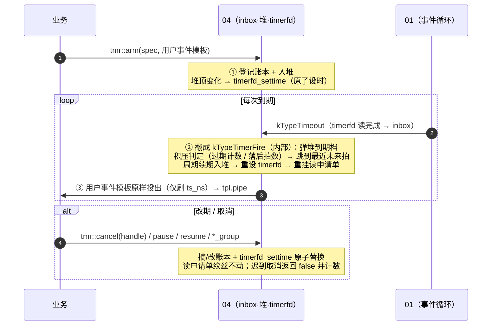

# 04 定时器（Timer）

> 自底向上第二层（与 02 并列）：进程内定时原语，每进程一套。时间堆与 timerfd 归本模块，"到点必醒"的读申请单归 [01](./01-dispatcher.md)（选型见 [../tech-stack.md](../tech-stack.md)）——**01 管"睡到 T"，04 管"何时是 T"**。号段 300–399、周期与组语义在本模块定死；业务拿到的就是登记时塞进来的那个事件，不见堆、不见 timerfd、不见机制句柄。

## 职责

定时语义层：把"到点叫人"做成上层可用的定时服务——一次性/周期/分组的登记与到期交付。

1. **持有机制**：时间堆（Boost.Heap `d_ary_heap` + 句柄封装，RAII）+ timerfd（每进程一个，全部定时器共用）。堆顶到期时刻 `timerfd_settime(TFD_TIMER_ABSTIME, CLOCK_MONOTONIC)` 设时；凡动堆（改期/取消/暂停/恢复）收尾 = 原子替换（堆空 `clear()` 停表），不碰在飞申请单。
2. **定义契约**：`TimerSpec`（`at` 一次性 / `every` 周期）、语义句柄 `TimerHandle`、`TimerGroup`，门面自由函数 `tmr::arm()/cancel()/pause()/resume()/…_group()`；上层只见语义句柄与门面，不见堆句柄、不见 timerfd、不见类、不见 01 的 `OpKind`。
3. **到期交付**：到期唤醒（`kTypeTimeout`）进 04 自己的 `inbox`，翻成内部事件 `kTypeTimerFire = 300`（业务不见）——04 在此弹堆、重设 timerfd、续期/结案，然后把**登记时的用户事件模板原样投出**（仅刷 `ts_ns`）到登记的管道。
4. **周期语义**：`every(interval)` 自动续期；默认 **fixed-rate + 跳过积压**（读回的过期计数与实际时刻作积压信号）；fixed-delay 预留。
5. **定时器组**：`TimerGroup` 批量暂停/恢复/取消——仿生模式切换、会话开始/结束时整组调度。
6. **语义账本**：`TimerHandle → {堆句柄、spec、用户事件模板、下一到期时刻、序号、归属组}` 映射；重挂、暂停、改期都在这张表上做，机制细节对上层透明。

**不负责**：事件循环与投递（01）、IPC（02）、业务语义（M2）；日历/星期/cron 类语义（二期）；跨进程定时服务（优化预留——将来走 02 订阅模式后挂，`TimerSpec`/句柄/组契约不变）；闹钟持久化（暂无需求）。

## 数据结构

沿用 01 的设计约定（**外壳函数式、类退居资源聚合体**）：门面 = `tmr` 命名空间自由函数操作集（资源引用作第一参数，`create()`/`stop()` 管资源生死），应用层只见契约与门面、不见类；类只做**资源聚合体**（RAII 资源成员，操作全在门面自由函数）与**库薄壳**（RAII + 不可再拆的 syscall/库封装），原语就是门面函数本身；封装靠文件边界——**头文件** = 契约类型 + 门面声明（应用层唯一可见面），**实现文件** = 类定义 + 内脏自由函数（纯函数 + 编排函数），不用 `private`/`friend`；内脏住 `tmr` 命名空间（不跨模块直调；`tmr` 避开 timer 变量/成员的查找遮蔽）。机械性动作一律 `with(切面…, 本体)` 包裹（lambda 模拟 AOP around，见 [../with.md](../with.md)），编排函数本体只写业务。

```cpp
// ===== tmr.h：契约类型 + 门面（应用层唯一可见面） =====

// 04 号段 300–399。kTypeTimerFire 是内部事件（只进 04 自己的 inbox，业务不见）；
// 用户事件模板的 type 由业务自定（任意号段），04 原样透传、不占号。
inline constexpr EventDef kTypeTimerFire{300, kTmr, Qos::kBlock};   // 策略行（policy.h，声明即注册）

using TimerHandle = uint64_t;   // 语义句柄：arm() 返回，cancel/pause 用；单调发号不复用，0 = 无效
using GroupId     = uint32_t;   // 定时器组编号；0 = 无组

struct TimerSpec {
    enum Kind { kAt, kEvery } kind;
    uint64_t at_ns;        // kAt：一次性绝对时刻（CLOCK_MONOTONIC）
    uint64_t every_ns;     // kEvery：周期间隔（锚点 = arm 时刻；跳积压后锚点平移至最近未来拍，此后按新栅格续期）
    GroupId  group = 0;    // 归属组
    // 二期：日历/星期/cron
};

struct TimerFire {              // kTypeTimerFire 负载（内部）
    TimerHandle handle;
    uint64_t    seq;            // 该句柄的计划拍号（含跳过的拍）：相邻 seq 差 − 1 = 欠拍数，对账依据
    uint64_t    due_ns;         // 本拍计划到期时刻
    uint64_t    actual_ns;      // 实际触发时刻（漂移观测）
};

class Timer;                    // 资源聚合体（定义在实现文件）：应用层只见名字，用指针/引用持有

// ===== 门面：自由函数操作集，资源引用作第一参数 =====
namespace tmr {
std::unique_ptr<Timer> create(Dispatcher&);          // 资源出生（RAII）+ 首挂 timerfd 读申请单（rearm_wait 首挂点）

TimerHandle arm(Timer&, TimerSpec, Event tpl);       // 登记账本 + 入堆 + 重设 timerfd，tpl.pipe 即收件管道

// 语法糖：arm 的参数适配形，无新不变量——只声明，实现进 .cc（after 用 clock_ns()，头文件不带时钟依赖）
TimerHandle at(Timer&, uint64_t abs_ns, Event tpl);
TimerHandle after(Timer&, uint64_t delay_ns, Event tpl);
TimerHandle every(Timer&, uint64_t iv_ns, Event tpl);

bool cancel(Timer&, TimerHandle);            // 摘堆摘表，模板作废永不投出；迟到（已 fire）返回 false 并计数
bool pause(Timer&, TimerHandle);   bool resume(Timer&, TimerHandle);    // true = 生效；句柄已销 = false（静默无操作）
bool pause_group(Timer&, GroupId); bool resume_group(Timer&, GroupId);  // 组内无存活条目 = false
bool cancel_group(Timer&, GroupId);
void stop(Timer&);                           // 资源死：清零 timerfd → 摘堆清账本 → 注销 inbox 消费者，之后门面调用一律拒绝
}
```

```cpp
// ===== tmr.cc：内部类型（实现文件） =====

class TimerFd {                 // 库薄壳：timerfd RAII + 不可再拆的 syscall 封装（fd 封在壳内，不出模块边界）
public:
    void set(uint64_t abs_ns);  // timerfd_settime(TFD_TIMER_ABSTIME, CLOCK_MONOTONIC)
    void clear();               // 清零：停止唤醒（下次 set 再武装）
};

class TimerHeap {               // 库薄壳：Boost.Heap RAII + 不可再拆的库封装（d_ary_heap + handle_type）
public:
    using Handle = /* handle_type 薄封装，不出模块边界 */;
    uint64_t top_deadline() const;
};

struct TimerEntry {             // 账本条目：一档定时器的档案
    TimerHeap::Handle heap;     // 机制句柄（堆内位置），上层不可见
    TimerSpec        spec;
    Event            tpl;       // 用户事件模板：到期原样投出（仅刷 ts_ns），tpl.pipe 即收件管道
    uint64_t         next_ns;   // 下一到期时刻（绝对，CLOCK_MONOTONIC）
    uint64_t         seq = 0;   // 计划拍号：每续期/跳拍 +1（跳过的拍也占号）
    bool             paused = false;
    uint64_t         paused_at_ns = 0;   // 暂停时刻：恢复时顺延/重锚用
};

struct TimerTable { /* TimerHandle → TimerEntry + 组索引（GroupId → handles）；一把锁护增删查 */ };
```

```cpp
// ===== tmr.cc：资源聚合体（实现文件） =====

// 资源聚合体：资源出生与生死归 create/stop，操作全在门面自由函数
class Timer {
public:
    PipeId        inbox;    // 04 收件管道：01 投回 kTypeTimeout / kTypeError
    Dispatcher&   d;        // 01：投递、代交都走它
    TimerFd       tfd;      // timerfd（每进程一个，全部定时器共用）
    TimerHeap     heap;     // 时间堆
    TimerTable    table;    // 语义账本
    OpCtx         wait;     // timerfd 常驻读申请单（TimerWait）：source = 0，pipe = inbox
};
```

```cpp
// ===== tmr.cc：内脏自由函数（实现文件，不跨模块直调） =====
namespace tmr {   // 门面 arm/cancel/pause/resume/*_group 的实现体即编排；`tmr` 避开 timer 变量/成员的查找遮蔽

// ===== 门面语法糖实现：参数适配，无新不变量（不进头文件，免带时钟依赖） =====
TimerHandle at(Timer& t, uint64_t abs_ns, Event tpl)      { return arm(t, TimerSpec{.kind = kAt,   .at_ns = abs_ns}, std::move(tpl)); }
TimerHandle after(Timer& t, uint64_t delay_ns, Event tpl) { return arm(t, TimerSpec{.kind = kAt,   .at_ns = clock_ns() + delay_ns}, std::move(tpl)); }
TimerHandle every(Timer& t, uint64_t iv_ns, Event tpl)    { return arm(t, TimerSpec{.kind = kEvery, .every_ns = iv_ns}, std::move(tpl)); }

// ===== 纯函数：查询/变换，无副作用，可直接单测 =====

uint64_t next_due(const TimerSpec&, uint64_t due_ns);   // 周期续期：due_ns + every_ns（按计划时刻加，不按实际时刻）
bool     should_skip(const TimerSpec&, uint64_t due_ns, uint64_t now_ns, uint64_t expirations); // 积压判定
uint64_t skip_beats(const TimerSpec&, uint64_t due_ns, uint64_t now_ns); // 跳积压：并到最近未来拍，返回新 due
Event    deliver_template(const Event& tpl, uint64_t now_ns);      // 原样拷贝 + 刷 ts_ns（模板本体不动）
Event    make_fire_event(const TimerEntry&, uint64_t now_ns);      // 条目 → kTypeTimerFire（内部）

// ===== 动堆切面（定义见 ../with.md）：with(heap(t), 本体) =====
Aspect heap(Timer&);   // 返回 Aspect 值：state = Timer 指针；enter = 加锁（堆/表/timerfd 一把锁），exit = reschedule() 恒调（堆空 clear() 停表）

// ===== 编排函数：带副作用，动词用命令式 =====

void        on_timer_event(Timer&, const Event&);   // inbox 消费者：with(ev, …) 按 kTypeTimeout / kTypeError 分流
void        fire_due(Timer&, uint64_t now_ns, uint64_t expirations); // 弹堆到期档 → 逐档交付 + 续期/结案（with(heap(t), rearm(t.wait), 本体)）
void        reschedule(Timer&);                     // 动堆切面的 exit 体：按堆顶 timerfd_settime 原子替换，堆空 → clear() 停表
void        rearm_wait(Timer&);                     // 挂/重挂 timerfd 读申请单（经 01 代交）：rearm 切面的 exit 体（fire_due 收尾、kTypeError 自愈）+ create 首挂
}  // namespace tmr
```

## 接口与流水线

### 门面操作集（tmr.h）

| 操作 | 调用线程 | 语义 |
|---|---|---|
| `create(Dispatcher&)` | 启动时 | 资源出生（RAII，类定义在实现文件构造）；create 即挂常驻读申请单（rearm_wait 首挂点） |
| `arm(Timer&, spec, tpl)` | 任意线程 | 登记 + 入堆 + 重设 timerfd，返回 `TimerHandle`；`tpl.pipe` 即到期收件管道。语法糖 `at(t, abs, tpl)` / `after(t, delay, tpl)` / `every(t, iv, tpl)`（`arm` 的参数适配形，无新不变量，实现进 .cc） |
| `cancel(Timer&, handle)` | 任意线程 | 摘堆摘表，模板作废永不投出；迟到（已 fire）返回 `false` 并计数 |
| `pause(Timer&, handle)` / `resume(Timer&, handle)` | 任意线程 | 单档暂停/恢复，返回 `bool`：true = 生效，句柄已销 = `false`（静默无操作） |
| `pause_group(Timer&, g)` / `resume_group(Timer&, g)` | 任意线程 | 整组暂停/恢复，返回 `bool`：组内无存活条目 = `false` |
| `cancel_group(Timer&, g)` | 任意线程 | 整组取消，返回 `bool`：组内无存活条目 = `false` |
| `stop(Timer&)` | 停机时 | 清零 timerfd → 摘堆清账本 → 注销 `inbox` 消费者；之后门面调用一律拒绝（返回 `false` / 断言） |

### 到期流水线



`kTypeTimerFire` 是"一拍到点"的事件形态：timerfd 路由下由 `fire_due` 弹堆后合成、同点消费（业务不见）；跨进程定时服务预留下它改由 02 抵达，同一处理点——交付、续期、跳积压全在这一个入口串行。

### 与 01 的对接

| 01 投回的事件 | 04 怎么处理 |
|---|---|
| `kTypeTimeout`（timerfd 读完成） | `on_timer_event` → `fire_due`：弹堆、交付、续期、重设 |
| `kTypeError`（读失败） | 重建 timerfd + 重挂读申请单（自愈），计数上报 |

寻址约定：`wait`（`TimerWait` 读申请单）`source` 填 0（`kInternalWakeSource` 保留值，永不分配给业务/对端），`pipe` 填 `inbox`——与 02 合成事件同规则。01 只把读完成翻成 `kTypeTimeout` 投回，不认识时间堆、不认识时刻。

过期计数的携带路径：读申请单 buffer 固定 8 字节 `uint64`；01 将计数附在 `kTypeTimeout` 事件负载中投回（01 不解释其含义，透传）；`on_timer_event` 从负载取出，传给 `fire_due(now_ns, expirations)` 作积压判定。

### 例子：仿生呼吸 tick（fixed-rate）

```cpp
// 07 启动
TimerHandle h = tmr::every(timer, 每500ms, Event{.type = 呼吸tick, .pipe = 仿生管道});
```

| 拍 | 情况 | 04 处理（内部 seq） | 业务收到 |
|---|---|---|---|
| 1 | 正点到期 | 弹堆 → 续期 +500ms → 重设（seq = 1） | 原样 `呼吸tick` |
| 2 | 进程卡顿，欠 拍 2、3 | 积压判定 → 拍 2、3 占号跳过，投最近未来拍（seq → 4） | 原样 `呼吸tick` |
| 3 | 正点到期 | 弹堆 → 续期（seq = 5） | 原样 `呼吸tick` |

业务不补拍、不重算节拍——欠拍占号不投（`seq` 是计划拍号：每续期/跳拍 +1，相邻 `seq` 差 − 1 = 欠拍数，1→4 即欠 2 拍），节拍按计划栅格续期，不累积漂移。

## 规则

- **风格**：沿用 01 约定——外壳函数式、类退居资源聚合体：门面 = `tmr` 自由函数（头文件），内脏分纯/编排住 `tmr`（实现文件，不跨模块直调）；类只做资源聚合体与库薄壳，原语就是门面函数；契约/账本是纯结构体，不带方法。
- **门面准入**：新操作先问能否用 `arm`/`cancel`/`pause` 组合实现——能则写成门面语法糖（如 `at`/`after`/`every`，参数适配、无新不变量），不能才新增门面原语。`pause` 不可用 `cancel` 搭（断句柄身份），是判据的范例；门面只增原语，不增类方法（演进防火墙）。
- **号段**：04 占 300–399，目前只用 `kTypeTimerFire = 300`（内部事件，业务不见）；用户事件模板的 `type`/负载由业务自定，04 原样透传、不占号。
- **交付语义**：到期把**登记时的用户事件模板原样投出**（仅刷 `ts_ns`）到 `tpl.pipe`；每句柄 `seq` = **计划拍号**（含跳过的拍，每续期/跳拍 +1，相邻 `seq` 差 − 1 = 欠拍数，对账依据），`TimerFire` 记 `due_ns`/`actual_ns` 供漂移观测；一次性到期即销档、句柄作废。
- **周期语义**：fixed-rate 默认——续期按**计划到期时刻**加间隔（`due + every`），不按实际时刻，不累积漂移；落后超一拍即跳积压（并到最近未来拍，跳过的拍占号不投、不逐拍补投，锚点随之平移至新栅格，此后按新栅格续期）；fixed-delay 预留。
- **组语义**：暂停 = 摘堆留档（记暂停时刻）；恢复 = 一次性顺延剩余时长（`at_ns += 暂停时长`）、周期档从恢复时刻重锚（跳过暂停期间的拍，不补拍）；取消 = 整组摘堆摘表。
- **动堆必重设（已结构化）**：凡动堆的操作（`arm`/`cancel`/`pause`/`resume`/`*_group`，含组/单档暂停与恢复）一律 `with(heap(t), …)` 包裹，exit 恒 `reschedule()` 重设 timerfd（**堆空时 `clear()` 停表**）——顺序条款变成结构，漏了就进不了库，不再有"旧时刻空醒一次/压住更近到期"的坑。
- **机械性切面**：与业务无关且重复的机械动作一律 `with(切面…, 本体)` 包裹（切面 = `Aspect` 数据形：state 挂机械状态与策略行，见 [../with.md](../with.md)）——门面 `live`、动堆 `heap`（必重设）、读单 `rearm`（timerfd 常驻读单重挂）、inbox 分流 `with(ev, …)`；新增机械动作先过切面准入（工厂 + 参数审查），业务数据不进切面。
- **取消与竞态**：**到期交付的唯一裁决点 = 04 的 `inbox` 消费线程**——弹堆、判定、投出在此串行；`cancel` 与到期以"账本条目归属"裁决，谁先摘到条目谁生效——`cancel` 迟到（条目已被弹走）返回 `false` 并计数，到期迟到（句柄已被摘）丢弃不投；`pause`/`resume`/组族同此裁决，已销即返回 `false`、静默无操作。与 02 的销账裁决同构。
- **线程安全**：门面操作（`arm`/`cancel`/`pause`/`resume`/`pause_group`/`resume_group`/`cancel_group`）任意线程可调；账本、时间堆、timerfd 设时共用一把锁（多写单交付：登记/改期/取消在调用线程，交付/续期只在 `inbox` 消费线程）。`timerfd_settime` 是线程安全 syscall，锁内直调；timerfd 读申请单每 fire 重挂一次，经 01 代交（单提交者约定）。
- **时钟与精度**：全线 `CLOCK_MONOTONIC`，到期时刻一律绝对时间；`TFD_TIMER_ABSTIME` 让内核按绝对时刻触发，改期/取消不产生漂移；对内精度到内核定时精度，业务抖动观测看 `TimerFire` 的 `due_ns`/`actual_ns`。
- **生命周期**：`TimerHandle` 单调发号不复用（天然无 ABA）；`TimerEntry` 随 `TimerTable` 持有，禁裸 `new/delete`；RAII 管 timerfd；库类型（`handle_type`、fd、`itimerspec`）不出模块边界。
- **stop()**：清零 timerfd → 摘堆清账本（模板作废）→ 注销 `inbox` 消费者；之后门面调用一律拒绝（返回 `false` / 断言）。
- **优化预留**：跨进程定时服务可后挂（04 服务进程统一计时，到期经 02 订阅模式把**用户事件模板原样**送回订阅方），`TimerSpec`/句柄/组契约不变、交付语义不变；日历/星期/cron 二期扩展 `TimerSpec`。
