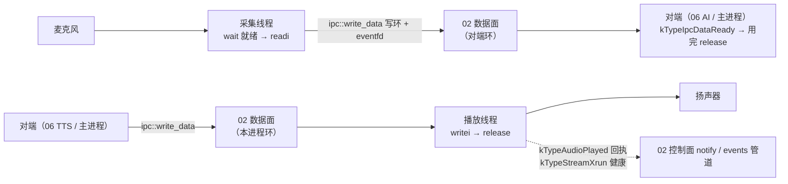
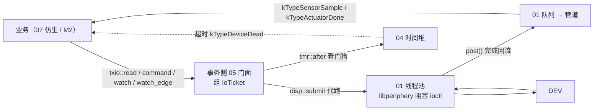

# 05 设备 IO（Device IO）

> 自底向上第三层（M1 子进程层）：设备 IO 域，一份文档、两个进程——**流式 IO 进程**（流式设备）与**事务 IO 进程**（事务型与事件型设备）。边界按**时延预算 + 内核阻塞特性**划，不按频率（判据见「设备分类判据」）。设备契约与号段 400–499 在本模块定死；事件循环与投递归 [01](./01-dispatcher.md)，IPC 归 [02](./02-ipc.md)，定时语义归 [04](./04-timer.md)；库选型（libperiphery、ALSA）见 [../tech-stack.md](../tech-stack.md)。

## 职责

把外设收成两个进程，向上交统一的设备契约：

1. **定义契约**：`DeviceId`、流式/事务型/事件型三类抽象设备、`AudioFormat` / `SensorSample` / `DeviceEventInfo` / `ActuatorCommand` 等负载结构与门面自由函数 `stio::`（流式）/ `txio::`（事务）；上层只见契约与门面，不见 ALSA/libperiphery 句柄、不见类。
2. **流式 IO 进程（流式设备）**：音频采集、扬声器等连续定长节拍设备。采集/播放专用线程 poll 就绪后直读/直写（ALSA `readi/writei`），音频块经 02 数据面零拷贝过进程；不绕 01 申请单账本（理由见规则"流式通道"）。
3. **事务 IO 进程（事务型与事件型设备）**：I2C/SPI 传感器、动作、呼吸/体温等内核阻塞 ioctl 设备，以及触摸/按键等**事件型设备**（发生驱动、无需请求，见规则"事件型设备"）。阻塞调用由 01 线程池**代跑**、完成后 `post()` 回流——不是 Reactor（ioctl 不可 poll，等就绪挡不住内核阻塞，见规则"代跑机制"）。
4. **卡死看门狗**：事务侧每张在飞事务挂 04 `tmr::after`，超时合成为 `kTypeDeviceDead` 上报并置死设备、拒新单；拆进程的红利——卡死只带走事务进程，可整体重启不连累音频。
5. **健康上报**：流式侧 xrun（欠载/溢出）与两侧设备生死，以事件投登记管道；业务不碰 ALSA 状态机、不碰 ioctl 错误码。

**不负责**：业务语义（M2 / 07——触摸决策、呼吸曲线、动作含义）、IPC 协议语义（02）、事件循环与投递（01）、定时语义（04）；音频算法（AEC/AGC/降噪，归 06）；物理量换算（温度值、角度语义，归业务）。

## 设备分类判据

设备清单后补（BOM 补齐后往表里填行），新设备按判据入座，契约不改：

| 类别 | 判据 | 归属 | 机制 | 典型（待 BOM 补齐） |
|---|---|---|---|---|
| 流式设备 | 时延预算 ≤ 1 周期（5–10ms）、连续定长节拍、可 poll 就绪 | 流式进程 | 专用线程 wait 就绪 → `readi/writei` | 麦克风、扬声器 |
| 事务型设备 | 内核 ioctl 阻塞（不可 poll）、时延预算 ≥ 50ms | 事务进程 | 01 代跑线程 + 完成回流 | I2C 传感器、舵机总线、PWM |
| 事件型设备 | 发生驱动（无需请求）、频率低、反射预算 < 100ms | 事务进程 | 可 poll → 常驻读申请单直入收货口；阻塞 → `watch` 轮询 | 触摸（GPIO 边沿 vs I2C 电容）、按键 |

判据主序是**时延预算**（反射路径不过界），次序是**内核阻塞特性**（决定机制）；频率不是判据。上表即 policy.h 的 `DevicePolicy` 行（文档形）：类别 → 机制的映射是数据不是分支——`attach` 按类别出重载（`stio::attach(StreamSpec)` / `txio::attach(DeviceSpec)`），流式设备想走代跑、事务设备想走专用线程，编译不过。

**事件型设备的两种落法**：事件型是发生驱动（我不请求、它自己来），与读数/动作的"发起 → 回执"形不同。归属统一事务进程（常驻读申请单的延迟是 μs 级事件循环延迟，反射预算无忧，不需要第三堵墙），机制按总线定：可 poll 的（GPIO 边沿、evdev）挂**常驻读申请单**，边沿即完成项、直入 01 收货口（与 02 的 UDS 常驻读单同构，`rearm`）；阻塞轮询的（I2C 电容触摸）挂 `txio::watch` 周期订阅。两路事件统一翻 `kTypeDeviceEvent`。

## 数据结构

沿用 01 的设计约定（**外壳函数式、类退居资源聚合体**）：门面 = `stio` / `txio` 命名空间自由函数操作集（资源引用作第一参数，`create()`/`stop()` 管资源生死），应用层只见契约与门面、不见类；类只做**资源聚合体**（RAII 资源成员，操作全在门面自由函数）与**库薄壳**（RAII + 不可再拆的 syscall/库封装），原语就是门面函数本身；封装靠文件边界——**头文件** = 契约类型 + 门面声明（应用层唯一可见面），**实现文件** = 类定义 + 内脏自由函数（纯函数 + 编排函数），不用 `private`/`friend`；内脏住 `stio`/`txio` 命名空间（不跨模块直调）。共享契约（`dev.h`）两个进程与业务共同可见。机械性动作一律 `with(切面…, 本体)` 包裹（lambda 模拟 AOP around，见 [../with.md](../with.md)），编排函数本体只写业务。

```cpp
// ===== dev.h：共享契约（两个进程与业务共同可见） =====

// 05 号段 400–499，再分三段：400–409 两侧公共、410–449 流式侧、450–499 事务侧。
// 事件定义 = 策略行（policy.h，声明即注册）：满时策略随声明出生，不写分支。
inline constexpr EventDef kTypeDeviceDead  {403, kDev, Qos::kBlock};     // 设备死亡（两侧共用）：看门狗超时或不可恢复错误
inline constexpr EventDef kTypeAudioPlayed {411, kDev, Qos::kDropCount}; // 播放块消费完（负载 = StreamBlockAck，观测/统计用）：可丢观测
inline constexpr EventDef kTypeStreamXrun  {412, kDev, Qos::kDropCount}; // 欠载/溢出（负载 = StreamHealth）：可丢观测
inline constexpr EventDef kTypeSensorSample{450, kDev, Qos::kDropCount}; // 传感器读数（负载 = SensorSample）：高频读数丢弃并计数
inline constexpr EventDef kTypeActuatorDone{451, kDev, Qos::kBlock};     // 动作完成回执（负载 = ActuatorResult）
inline constexpr EventDef kTypeDeviceEvent {452, kDev, Qos::kBlock};     // 事件型设备事件（负载 = DeviceEventInfo："发生了什么"，区别于 450 "读数"）

using DeviceId = uint32_t;   // 设备编号：attach() 分配，兼任 SourceId（域看 source），0 = 无效
using IoId     = uint64_t;   // 事务/订阅申请单号：read/command/watch 返回，cancel 用；ticket 发号，0 = 无效

constexpr uint8_t kStream      = 1;   // 流式设备
constexpr uint8_t kTransaction = 2;   // 事务型设备
constexpr uint8_t kEvent       = 3;   // 事件型设备（边沿/键值/中断：发生驱动，无需请求）

constexpr uint8_t kCapture  = 1;      // StreamSpec.dir
constexpr uint8_t kPlayback = 2;

// AudioFormat（流式设备参数）定义在共享语音契约 [../media.md](../media.md)，03/05/06 共用；
// dev.h 直接引用，不重复定义。

struct StreamSpec {          // 流式设备挂接参数（ALSA PCM 打开参数的抽象）
    uint8_t     dir;         // kCapture / kPlayback
    std::string pcm;         // ALSA PCM 名（"default"、"hw:0,0"）
    AudioFormat fmt;
};

struct DeviceSpec {          // 事务型设备挂接参数（libperiphery 打开参数的抽象）
    uint8_t     bus;         // BusKind：kI2c = 1 / kSpi = 2 / kGpio = 3
    std::string path;        // /dev/i2c-1、/dev/spidev0.0、/dev/gpiochip0
    uint32_t    addr;        // I2C 从地址 / GPIO 线号
    uint32_t    watchdog_ns; // 卡死看门狗阈值，0 = 用默认值（见规则"看门狗"）
};

struct StreamBlockAck {      // kTypeAudioPlayed 负载：一块播完（统计/观测，流控靠环空位）
    DeviceId dev;
    uint64_t seq;            // 块序号：与数据面 DataBlockView.seq 对账
    uint64_t t_ns;           // 播完时刻（CLOCK_MONOTONIC）
};

struct StreamHealth {        // kTypeStreamXrun 负载
    DeviceId dev;
    uint64_t xruns;          // 累计欠载/溢出次数
    uint64_t t_ns;
};

struct SensorSample {        // kTypeSensorSample 负载
    DeviceId dev;
    uint32_t channel;        // 同器件多通道
    double   value;          // 归一化读数：物理量换算归业务
    uint64_t t_ns;           // 采样时刻
};

struct DeviceEventInfo {     // kTypeDeviceEvent 负载："发生"不是"读数"——无需请求，自己来
    DeviceId dev;
    uint32_t code;           // 弱类型：边沿/键值/触摸点，语义由设备文档定，05 不解释
    uint64_t t_ns;           // 事件时刻（内核时间戳，源头打点）
};

struct ActuatorCommand {     // 动作指令（业务 → 事务侧门面）
    DeviceId dev;
    uint32_t action;         // 动作编号：语义由业务与设备文档定，05 不解释
    double   arg;            // 参数（角度/占空比/目标值）
    uint64_t deadline_ns;    // 期望完成时刻，0 = 尽快
};

struct ActuatorResult {      // kTypeActuatorDone 负载
    DeviceId dev;
    uint32_t action;
    int32_t  status;         // 0 = 成功；负 = 失败原因（传输层错误码）
};

struct DeviceDeadInfo {      // kTypeDeviceDead 负载（两侧共用）
    DeviceId dev;
    int32_t  why;            // 死因：看门狗超时 / 不可恢复错误码
    uint64_t stall_ns;       // 卡死时长（看门狗路径有效）
};
```

> 音频块不另立块视图：采集/播放块的送达形态就是 02 数据面的 `DataBlockView`（零拷贝、带 `seq`），05 不重复定义——避免两套视图契约。

```cpp
// ===== stio.h：流式进程门面（流式设备，应用层唯一可见面） =====

class StreamIo;                  // 资源聚合体（定义在实现文件）：应用层只见名字，用指针/引用持有

namespace stio {
std::unique_ptr<StreamIo> create(Dispatcher&, Ipc&);   // 资源出生（RAII）：采集/播放线程的宿主
DeviceId attach(StreamIo&, const StreamSpec&, PipeId events);  // 挂接一条流（mic 或 speaker），events 收 411/412/403
bool     start(StreamIo&, DeviceId);      // 启流：采集开读 / 播放开写
void     detach(StreamIo&, DeviceId);     // 停流并摘除
void     stop(StreamIo&);                 // 资源死：停线程 → 摘流 → 注销 02 挂接，之后门面调用一律拒绝（`live`）
}
```

```cpp
// ===== txio.h：事务进程门面（事务型与事件型设备，应用层唯一可见面） =====

class TxnIo;                  // 资源聚合体（定义在实现文件）：应用层只见名字，用指针/引用持有

namespace txio {
std::unique_ptr<TxnIo> create(Dispatcher&, Timer&, Ipc&);   // 资源出生（RAII）
DeviceId attach(TxnIo&, const DeviceSpec&, PipeId events);  // 挂接事务型设备，events 收 450/451/403
IoId     read(TxnIo&, DeviceId, uint32_t channel, PipeId reply);   // 单次读 → kTypeSensorSample 投 reply
IoId     command(TxnIo&, const ActuatorCommand&, PipeId reply);    // 动作 → kTypeActuatorDone 投 reply
IoId     watch(TxnIo&, DeviceId, uint32_t channel, uint64_t period_ns, PipeId reply); // 周期订阅（04 every 驱动）
IoId     watch_edge(TxnIo&, DeviceId, PipeId reply);  // 事件型订阅（可 poll）：常驻读申请单，边沿即 kTypeDeviceEvent
bool     cancel(TxnIo&, IoId);         // 撤订阅或在飞事务（按号查表）：模板作废（迟到完成走 settle）
void     stop(TxnIo&);                 // 资源死：撤订阅/看门狗 → 等在飞结清 → 关句柄，之后门面调用一律拒绝（`live`）
}
```

```cpp
// ===== stio.cc：内部类型（实现文件） =====

class PcmStream {            // 库薄壳：ALSA RAII + 不可再拆的库封装（snd_pcm_t 封在壳内，不出边界）
public:
    bool   wait(int timeout_ms);                 // poll 就绪等待
    size_t readi(std::span<std::byte>);          // 采集一拍
    bool   writei(std::span<const std::byte>);   // 播放一拍
    void   recover(int err);                     // xrun 自愈（snd_pcm_recover）
};

struct StreamRecord {        // 每条流一份，StreamHub：DeviceId → StreamRecord
    DeviceId     id;
    StreamSpec   spec;
    PipeId       events;     // 健康/回执收件管道
    PcmStream    pcm;
    std::jthread worker;     // 采集/播放专用线程（RT 优先级预留）
};
```

```cpp
// ===== txio.cc：内部类型（实现文件） =====

class DevHandle {            // 库薄壳：libperiphery RAII + 不可再拆的库封装（i2c/spi/gpio 句柄封在壳内）
public:
    int read(...);  int write(...);   // 阻塞 ioctl，只许在代跑线程调
};

struct DeviceRecord {        // 每设备一份，DeviceHub：DeviceId → DeviceRecord
    DeviceId   id;
    DeviceSpec spec;
    DevHandle  dev;
    PipeId     events;
    bool       dead = false; // 置死后拒新单，只上报不恢复（重开 = detach/attach 或进程重启）
};

struct IoTicket {            // 事务/订阅档案：一张在飞 ioctl、一条轮询订阅或一条边沿订阅
    IoId        id;  DeviceId dev;  uint32_t channel;  uint32_t action;
    PipeId      reply;       // 回执管道：kTypeSensorSample / kTypeActuatorDone 投这里
    TimerHandle watchdog;    // 04 看门狗句柄：完成即撤，超时合成 kTypeDeviceDead；边沿订阅留空（等待是常态）
    uint64_t    period_ns;   // 0 = 一次性；非 0 = 周期订阅（04 every 续期）
    std::atomic<int> inflight;
    bool        cancelled = false;
};
struct TicketTable { /* IoId → IoTicket；一把锁护增删查 */ };
```

```cpp
// ===== stio.cc / txio.cc：资源聚合体（实现文件） =====

class StreamIo {               // 资源出生与生死归 create/stop，操作全在门面自由函数
public:
    PipeId     inbox;        // 05 流式侧收件管道：02 数据面 DataReady / 01 事件
    Dispatcher& d;  Ipc& ipc;
    StreamHub  streams;      // DeviceId → StreamRecord
};

class TxnIo {
public:
    PipeId     inbox;        // 05 事务侧收件管道：01 投回的完成/唤醒/超时
    Dispatcher& d;  Timer& timer;  Ipc& ipc;
    DeviceHub  devices;      // DeviceId → DeviceRecord
    TicketTable tickets;     // 在飞事务/订阅账本
};
```

```cpp
// ===== stio.cc / txio.cc：内脏自由函数（实现文件，不跨模块直调） =====
namespace stio {   // 门面 attach/start/detach 的实现体即编排

// ===== 纯函数：查询/变换，无副作用，可直接单测 =====
Event make_xrun_event(const StreamRecord&, uint64_t xruns, uint64_t now_ns);

// ===== 编排函数：带副作用，动词用命令式 =====
void capture_loop(StreamRecord&, Ipc&);   // 采集：wait → readi → 写环（backpressure）
void playback_loop(StreamRecord&, Ipc&);  // 播放（block）：消费 02 数据面块 → writei → 回执 notify
void on_xrun(StreamRecord&, Ipc&, int err); // recover + kTypeStreamXrun 投 events；不可恢复翻 kTypeDeviceDead
}

namespace txio {   // 门面 read/command/watch/watch_edge/cancel 的实现体即编排

// ===== 纯函数：查询/变换，无副作用，可直接单测 =====
std::expected<SensorSample, int32_t>  do_sample(const DeviceRecord&, uint32_t channel);  // 阻塞！只在代跑线程跑
std::expected<ActuatorResult, int32_t> do_action(const DeviceRecord&, const ActuatorCommand&); // 同上

// ===== 编排函数：带副作用，动词用命令式 =====
void run_ticket(TxnIo&, IoTicket&);       // 代跑体（defer）：阻塞 ioctl
void on_ticket_done(TxnIo&, IoId, /*结果*/); // 完成回流（settle）：投 kTypeSensorSample / kTypeActuatorDone
void on_watchdog(TxnIo&, IoId);           // 超时（settle 拒绝路径之一）：置死设备 + kTypeDeviceDead + 拒新单
void on_sample_tick(TxnIo&, IoId);        // 04 every 到期 → 组单代跑（订阅续期归 04）
void on_edge_done(TxnIo&, IoId);          // 边沿读完成（rearm）：翻 kTypeDeviceEvent
}
```

## 接口与流水线

两进程各自一套 01+02+04（独立事件循环、时间堆、IPC 端点），05 门面在**设备 IO 进程内**驱动硬件；主进程/07/06 等消费方经 02 收发（控制面 notify/request 载语义事件，数据面载音频块），负载结构与本节契约同形。

### 门面操作集

| 操作 | 进程 | 调用线程 | 语义 |
|---|---|---|---|
| `stio::create(Dispatcher&, Ipc&)` | 流式 | 启动时 | 资源出生（RAII） |
| `stio::attach(StreamSpec, events)` | 流式 | 启动/业务 | 打开 ALSA PCM 挂接一条流，返回 `DeviceId`；健康/回执投 `events` |
| `stio::start / detach` | 流式 | 业务 | 启流（采集开读/播放放开）/ 停流摘除 |
| `txio::create(Dispatcher&, Timer&, Ipc&)` | 事务 | 启动时 | 资源出生（RAII） |
| `txio::attach(DeviceSpec, events)` | 事务 | 启动/业务 | 打开 libperiphery 句柄挂接设备，返回 `DeviceId` |
| `txio::read(dev, channel, reply)` | 事务 | 任意线程 | 组单代跑，读数以 `kTypeSensorSample` 投 `reply` |
| `txio::command(cmd, reply)` | 事务 | 任意线程 | 组单代跑，完成以 `kTypeActuatorDone` 投 `reply` |
| `txio::watch(dev, channel, period, reply)` | 事务 | 任意线程 | 周期订阅：04 `every` 到期触发代跑读，读数投 `reply` |
| `txio::watch_edge(dev, reply)` | 事务 | 任意线程 | 事件型订阅（可 poll）：常驻读申请单，边沿以 `kTypeDeviceEvent` 投 `reply` |
| `txio::cancel(id)` | 事务 | 任意线程 | 撤订阅或在飞事务：模板作废（迟到走 `settle`） |
| `stio::stop / txio::stop` | 各自 | 停机时 | 资源死（见规则"stop()"）；之后门面调用一律拒绝（`live`） |

### 流式侧流水线（音频进音频出）



流控不靠回执：环本身的空位就是背压（`write_data` 满返 `false`，调用方重试/丢弃/降级），回执事件只做统计观测。

### 事务侧流水线（代跑 + 看门狗）



发起侧的标准形——守护、单据与看门狗、代跑三个 `Aspect` 值一次平铺，本体只剩业务（`ticket` 的 state 挂 `OpPolicy` 行 = 看门狗来源）：

```cpp
IoId txio::read(TxnIo& io, DeviceId dev, uint32_t ch, PipeId reply) {
    return with(live(io),                                          // live
                ticket(io.tickets, {.dev = dev, .reply = reply}, kOpTxIo,   // ticket：登记本单
                       io.timer, 看门狗时长(dev), 超时模板),
                defer(io.d),                                       // defer
                [&](IoTicket& tk) {
        return do_sample(io.devices[dev], ch);                     // 业务：阻塞读
    });
}
```

事件型（`watch_edge`）不经代跑：常驻读申请单由 01 直接收割，边沿完成即 `kTypeDeviceEvent`，随即 `rearm` 重挂；不挂看门狗——等待是常态，不返回不是事故。

### 与 01/02/04 的对接

| 模块 | 流式 IO 进程 | 事务 IO 进程 |
|---|---|---|
| 01 | 健康/回执以 `post()` 回流；采集/播放线程不占申请单账本（见规则"流式通道"） | 阻塞 ioctl 经 `disp::submit` 代跑，完成 `post()` 回流；事件型常驻读申请单直入收货口 |
| 02 | 数据面 `write_data`/`release`（音频块）；控制面 `notify`（回执/健康） | 控制面 `notify`（读数/回执/生死上报）、`request`（指令下发） |
| 04 | 流统计节拍（可选 `every`） | 周期订阅（`every`）、看门狗（`after`/`cancel`） |

**进程拓扑**：流式、事务都是子进程，各 `connect` 主进程（02 星型）；07 仿生同时对两侧时经主进程转发——单跳几十 μs，对反射预算无感（子进程直连记 02 优化预留）。

### 例子：采集 → 环 → 唤醒（流式侧）

```cpp
auto io = stio::create(*d, *ip);
DeviceId mic = stio::attach(*io, StreamSpec{.dir = kCapture, .pcm = "default",
                                           .fmt = {16000, 1, 16, 320}}, 采集健康管道）;  // 一拍 20ms
stio::start(*io, mic);
// 采集线程：wait 就绪 → readi → ipc::write_data（对端环）→ eventfd 唤醒
// 对端收到 kTypeIpcDataReady（DataBlockView）→ 转文字 → ipc::release(view)
```

### 例子：读体温 → 回流（事务侧）

```cpp
IoId id = txio::read（*io, 体温计，/*channel=*/0, 温度管道）;
// 温度管道等 kTypeSensorSample：any_cast<SensorSample>(ev.payload).value
```

| 圈 | 醒因 | 事务侧处理 | 动作 |
|---|---|---|---|
| 1 | 业务调 `txio::read()` | 组 `IoTicket` + 挂 04 看门狗 | `disp::submit` 代跑 |
| 2 | 代跑线程读完成 | `post()` 回流 | 撤看门狗、摘账、投 `kTypeSensorSample` |
| 2′ | （卡死）看门狗到期 | `on_watchdog` | 设备置死 + `kTypeDeviceDead`，迟到完成走 `settle` |

没事发生时事务侧无在飞单不占线程；流式侧睡在 `wait` 里，按节拍醒。

## 规则

- **风格**：沿用 01 约定——外壳函数式、类退居资源聚合体：门面 = `stio`/`txio` 自由函数（头文件），共享契约住 `dev.h`；内脏分纯/编排住 `stio`/`txio`（实现文件，不跨模块直调）；类只做资源聚合体与库薄壳，原语就是门面函数；契约/账本是纯结构体，不带方法。
- **门面准入**：新操作先问能否用既有门面组合实现——能则写成门面语法糖（参数适配、无新不变量），不能才新增门面原语；门面只增原语，不增类方法（演进防火墙）。
- **机械性切面**：与业务无关且重复的机械动作一律 `with(切面…, 本体)` 包裹（切面 = `Aspect` 数据形：state 挂机械状态与策略行，见 [../with.md](../with.md)）——门面 `live`、IoTicket 与看门狗 `ticket`/`settle`、代跑 `defer`、边沿读单 `rearm`、音频块 `block`、环写 `backpressure`；"用完必 release""完成必撤看门狗"等顺序条款由切面吸收；新增机械动作先过切面准入（工厂 + 参数审查）。
- **号段**：05 占 400–499——400–409 两侧公共（`kTypeDeviceDead` = 403）、410–449 流式侧（411/412）、450–499 事务侧（450/451/452）；新增类型在本节扩展并出行（`EventDef` 声明即注册，策略随行出生，见 [../policy.md](../policy.md)）。
- **背压**：不写分支、写行——满时策略 = 契约块的 `EventDef` 行、环满策略 = [../media.md](../media.md) 块 qos 声明制（下表即行的文档形）：

| 行 | 策略 | 为什么 |
|---|---|---|
| `kTypeAudioPlayed` 411 / `kTypeStreamXrun` 412 / `kTypeSensorSample` 450 | `kDropCount` 丢弃并计数 | 回执与健康是观测，不准阻塞采集/播放线程 |
| `kTypeActuatorDone` 451 / `kTypeDeviceEvent` 452 / `kTypeDeviceDead` 403 | `kBlock` 关键阻塞 | 完成回执、事件与生死关乎业务决策 |
| 音频块 `kKindVoicePcm` | `kQosRealtime` 丢旧留新 + 计数 | 实时流，旧不如新 |

（边沿抖动的滤波/合并归业务。）
- **边界判据**：时延预算主序、内核阻塞特性次序，频率不是判据；新设备按「设备分类判据」入座，跨类别的先改判据表再落契约。
- **流式通道（对 01 的显式例外）**：采集/播放线程直跑 ALSA（`wait` 就绪 → `readi/writei`），块经 02 数据面零拷贝过进程，**不占 01 申请单账本**——流式定长节拍绕 ring 只加抖动；01 的 `submit_op` 账本留给需要生命周期管理的申请单（02 控制面的 UDS 读写、05 事件型设备的常驻读申请单等）；事务型设备的调用走 `submit` 代跑、不占账本。例外只在"读写怎么发"，事件回流仍一律 `post()` 过统一收货口。
- **代跑机制**：事务侧阻塞 ioctl 一律 `disp::submit` 代跑 + `post()` 完成回流——I2C/SPI 的 ioctl 不可 poll，"Reactor 等就绪"挡不住内核阻塞，不采用；代跑体里只许做阻塞调用与 `post()` 回流，不碰 02/04 门面（副作用收敛在 inbox 消费线程）；同设备事务由账本串行，防 ioctl 交错。
- **事件型设备**：发生驱动的入口是订阅形（`watch_edge`/`watch`），不是请求形；可 poll 型（GPIO 边沿、evdev）挂常驻读申请单——`OpKind::DeviceIo` 的正主，与 02 的 UDS 常驻读单同构（`rearm`），阻塞轮询型（I2C 电容）挂 `watch`；事件统一翻 `kTypeDeviceEvent`（`code` 弱类型，语义归设备文档）。
- **看门狗**：不写"挂不挂"的分支——超时参数与处置是 `OpPolicy` 行（事务默认 500ms 置死 / 事件型常驻读单无超时，见 [../policy.md](../policy.md)），行指针挂进 `ticket` 的 `Aspect.state`，挂撤由 `ticket`/`settle` 查行；超时 = 置死设备 + `kTypeDeviceDead` 上报 + 拒新单（迟到完成走 `settle`）；恢复只走 detach/attach 重开或进程重启（主进程拉起），不做原地自愈。
- **时延预算**：

| 路径 | 预算 | 归属 |
|---|---|---|
| mic 采集 → 环 | ≤ 1 周期（5–10ms） | 流式 |
| 环 → 扬声器 | ≤ 1 周期 | 流式 |
| 触摸 → 微动（反射） | < 100ms | 跨进程（05 ↔ 07 ↔ 05），单跳几十 μs 可忽略 |
| 动作指令 → 完成 | < 50ms + 器件时长 | 事务 |
| 体温 / 呼吸 | 秒级 | 事务 |

- **线程安全**：`stio`/`txio` 门面任意线程可调；采集/播放线程只碰自己的 `PcmStream` 与 02 数据面；事务侧账本一把锁多写单读（调用线程登记、inbox 消费线程销账）；libperiphery 句柄只在代跑线程用。
- **生命周期**：数据面块视图走 `block`（02 语义照旧）；`IoTicket` 生死走 `ticket`，禁裸 `new/delete`；流线程 `jthread` RAII，`stop()` 时 join。
- **错误拦截**：不写分支——错误源的归属与处置是 `ErrPolicy` 行（ALSA xrun 就地 `recover` + 计数 / ALSA 不可恢复置死 / libperiphery 负码翻 `ActuatorResult.status` 或置死，见 [../policy.md](../policy.md)）；`intercept` 切面查行，库错误不抛上层。
- **stop()**：停流停线程 → 撤订阅/看门狗 → 在飞事务标记取消、等结清 → 摘设备关句柄 → 注销 02 挂接；之后门面调用一律拒绝（`live`）。
- **优化预留**：子进程直连（02）；播放侧环深度自适应；事件型设备绑核直入流式侧（反射预算收紧到 ms 级时启用）。
