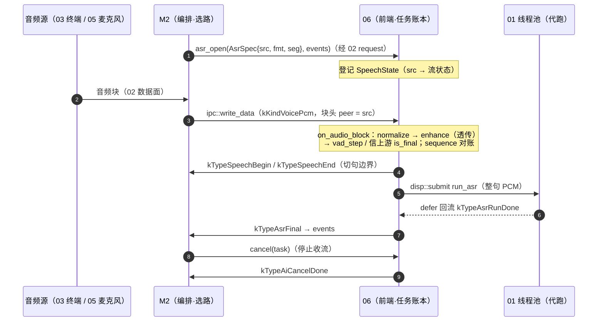
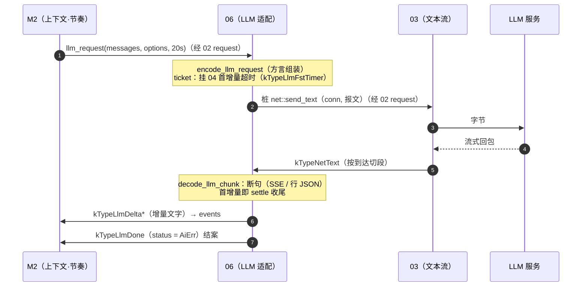
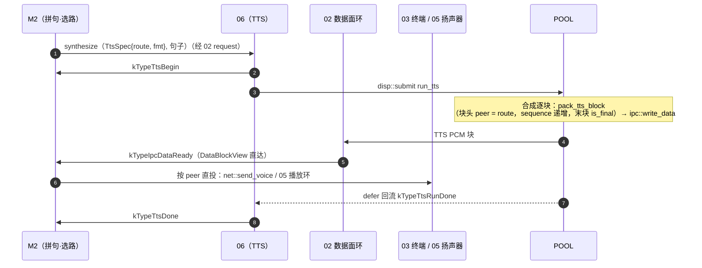

# 06 AI（ASR / TTS / LLM 对接）

> 自底向上第三层（M1 子进程层，与 03/05 并列）：AI 域，一份文档、一个进程——**"语音 ↔ 文字"转换的唯一归属**：语音前端、ASR、TTS、LLM 报文对接。**无状态纯转换件**：会话上下文、prompt、流水线编排、选路全归 M2，06 只回答"这段音频是什么字、这段文字怎么发音、这轮对话的报文怎么拼怎么解"。契约与号段 500–599 在本模块定死；共享语音契约 `media.h` 的解释权（`sequence`/`is_final`）左半在此（见 [../media.md](../media.md)）；事件循环与投递归 [01](./01-dispatcher.md)，IPC 归 [02](./02-ipc.md)，网络字节归 [03](./03-network.md)，定时语义归 [04](./04-timer.md)，设备归 [05](./05-device-io.md)；选型（sherpa-onnx、nlohmann/json）见 [../tech-stack.md](../tech-stack.md)。

## 职责

把音频与文字之间的三件转换做干净，向上交统一的任务契约：

1. **定义契约**：`TaskId`、号段 500–599 事件与负载（`AsrResult`、`LlmDelta`/`LlmDone`、`TtsSpec`、健康/错误）与 `ai::` 门面自由函数；上层只见契约与门面，不见 sherpa-onnx 句柄、不见类。
2. **语音前端**：数据面音频块 → 可识别的整句 PCM。重采样/声道混合/位深归一（`AudioFormat` → 模型输入规格）；**VAD + 整句切分**——`is_final`/`sequence` 的解释者与产生者（media.h 解释权左半）；`sequence` 对账与丢块就地处置。AEC/AGC/降噪**只留桩位**（接口先立、一期恒等透传，实现与选型后补）。
3. **ASR 子组件**：整句 PCM → 文字（sherpa-onnx 本地推理）。只做语音→文字，不做语义理解；一期只出最终结果，中间结果事件位置预留。
4. **LLM 对接子组件**：**无状态单发请求**。把方言无关的请求语义（messages/options，M2 拼好下发）组装成对端 API 报文；经 03 客户端文本流门面收发字节；断句（按行/SSE 拼报文——03 只给按到达切段的 chunk）；流式增量解析为 `LlmDelta` 事件流，终止/错误归纳为 `LlmDone`。历史、prompt、人设由 M2 拼好随请求下发，06 不存会话状态。
5. **TTS 子组件**：文字 → 合成 → 按 `AudioFormat`/period 切块的 PCM（一个文本单元一单，边合成边出块），块上 02 数据面（`kKindVoicePcm` + qos 声明），块头回填 M2 指定的路由标签，M2 据此直投 03/05。06 不选路、不混音。
6. **任务执行与自保**：任务账本（`TaskId` → 在飞任务：超时、取消、销账）；推理阻塞/CPU 密集走 01 代跑 + `post()` 回流（同 05 代跑机制）；模型加载失败/推理超时/报文解析失败以健康与错误事件上报；新增事件一律出行（`EventDef` 声明即注册，见 [../policy.md](../policy.md)）。

**不负责**：对话上下文、prompt、人设、多轮记忆（M2 拼好随请求下发）；流水线编排、打断与会话节奏（M2 逐步调用 06 的三项能力串起四步流水线）；选路与混音（M2，语音双路终端/本地由业务选）；网络字节与连接生命周期（03，含断线重连）；声卡与设备 IO（05）；01/02/04 机制本体；仿生（[07](./07-bionic.md)）；"该回什么话"的业务策略。

## 内部构成

子组件是进程内分工，不占模块号、不出进程：

| 子组件 | 回答的问题 | 机制 |
|---|---|---|
| 语音前端 | 哪里是一句？字节对不对？ | inbox 线程内纯逻辑（归一化、VAD/切句、对账） |
| ASR | 这句话是什么字？ | 代跑（`disp::submit`）：sherpa-onnx 识别 |
| LLM 适配 | 报文怎么拼、流怎么解？ | inbox 线程内纯逻辑（方言组装/断句/增量解析）+ 03 文本流 |
| TTS | 这段字怎么发音？ | 代跑：sherpa-onnx 合成，出块直写数据面环 |
| 任务账本 | 谁在飞、该销谁？ | `TaskTable` 一把锁多写单读（同 02 请求表裁决形） |

## 数据结构

沿用 01 的设计约定（**外壳函数式、类退居资源聚合体**）：门面 = `ai` 命名空间自由函数操作集（资源引用作第一参数，`create()`/`stop()` 管资源生死），应用层只见契约与门面、不见类；类只做**资源聚合体**（RAII 资源成员，操作全在门面自由函数）与**库薄壳**（RAII + 不可再拆的库封装），原语就是门面函数本身；封装靠文件边界——**头文件** = 契约类型 + 门面声明（应用层唯一可见面），**实现文件** = 类定义 + 内脏自由函数（纯函数 + 编排函数），不用 `private`/`friend`；内脏住 `ai` 命名空间（不跨模块直调）。机械性动作一律 `with（切面…, 本体）` 包裹（lambda 模拟 AOP around，见 [../with.md](../with.md)），编排函数本体只写业务。

```cpp
// ===== ai.h：契约类型 + 门面（应用层唯一可见面） =====

// 06 号段 500–599：500–509 公共、510–549 语音前端 / ASR、550–579 LLM、580–599 TTS。
// 客户端（M2）经 02 RPC 调门面（桩函数），入站事件经 02 notify 投回声明的管道。
// 事件定义 = 策略行（policy.h，声明即注册）：满时策略随声明出生，不写分支。
inline constexpr EventDef kTypeAiError     {500, kAi, Qos::kBlock};     // 子组件错误（负载 = AiErrorInfo）：推理失败、报文解析失败等
inline constexpr EventDef kTypeAiCancelDone{501, kAi, Qos::kBlock};     // 取消完成回执（负载 = TaskId）
inline constexpr EventDef kTypeAiDead      {503, kAi, Qos::kBlock};     // 引擎不可用（负载 = AiDeadInfo）：模型加载失败 / 不可恢复错误

inline constexpr EventDef kTypeSpeechBegin {510, kAi, Qos::kBlock};     // 语音开始（负载 = SpeechSeg）：打断/抢跑信号
inline constexpr EventDef kTypeSpeechEnd   {511, kAi, Qos::kBlock};     // 整句边界（负载 = SpeechSeg）：is_final 的解释产物
inline constexpr EventDef kTypeAsrFinal    {512, kAi, Qos::kBlock};     // 识别最终文字（负载 = AsrResult）
inline constexpr EventDef kTypeAsrPartial  {513, kAi, Qos::kDropCount}; // 识别中间结果（负载 = AsrResult）：预留，一期不产；可丢观测
inline constexpr EventDef kTypeAsrRunDone  {514, kAi, Qos::kBlock};     // 内部：ASR 代跑完成回流，只回 06 自己的 inbox——业务看不到它

inline constexpr EventDef kTypeLlmDelta    {550, kAi, Qos::kBlock};     // LLM 流式增量（负载 = LlmDelta）
inline constexpr EventDef kTypeLlmDone     {551, kAi, Qos::kBlock};     // LLM 回包结束（负载 = LlmDone）
inline constexpr EventDef kTypeLlmFstTimer {552, kAi, Qos::kBlock};     // 内部：首增量超时到期，只回 06 自己的 inbox——业务看不到它

inline constexpr EventDef kTypeTtsBegin    {580, kAi, Qos::kBlock};     // 合成开始（负载 = TaskId）：首块即将上环
inline constexpr EventDef kTypeTtsDone     {581, kAi, Qos::kBlock};     // 合成完成（负载 = TaskId）：末块（is_final）已上环
inline constexpr EventDef kTypeTtsRunDone  {582, kAi, Qos::kBlock};     // 内部：TTS 代跑完成回流，只回 06 自己的 inbox——业务看不到它

using TaskId = uint64_t;   // 任务号：asr_open/llm_request/synthesize 返回，cancel 用；ticket 发号，0 = 无效

constexpr uint8_t kTaskAsr = 1;   // TaskEntry.kind
constexpr uint8_t kTaskLlm = 2;
constexpr uint8_t kTaskTts = 3;

constexpr uint8_t kSegUpstream = 1;   // AsrSpec.seg：整句边界信上游 is_final（终端语音）
constexpr uint8_t kSegVad      = 2;   // AsrSpec.seg：VAD 自切（本地麦克风）

// 错误码：任务级原因（LlmDone.status / AiErrorInfo.err），独立常量空间——不占 EventType 号段，避免撞号。
enum class AiErr : int32_t {
    kOk        = 0,
    kTimeout   = -1,   // 首增量超时 / 任务超时
    kBroken    = -2,   // LLM 连接断开（03 kTypeNetDown 波及）
    kRejected  = -3,   // 对端拒绝（错误报文 / 非成功状态）
    kBadStream = -4,   // 报文解析失败（断句 / JSON）
    kEngine    = -5,   // 推理失败 / 引擎不可用
    kCancelled = -6,   // 被 cancel
    kTooLong   = -7,   // 整句超缓冲上限，强制切句
    kLost      = -8,   // 入流丢块（sequence 跳号），整句作废
};

struct AsrSpec {            // asr_open 参数
    uint32_t    src;        // 音频来源标识 = 块头 peer（03 = TerminalId / 05 = DeviceId）：06 只当流键用，不解释含义
    AudioFormat fmt;        // 输入音频参数（前端据此归一化到模型规格）
    uint8_t     seg_mode;        // 切句来源：kSegUpstream / kSegVad
    std::string lang;       // 语种（选模型），空 = 默认
};

struct SpeechSeg {          // kTypeSpeechBegin / kTypeSpeechEnd 负载
    TaskId   task;
    uint32_t seg_seq;       // 整句序号（任务内从 0 递增）：与 AsrResult.seg_seq 对账
    uint64_t t_ns;          // 边界时刻（CLOCK_MONOTONIC）
};

struct AsrResult {          // kTypeAsrFinal / kTypeAsrPartial 负载
    TaskId      task;
    uint32_t    seg_seq;
    std::string text;       // UTF-8 文字
    float       confidence; // 0 = 模型不提供
    uint64_t    t_ns;
};

struct LlmRequest {         // llm_request 参数：方言无关的请求语义，报文组装归 06 适配层
    std::string messages;   // 会话内容 JSON（M2 组装：system / 历史 / 本轮），06 不存不改
    std::string options;    // 采样参数 JSON（temperature 等方言无关键）
};

struct LlmDelta {           // kTypeLlmDelta 负载
    TaskId      task;
    std::string text;       // 增量文字（UTF-8）：M2 可边收边拼句送 TTS
    uint64_t    t_ns;
};

struct LlmDone {            // kTypeLlmDone 负载
    TaskId      task;
    int32_t     status;     // AiErr：0 = 正常结束；负 = 失败原因
    std::string usage;      // 用量 JSON（token 统计透传，可空）
    uint64_t    t_ns;
};

struct TtsSpec {            // synthesize 参数
    uint32_t    route;      // 出块路由标签 = 下一跳目标标识（TerminalId / DeviceId）：06 回填块头 peer，M2 据此直投，06 不解释
    AudioFormat fmt;        // 期望输出参数（模型规格 → fmt 反向归一化）；period_frames = 出块粒度
    std::string voice;      // 音色名（模型内命名），空 = 默认
};

struct AiErrorInfo {        // kTypeAiError 负载
    TaskId      task;       // 0 = 与任务无关（引擎级）
    int32_t     err;        // AiErr
    std::string what;       // 简述（日志用，不作分支判断）
    uint64_t    t_ns;
};

struct AiDeadInfo {         // kTypeAiDead 负载
    int32_t     why;        // 死因：模型加载失败 / 不可恢复错误码
    std::string component;  // "asr" / "tts" / "llm"：分件置死，其余照常
    uint64_t    t_ns;
};

class Ai;                   // 资源聚合体（定义在实现文件）：应用层只见名字，用指针/引用持有

// ===== 门面：自由函数操作集，资源引用作第一参数 =====
// create 双形态，同一契约两个半边：06 进程内 = 本体；M2 主进程 = 桩（02 对端引用 + 事件分派）。
namespace ai {

// ---- 06 进程内（AI 进程启动时装配） ----
std::unique_ptr<Ai> create(Dispatcher&, Timer&, Ipc&, Net&);   // 资源出生（RAII）+ 模型装载；Net = 03 客户端桩（LLM 文本流）
void serve(Ai&);            // 登记 RPC 处理器：客户端门面的对端半边
void stop(Ai&);             // 资源死：在飞任务 kBroken 结案 → 拆引擎，之后门面调用一律拒绝（`live`）

// ---- 客户端（M2 主进程，桩函数内部经 02 到 06；事件经 02 投回声明的管道） ----
TaskId asr_open(Ai&, const AsrSpec&, PipeId events);                                // 订阅形：开一段"听"
TaskId llm_request(Ai&, const LlmRequest&, PipeId events, uint64_t timeout_ns);     // 单发流式请求（timeout = 首增量上限）
TaskId synthesize(Ai&, const TtsSpec&, std::string_view text, PipeId events);       // 一单 = 一个文本单元
bool   cancel(Ai&, TaskId);                                                         // 结束/取消在飞任务（打断语义）
}
```

```cpp
// ===== ai.cc：内部类型（实现文件） =====

struct SpeechState {        // 每 ASR 流一份：语音前端状态（归一化 + 切句 + 对账）
    TaskId     task;
    AsrSpec    spec;
    uint32_t   next_seg = 0;       // 下一个整句序号
    uint64_t   expect_seq = 0;     // sequence 对账：跳号 = 丢块
    bool       in_speech = false;  // VAD 状态机（kSegVad）；kSegUpstream 恒在句中
    uint64_t   silence_ns = 0;     // 尾静音累计（kSegVad 的 is_final 判定）
    std::vector<uint8_t> seg_buf;  // 当前整句 PCM 缓冲（归一化后），设上限
};

class AsrEngine {           // 库薄壳：sherpa-onnx 识别 RAII + 不可再拆的库封装（句柄封在壳内，不出边界）
public:
    std::expected<AsrResult, int32_t> decode(std::span<const std::byte>, const AudioFormat&);
};

class TtsEngine {           // 库薄壳：sherpa-onnx 合成 RAII + 不可再拆的库封装
public:
    // 合成一个文本单元，逐块产出（period 粒度）：出块即由编排层写环
};

struct LlmParseState {      // 每 LLM 任务一份：流断句缓冲（SSE 行 / 分隔符攒包）
    std::string acc;
    bool        done = false;
};

struct TaskEntry {          // 任务档案，TaskTable：TaskId → TaskEntry
    TaskId   id;
    uint8_t  kind;          // kTaskAsr / kTaskLlm / kTaskTts
    PipeId   events;        // 事件收件管道（登记时声明）
    uint32_t tag;           // ASR = AsrSpec.src；TTS = TtsSpec.route；LLM = 0
    TimerHandle timer;      // 04：LLM 首增量超时（tmr::after），出首增量即撤；ASR/TTS 留空
    std::atomic<int> inflight;
    bool     cancelled = false;
};
struct TaskTable { /* TaskId → TaskEntry；一把锁护增删查：调用线程登记、inbox 消费线程销账 */ };
```

```cpp
// ===== ai.cc：资源聚合体（实现文件） =====

// 资源聚合体：资源出生与生死归 create/stop，操作全在门面自由函数
class Ai {
public:
    PipeId      inbox;      // 06 收件管道：02 数据面 DataReady / 03 文本流事件 / 01 代跑回流 / 04 超时
    Dispatcher& d;          // 01：投递、代跑都走它
    Timer&      timer;      // 04：LLM 首增量超时
    Ipc&        ipc;        // 02：控制面 RPC + 数据面音频
    Net&        net;        // 03 客户端桩：LLM 文本流
    TaskTable   tasks;      // 在飞任务账本
    std::map<uint32_t, SpeechState> streams;   // src → 前端状态（asr_open 登记，cancel 摘除）
    AsrEngine   asr;
    TtsEngine   tts;
};
```

```cpp
// ===== ai.cc：内脏自由函数（实现文件，不跨模块直调） =====
namespace ai {   // 门面 asr_open/llm_request/synthesize/cancel 的实现体即编排

// ===== 纯函数：查询/变换，无副作用，可直接单测 =====

std::expected<std::vector<uint8_t>, int32_t> normalize(std::span<const std::byte>, const VoiceMeta&,
                                                       const AudioFormat& target);  // 重采样/声道/位深归一
std::vector<uint8_t> enhance(std::span<const uint8_t>);   // 语音增强桩位（AEC/AGC/降噪）：一期恒等透传
uint32_t vad_step(SpeechState&, std::span<const std::byte>);  // 喂一拍 → 状态迁移：0 无变化 / 1 语音开始 / 2 整句结束
std::string encode_llm_request(const LlmRequest&, uint8_t dialect);                 // 方言无关语义 → 对端报文
std::expected<std::vector<LlmDelta>, int32_t> decode_llm_chunk(LlmParseState&, std::string_view); // 断句 + 增量解析
std::vector<std::byte> pack_tts_block(uint32_t route, VoiceMeta, std::span<const std::byte> pcm);  // 块头 peer = route
Event make_seg_event(TaskId, uint32_t seg_seq, EventType, PipeId, uint64_t now_ns);
Event to_event(const AsrResult&, PipeId, uint64_t now_ns);
Event make_cancel_event(TaskId, PipeId, uint64_t now_ns);

// ===== 编排函数：带副作用，动词用命令式 =====

void on_ai_event(Ai&, const Event&);        // inbox 消费者：with(ev, …) 按 Event.type 分流（见"与 01/02/03/04 的对接"）
void on_audio_block(Ai&, const Event&);     // block：按块头 peer 归流 → 前端 → 切句触发推理
void on_asr_run_done(Ai&, const Event&);    // 代跑回流（kTypeAsrRunDone，settle）：投 kTypeAsrFinal
void on_tts_run_done(Ai&, const Event&);    // 代跑回流（kTypeTtsRunDone，settle）：末块已上环，投 kTypeTtsDone
void on_llm_text(Ai&, const Event&);        // 03 kTypeNetText → 断句 → kTypeLlmDelta / kTypeLlmDone
void on_llm_down(Ai&, const Event&);        // 03 kTypeNetDown：在飞 LLM 任务 kBroken 结案（settle 拒绝路径之一）
void on_llm_fst_timer(Ai&, TaskId);         // 04 到期（kTypeLlmFstTimer）：无首增量 → kTypeLlmDone(kTimeout) 结案（同走 settle）
void on_cancel(Ai&, TaskId);                // 作废在飞（settle）、投 kTypeAiCancelDone
void run_asr(Ai&, TaskId, std::vector<uint8_t>&&, const AudioFormat&);  // 代跑体（defer）：整句推理
void run_tts(Ai&, [askId, std::string, const TtsSpec&);                 // 代跑体（defer）：合成逐块写环（数据面直写）
}  // namespace ai
```

## 接口与流水线

06 进程自带一套 01+02+04（独立事件循环、时间堆、IPC 端点），`connect` 主进程（02 星型）；M2 经 02 收发（控制面 request/notify 载任务与事件，数据面载音频块），03 的文本流桩在 06 进程内装配。

### 门面操作集（ai.h）

| 操作 | 半边 | 调用线程 | 语义 |
|---|---|---|---|
| `create(Dispatcher&, Timer&, Ipc&, Net&)` | 双形态 | 启动时 | 资源出生（RAII）：06 进程内造本体并装载模型（失败分件 `kTypeAiDead` + 拒新单），M2 造桩 |
| `serve(Ai&)` | 进程内 | 启动时 | 登记 RPC 处理器：客户端门面的对端半边，逐 op 分派 |
| `asr_open(AsrSpec, events)` | 客户端 | 任意线程 | 开一段"听"：登记 `src` → `SpeechState`，音频块经 02 数据面流入；`events` 收 510–512 |
| `llm_request(LlmRequest, events, timeout)` | 客户端 | 任意线程 | 单发流式请求：组报文 → 03 文本流；`events` 收 550/551；`timeout` = 首增量上限 |
| `synthesize(TtsSpec, text, events)` | 客户端 | 任意线程 | 一个文本单元一单：合成逐块上环（块头 `peer` = `route`）；`events` 收 580/581 |
| `cancel(TaskId)` | 客户端 | 任意线程 | 结束/取消在飞任务（打断语义）：ASR = 停止收流丢在攒整句；LLM = 停收增量；TTS = 停合成丢未出块；回执 501 |
| `stop(Ai&)` | 进程内 | 停机时 | 在飞任务 `kBroken` 结案 → 撤超时 → 关 LLM 连接拆引擎；之后门面调用一律拒绝（`live`） |

客户端半边是**桩函数**：签名与进程内门面一致，内部把调用编成 02 请求，事件由桩层翻回号段事件 `post` 到声明的管道——与 03 的客户端半边同构，共用同一个 `rpc` 桩壳（见 [../with.md](../with.md)）。

### 客户端 RPC 映射（02 承载）

门面调用编成 02 请求（body = JSON，nlohmann/json 序列化），`ipc::request`/`respond` 承载往返；入站事件以 `ipc::notify` 信封送达，桩层翻译投递。请求/响应语义、超时与销账全用 02 既有裁决，06 不另立请求表（06 的 `TaskTable` 管任务生命周期，不管 RPC 往返）。

| 门面 | 02 载体 | 请求体（JSON） | 回程 |
|---|---|---|---|
| `asr_open` | `request` | `{"op":"asr_open","src":7,"fmt":{…},"seg":1,"lang":"zh","events":42}` | 响应 `{"ok":true,"task":9}`；事件回 `events` |
| `llm_request` | `request` | `{"op":"llm","messages":{…},"options":{…},"timeout_ns":…,"events":43}` | 响应 `{"ok":true,"task":10}`；550/551 流式回 `events` |
| `synthesize` | `request` | `{"op":"tts","route":3,"fmt":{…},"voice":"…","text":"…","events":44}` | 响应 `{"ok":true,"task":11}`；PCM 走数据面；580/581 回 `events` |
| `cancel` | `request` | `{"op":"cancel","task":10}` | 响应 `{"ok":true}`；501 回任务的 `events` |
| 事件回程 | `notify` | 信封 `{"ev":550,"pipe":43,…负载字段}` | 桩层翻号段事件 `post` 到声明的管道 |
| 音频入流 | 02 数据面 | 块 = `kKindVoicePcm`（M2 → 06，块头 `peer` = `AsrSpec.src`） | 06 收 `kTypeIpcDataReady` 自取，用完 `ipc::release` |
| TTS 出块 | 02 数据面 | 块 = `kKindVoicePcm`（06 → M2，块头 `peer` = `TtsSpec.route`） | M2 收 `kTypeIpcDataReady`，按 `peer` 直投 03/05 |

### ASR 流水线（音频块 → 整句 → 文字）



### LLM 流水线（单发请求 → 流式增量）



### TTS 流水线（文本单元 → PCM 块流）



### 与 01/02/03/04 的对接

| 来源 | 事件 | 06 怎么处理 |
|---|---|---|
| 02 | `kTypeIpcRequest`（M2 门面调用） | RPC 分派：asr_open / llm / tts / cancel → 组单登记，ack 即回响应 |
| 02 | `kTypeIpcDataReady`（音频入流） | `on_audio_block`：按块头 `peer` 归流 → 前端 → 切句触发推理，用完 `ipc::release` |
| 02 | `kTypeIpcDataLost`（seq 对账丢块） | 作废在攒整句（`AiErr::kLost` 计数 + `kTypeAiError`），不产结果 |
| 03 | `kTypeNetText`（LLM 回包段） | `on_llm_text`：断句 → `kTypeLlmDelta` / `kTypeLlmDone` |
| 03 | `kTypeNetDown`（LLM 连接断） | `on_llm_down`：在飞 LLM 任务 `kBroken` 结案；重连归 03，06 不管 |
| 01 线程池 | `kTypeAsrRunDone` / `kTypeTtsRunDone`（代跑回流） | 摘单、投结果事件；任务已取消则走 `settle` |
| 04 | `kTypeLlmFstTimer`（首增量超时） | `on_llm_fst_timer`：`kTypeLlmDone(kTimeout)` 结案（迟到增量走 `settle`） |

06 启动时把 `on_ai_event` 登记为 `inbox` 管道的消费者，统一按 `Event.type` 分流：

```cpp
void ai::on_ai_event(Ai& a, const Event& ev) {
    with(ev, {   // 机械：按 Event.type 查表分流
        {kTypeIpcRequest,   [&](const Event& e){ on_rpc(a, e); }},
        {kTypeIpcDataReady, [&](const Event& e){ on_audio_block(a, e); }},
        {kTypeIpcDataLost,  [&](const Event& e){ on_lost(a, e); }},
        {kTypeNetText,      [&](const Event& e){ on_llm_text(a, e); }},
        {kTypeNetDown,      [&](const Event& e){ on_llm_down(a, e); }},
        {kTypeAsrRunDone,   [&](const Event& e){ on_asr_run_done(a, e); }},
        {kTypeTtsRunDone,   [&](const Event& e){ on_tts_run_done(a, e); }},
        {kTypeLlmFstTimer,  [&](const Event& e){ on_llm_fst_timer(a, any_cast<TaskId>(e.payload)); }},
    });
}
```

**寻址约定（SourceId ↔ PeerId）**：06 是 02 的子进程端，`PeerId` 即 06 域的 `SourceId`（主进程 = 唯一对端）；音频块的归属看块头 `peer`（= `AsrSpec.src` / `TtsSpec.route`），06 只当流键/路由标签用，不解释含义——寻址语义归 M2。代跑回流与超时合成事件 `source` 填 0（与 02/03 的合成事件同规则）。

### 例子：对话一轮（终端语音 → ASR → LLM → TTS → 回终端）

```cpp
// M2 主进程（06 的客户端桩）
TaskId listen = ai::asr_open(ai, AsrSpec{.src = T1, .fmt = {16000,1,16,320},
                                         .seg = kSegUpstream}, 对话管道）;
// 终端语音块由 M2 选路后 ipc::write_data 写 06 环（块头 peer = T1）……
// 对话管道收 kTypeAsrFinal → M2 拼 messages（system + 历史 + 本轮）：
TaskId llm = ai::llm_request(ai, LlmRequest{.messages = …, .options = …}, llm 管道，20s);
// llm 管道收 kTypeLlmDelta：M2 拼句，句满即合成：
TaskId tts = ai::synthesize（ai, TtsSpec{.route = T1, .fmt = {16000,1,16,320}}, 句子，tts 管道）;
// TTS PCM 块回 M2（kTypeIpcDataReady，块头 peer = T1）→ net::send_voice(net, T1, meta, pcm)
// 用户插话：ai::cancel(ai, llm); ai::cancel(ai, tts);
```

| 步 | 醒因 | 06 处理 | M2 收到 |
|---|---|---|---|
| 1 | 音频块流入 | 前端归一化 + 切句（信上游 is_final） | `kTypeSpeechEnd` |
| 2 | 整句到手 | 代跑整句推理 | `kTypeAsrFinal` |
| 3 | LLM 请求 | 组报文 → 03 文本流 → 断句增量解析 | `kTypeLlmDelta*` → `kTypeLlmDone` |
| 4 | 句子合成 | 代跑合成，逐块上环（末块 is_final） | `kTypeTtsBegin` → 块流 → `kTypeTtsDone` |

## 规则

- **风格**：沿用 01 约定——外壳函数式、类退居资源聚合体：门面 = `ai` 自由函数（头文件），内脏分纯/编排住 `ai`（实现文件，不跨模块直调）；类只做资源聚合体与库薄壳，原语就是门面函数；契约/账本是纯结构体，不带方法。
- **门面准入**：新操作先问能否用既有门面组合实现——能则写成门面语法糖（参数适配、无新不变量），不能才新增门面原语；门面只增原语，不增类方法（演进防火墙）。
- **机械性切面**：与业务无关且重复的机械动作一律 `with（切面…, 本体）` 包裹（切面 = `Aspect` 数据形：state 挂机械状态与策略行，见 [../with.md](../with.md)）——门面 `live`、客户端桩壳 `rpc`、任务表与首增量超时 `ticket`/`settle`、代跑 `defer`、音频块 `block`、inbox 分流 `with(ev, …)`；"用完必 release""迟到必丢弃计数"等顺序条款由切面吸收；新增机械动作先过切面准入（工厂 + 参数审查）。
- **号段**：06 占 500–599——500–509 公共（500 错误 / 501 取消回执 / 503 引擎死亡）、510–549 语音前端与 ASR（510/511 边界、512 最终、513 预留、514 内部）、550–579 LLM（550/551、552 内部）、580–599 TTS（580/581、582 内部）；内部事件只回 06 自己的 `inbox`，业务看不到；新增类型在本节扩展并出行（`EventDef` 声明即注册，策略随行出生，见 [../policy.md](../policy.md)）。
- **无状态**：06 不持会话上下文、prompt、人设、多轮历史——M2 拼好随请求下发；任务内状态（VAD/切句缓冲/对账/断句缓冲）是转换的载体，不是会话状态；换 LLM 对端方言只动 `encode_llm_request`/`decode_llm_chunk` 一组纯函数，契约不变。
- **media.h 解释权**：06 解释并产生 `sequence`/`is_final`——入流按 `VoiceMeta` 对账（跳号 = 丢块，作废在攒整句 + 计数）；切句产生 `kTypeSpeechBegin`/`kTypeSpeechEnd`（`kSegVad` 自判、`kSegUpstream` 信上游，两种模式都产）；TTS 出块自填 `VoiceMeta`（`sequence` 任务内递增、`is_final` = 末块）。
- **整句 ASR + 流式 LLM/TTS**：ASR 一整句一推理（`kTypeAsrPartial` 位置预留，一期不产）；LLM 回包流式增量（`kTypeLlmDelta` 边解析边投）；TTS 一个文本单元一单、逐块出（首块不必等整段合成完）；增量文本拼句归 M2（节奏归 M2）。
- **推理代跑**：阻塞/CPU 密集推理（ASR/TTS）一律 `disp::submit` 代跑 + `post()` 回流（同 05 代跑机制）；代跑体只许碰引擎句柄与 `post()` 回流，**显式例外**：TTS 代跑体直写 02 数据面环（流式出块，同 05 流式通道精神，`write_data` 任意线程可调）；同引擎任务由账本串行排队，防推理交错。
- **背压**：不写分支、写行——满时策略 = 契约块的 `EventDef` 行、环满策略 = [../media.md](../media.md) 块 qos 声明制（下表即行的文档形）：

| 行 | 策略 | 为什么 |
|---|---|---|
| 510/511 切句边界、512 最终文字 | `kBlock` 关键阻塞 | 边界与最终文字是流水线依据 |
| 513 中间结果（预留） | `kDropCount` 丢弃并计数 | 可丢观测 |
| 550 增量 / 551 结束 | `kBlock` 关键阻塞 | 丢块即文本坏 |
| 500/501/503 | `kBlock` 关键阻塞 | 错误、回执与生死 |
| 入流 / TTS PCM 块 | `kQosRealtime` 丢旧留新 + 计数 | 实时流，旧不如新 |
| 整句缓冲 | 上限 + 超长强制切句报 `kTooLong` | 防膨胀（`SpeechState` 的行，非队列） |

- **错误两层**：不写分支——错误源的归属与处置是 `ErrPolicy` 行（见 [../policy.md](../policy.md)）：传输层（断连、读写失败）走 01 的 `kTypeError` → 02 的 `kTypeIpcBroken`，M2 侧看到的是 02 错误码；任务层（推理失败、报文解析失败、超时）走 `AiErr` 填 `LlmDone.status` / `AiErrorInfo.err`；引擎不可用 = 分件置死（`kTypeAiDead`，`component` 指名）+ 拒新单，恢复只走进程重启（主进程拉起），不做原地自愈（同 05 置死语义）；`intercept` 切面查行，库错误不抛上层。
- **超时**：不写"挂不挂"的分支——超时参数与处置是 `OpPolicy` 行（LLM = 首增量上限、ASR 流 / TTS 单 = 无超时，见 [../policy.md](../policy.md)），行指针挂进 `ticket` 的 `Aspect.state`；`llm_request` 的 `timeout_ns` 挂 04 `tmr::after`，出首增量即 `tmr::cancel`（挂撤住 `ticket`/`settle`），到点 `kTypeLlmDone(kTimeout)` 结案（迟到增量走 `settle`）。
- **线程安全**：门面任意线程可调（跨进程经 02 桩）；`inbox` 消费单线程裁决（任务账本销账、断句、投递串行，同 02/03 的销账裁决点）；`TaskTable` 一把锁多写单读（调用线程登记、inbox 消费线程销账）；引擎句柄只在代跑线程用（同引擎串行）；前端每拍纯逻辑在 inbox 线程跑（轻量），整句推理才代跑。
- **生命周期**：`TaskId` 发号与 `TaskEntry` 生死走 `ticket`；数据面块视图走 `block`（02 语义照旧）；`SpeechState` 整句缓冲设上限防膨胀；禁裸 `new/delete`；库类型（sherpa-onnx 句柄）不出模块边界。
- **stop()**：在飞任务 `kBroken` 结案（`LlmDone`/`kTypeAiError`）→ 撤超时 → 关 LLM 连接拆引擎 → 注销 02 挂接；之后门面调用一律拒绝（`live`）。
- **优化预留**：`kTypeAsrPartial` 启用（sherpa-onnx 流式识别，边听边出字）；TTS 增量送文（`feed_text` 形，边收边合成）；AEC/AGC/降噪桩位补实现（选型后补 [../tech-stack.md](../tech-stack.md)）；音频多播环（省 M2 转发的一次拷贝）；LLM 多方言/连接池；热词与说话人分离（模型能力预留）。
