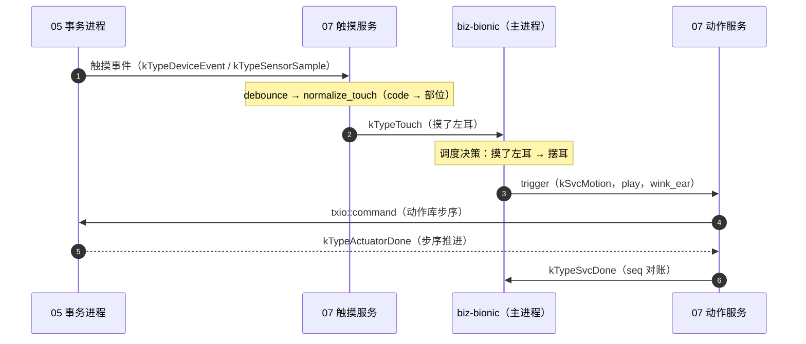
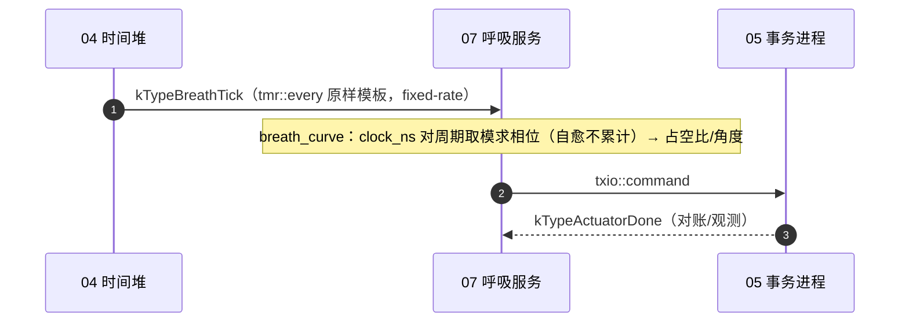

# 07 仿生进程（Bionic）

> 自底向上第三层（M1 子进程层，与 03/05/06 并列）：仿生域，一份文档、一个进程——**各仿生设备服务的唯一归属**：触摸服务、呼吸服务、体温服务、动作服务。07 答"**能做什么、怎么做**"（服务 = 动词表 + 设备绑定），"**什么时候做什么**"归 biz-bionic（M2 行为调度，号段 1050–1099 预留）——触摸决策与行为触发都在行为层，**每次反射都经行为层决策**，调度最纯粹。统一服务契约（`start`/`stop`/`configure`/`trigger` + 事件上报）与号段 600–699 在本模块定死；事件循环与投递归 [01](./01-dispatcher.md)，IPC 归 [02](./02-ipc.md)，定时语义归 [04](./04-timer.md)，设备归 [05](./05-device-io.md)；策略行见 [../policy.md](../policy.md)，机械性切面见 [../with.md](../with.md)。

## 职责

把四类仿生设备包成服务，向上交统一的服务契约：

1. **定义契约**：`SvcId`/`SvcReq`/`SvcResult`、号段 600–699 事件与负载（`TouchPoint`、`TempReport`、`SvcStateInfo`/`SvcErrorInfo`）与 `bio::` 门面自由函数；调度层只见契约与门面，不见设备句柄、不见类。
2. **触摸服务**：触摸/按键等事件型设备（05 订阅形）→ 边沿抖动滤波/合并（05 划归业务）→ 归一化触摸点 → `kTypeTouch` 投行为层。只答"摸了哪里"，不答"摸了之后干嘛"。
3. **呼吸服务**：04 呼吸节拍（`tmr::every`，fixed-rate + 跳积压）→ 呼吸曲线求值 → `txio::command` 驱动呼吸执行器；曲线表与幅度是服务数据。
4. **体温服务**：05 周期订阅体温计读数 → 物理量换算（05 划归业务）→ 迟滞闭环 → 加热片开关；换算后温度以 `kTypeTempReport` 上报。
5. **动作服务**：动作库（具名动作 → 步序 `ActuatorCommand`）+ 执行驱动：查库 → 逐步下发 → 回执推进；动作含义的"库与执行"在此，"选哪个动作"归 biz-bionic（只按名字引用）。
6. **统一服务契约**：四服务同一形（`start`/`stop`/`configure`/`trigger` + 事件上报），动词即行（查表执行，不写分支）；调度侧代码只写一份。
7. **服务自保**：设备生死收 05 `kTypeDeviceDead` 波及即服务降级（`kTypeSvcState`）并在飞单结案；服务状态与错误以事件上报；新增事件一律出行（`EventDef` 声明即注册，见 [../policy.md](../policy.md)）。

**不负责**：行为调度与触摸决策（biz-bionic：什么时候做什么、摸了之后干嘛）、对话编排与联动策略（biz-dialog 与 biz-bionic——`kTypeDlgState` 由行为层消费，07 不感知对话）；设备字节、ioctl 代跑与看门狗机制本体（05）；IPC 协议语义（02）、事件循环与投递（01）、定时机制本体（04）；语音转换（06）；"选哪条曲线、选哪个动作"的调度决策（biz-bionic 按名字引用，库表住本模块）。

## 内部构成

服务是进程内分工，不占模块号、不出进程（600–699 的子段是 owner 内政）：

| 服务 | 回答的问题 | 管的设备（经 05 门面） | 机制 |
|---|---|---|---|
| 触摸服务 | 摸了哪里？ | 触摸/按键（事件型） | 05 订阅事件 → inbox 纯逻辑（滤波/合并/归一化） |
| 呼吸服务 | 这一拍呼吸到哪？ | 呼吸执行器（事务型） | 04 节拍唤醒 → 曲线求值（纯函数）→ `txio::command` |
| 体温服务 | 现在多暖、要不要加热？ | 体温计 + 加热片（事务型） | 05 周期读数 → 换算 + 迟滞闭环（纯函数）→ `txio::command` |
| 动作服务 | 这个动作怎么动？ | 微动马达/舵机（事务型） | 动作库查步序（纯函数）→ 逐 `txio::command` + 回执推进 |

查表、求值都是轻量纯逻辑，inbox 线程直跑（同 06 语音前端），不代跑——阻塞都在 05 进程里代跑。

## 服务动词表

服务能力是数据不是分支——**服务 = 动词表 + 设备绑定**，调度只认 `SvcId` + 动词 + 参数：

| 服务 | `configure` 动词 | `trigger` 动词 | 库表（服务数据，biz-bionic 只引用名字） |
|---|---|---|---|
| 触摸 `kSvcTouch` | `filter`（去抖/合并窗口） | —（纯上报形，动词预留） | 触摸点映射表（`code` → 部位） |
| 呼吸 `kSvcBreath` | `scale`（幅度/频率微调） | `curve`（args: 曲线名）、`pause`、`resume` | 呼吸曲线表（名字 → 波形参数） |
| 体温 `kSvcTemp` | `target`（目标温度/迟滞窗） | `heat_on` / `heat_off` | 换算系数（一行） |
| 动作 `kSvcMotion` | `scale`（速度/力度缩放） | `play`（args: 动作名）、`halt` | 动作库（名字 → 步序 `ActuatorCommand` 序列） |

上表即服务动词的文档形：动词是行、查表执行——查无落空即 `kNoSuchVerb`/`kNoSuchAsset`，不写 `if` 分支；新增能力 = 加动词行，统一契约不变。瞬时动词（`curve`/`pause`/`resume`/`halt`/`heat_*`）完成即回执；过程动词（`play`）末步结案回执。

## 数据结构

沿用 01 的设计约定（**外壳函数式、类退居资源聚合体**）：门面 = `bio` 命名空间自由函数操作集（资源引用作第一参数，`create()`/`stop()` 管资源生死），应用层只见契约与门面、不见类；类只做**资源聚合体**（RAII 资源成员，操作全在门面自由函数）与**库薄壳**（RAII + 不可再拆的库封装），原语就是门面函数本身；封装靠文件边界——**头文件** = 契约类型 + 门面声明（应用层唯一可见面），**实现文件** = 类定义 + 内脏自由函数（纯函数 + 编排函数），不用 `private`/`friend`；内脏住 `bio` 命名空间（不跨模块直调）。机械性动作一律 `with（切面…, 本体）` 包裹（lambda 模拟 AOP around，见 [../with.md](../with.md)），编排函数本体只写业务。

```cpp
// ===== bio.h：契约类型 + 门面（应用层唯一可见面） =====

// 07 号段 600–699：600–609 公共、610–639 触摸、640–669 呼吸、670–689 体温、690–699 动作（预留）。
// 客户端（biz-bionic）经 02 RPC 调门面（桩函数），入站事件经 02 notify 投回声明的管道。
// 事件定义 = 策略行（policy.h，声明即注册）：满时策略随声明出生，不写分支。
inline constexpr EventDef kTypeSvcState   {600, kBio, Qos::kBlock};     // 服务状态迁移（负载 = SvcStateInfo）：启用/停用/降级
inline constexpr EventDef kTypeSvcError   {601, kBio, Qos::kBlock};     // 服务错误（负载 = SvcErrorInfo）
inline constexpr EventDef kTypeSvcDone    {602, kBio, Qos::kBlock};     // configure/trigger 完成回执（负载 = SvcResult）

inline constexpr EventDef kTypeTouch      {610, kBio, Qos::kBlock};     // 触摸事件（负载 = TouchPoint）：滤波/归一化后投 biz-bionic，反射决策在彼

inline constexpr EventDef kTypeBreathTick {640, kBio, Qos::kDropCount}; // 04 用户事件模板（呼吸节拍）：只投 07 自己的服务管道——业务看不到它

inline constexpr EventDef kTypeTempReport {670, kBio, Qos::kBlock};     // 温度上报（负载 = TempReport）：换算后温度，观测/联动依据

using SvcId = uint32_t;   // 服务编号：四服务固定值（不是发号），0 = 无效

constexpr uint8_t kSvcTouch  = 1;   // 触摸服务
constexpr uint8_t kSvcBreath = 2;   // 呼吸服务
constexpr uint8_t kSvcTemp   = 3;   // 体温服务
constexpr uint8_t kSvcMotion = 4;   // 动作服务

constexpr uint8_t kSvcDown     = 0;   // SvcStateInfo.state：停用
constexpr uint8_t kSvcUp       = 1;   // 启用
constexpr uint8_t kSvcDegraded = 2;   // 降级（设备死波及）

constexpr uint8_t kTouchDown = 1;   // TouchPoint.kind
constexpr uint8_t kTouchUp   = 2;

struct SvcReq {            // configure/trigger 统一请求形（02 RPC 载荷同形）
    SvcId       svc;
    std::string verb;       // 服务动词（动词表行名）：07 查表执行不解释，查无 = kNoSuchVerb
    std::string args;       // 动词参数 JSON（nlohmann/json），各服务自解释
    uint64_t    seq;        // 请求序号（单调发号）：SvcResult 对账，0 = 不对账
};

struct SvcResult {         // kTypeSvcDone 负载
    SvcId    svc;
    uint64_t seq;
    int32_t  status;        // SvcErr：0 = 成功
    uint64_t t_ns;
};

// 错误码：服务级原因（SvcResult.status / SvcErrorInfo.err），独立常量空间——不占 EventType 号段，避免撞号。
enum class SvcErr : int32_t {
    kOk          = 0,
    kNoSuchVerb  = -1,   // 动词不在服务动词表
    kNoSuchAsset = -2,   // 曲线/动作库无此名
    kBadArgs     = -3,   // 动词参数不合法
    kBusy        = -4,   // 服务忙：在飞未结（一单在飞）
    kDead        = -5,   // 服务降级/设备死（05 kTypeDeviceDead 波及）
    kCancelled   = -6,   // 被 halt/stop 打断
};

struct SvcStateInfo {      // kTypeSvcState 负载
    SvcId    svc;
    uint8_t  state;        // kSvcUp / kSvcDown / kSvcDegraded
    int32_t  why;          // SvcErr（降级死因）
    uint64_t t_ns;
};

struct SvcErrorInfo {      // kTypeSvcError 负载
    SvcId       svc;
    int32_t     err;       // SvcErr
    std::string what;      // 简述（日志用，不作分支判断）
    uint64_t    t_ns;
};

struct TouchPoint {        // kTypeTouch 负载：滤波/合并后的触摸点
    uint32_t part;         // 部位编号（触摸点映射表产物）：左耳/头顶/肚子……语义归 biz-bionic，07 不解释
    uint32_t code;         // 原始码（05 DeviceEventInfo.code 透传，对账用）
    uint8_t  kind;         // kTouchDown / kTouchUp
    uint64_t t_ns;         // 事件时刻（源头打点透传）
};

struct TempReport {        // kTypeTempReport 负载
    SvcId  svc;            // kSvcTemp
    double celsius;        // 换算后温度（05 原始读数 → 物理量换算在服务内）
    double target;         // 当前闭环目标
    bool   heating;        // 加热片在飞状态
    uint64_t t_ns;
};

class Bio;                  // 资源聚合体（定义在实现文件）：应用层只见名字，用指针/引用持有

// ===== 门面：自由函数操作集，资源引用作第一参数 =====
// create 双形态，同一契约两个半边：07 进程内 = 本体；biz-bionic 主进程 = 桩（02 对端引用 + 事件分派）。
namespace bio {

// ---- 07 进程内（仿生进程启动时装配） ----
std::unique_ptr<Bio> create(Dispatcher&, Timer&, Ipc&);   // 资源出生（RAII）+ 四服务装配（各挂 05 订阅/04 节拍）
void serve(Bio&);            // 登记 RPC 处理器：客户端门面的对端半边
void stop(Bio&);             // 资源死：停四服务 → 在飞 trigger kCancelled 结案 → 注销 02 挂接

// ---- 客户端（biz-bionic 主进程，桩函数内部经 02 到 07；事件经 02 投回声明的管道） ----
// 统一服务契约：四操作同一形，服务由 SvcId 指名——调度侧代码只写一份。
bool start(Bio&, SvcId, PipeId events);      // 服务启用：挂 05 订阅/04 节拍，事件投 events
bool stop(Bio&, SvcId);                      // 服务停用：撤订阅/节拍（资源死 = stop(Bio&)，两形并存）
bool configure(Bio&, const SvcReq&);         // 参数下发：查服务动词表执行，回执 kTypeSvcDone
bool trigger(Bio&, const SvcReq&);           // 调度触发点：同上，完成以 kTypeSvcDone 投 events
}
```

```cpp
// ===== bio.cc：内部类型（实现文件） =====

struct TouchState {          // 触摸服务状态
    uint64_t debounce_ns = 20'000'000;   // 去抖窗口（filter 动词下发）
    uint64_t merge_ns    = 30'000'000;   // 合并窗口：同窗多触摸点并成一次上报
    uint64_t last_ns = 0;    // 上一触摸点时刻（去抖判据）
    std::map<uint32_t, uint32_t> part_map;   // 触摸点映射表（服务数据）：05 code → 部位
};

struct BreathState {         // 呼吸服务状态
    uint32_t curve = 0;      // 当前曲线（呼吸曲线表行号）
    double   scale = 1.0;    // 幅度/频率缩放（scale 动词下发）
    uint64_t anchor_ns = 0;  // 曲线相位锚点：clock_ns 对曲线周期取模求相位（自愈，不按拍数累计）
    TimerHandle tick;        // 04 呼吸节拍句柄（组号 = kSvcBreath，模式切换整组调度）
};

struct TempState {           // 体温服务状态
    double target_c = 37.0;  // 目标温度（target 动词下发）
    double window_c = 0.5;   // 迟滞窗（target 动词下发）
    bool   heating = false;  // 加热片在飞状态
    IoId   sub = 0;          // 05 周期订阅单号（txio::watch 体温计）
};

struct MotionState {         // 动作服务状态
    uint64_t inflight_seq = 0;   // 在飞 trigger 序号（一单在飞），0 = 无
    uint32_t move = 0;           // 当前动作（动作库行号）
    size_t   step = 0;           // 步序游标
    double   scale = 1.0;        // 速度/力度缩放（scale 动词下发）
};

struct SvcEntry {            // 服务档案，SvcTable：SvcId → SvcEntry
    SvcId    id;
    uint8_t  state = kSvcDown;
    PipeId   events = 0;     // 事件收件管道（start 时声明）
    uint64_t next_seq = 0;   // trigger 序号发号（单调不复用）
};
struct SvcTable { /* SvcId → SvcEntry；一把锁护增删查 */ };

struct BreathCurve {         // 呼吸曲线表行（服务数据）：名字 → 波形参数
    std::string name;        // "calm" / "sleepy" / "excited"……biz-bionic 按名字引用
    uint64_t    period_ns;   // 周期
    double      amp;         // 幅度（0..1）
    uint8_t     shape;       // 波形（正弦/三角……breath_curve 求值参数）
};

struct MoveStep {            // 动作库步序行
    ActuatorCommand cmd;     // 一步一单（05 契约结构，dev 由服务装配时绑定）
    uint64_t        hold_ns; // 步间保持
};
struct Move {                // 动作库行：名字 → 步序
    std::string name;        // "wink_ear" / "pat"……biz-bionic 按名字引用
    std::vector<MoveStep> steps;
};
```

```cpp
// ===== bio.cc：资源聚合体（实现文件） =====

// 资源聚合体：资源出生与生死归 create/stop，操作全在门面自由函数
class Bio {
public:
    PipeId      inbox;      // 07 收件管道：02 转发的 05 事件 / 04 节拍 / RPC 分派
    Dispatcher& d;          // 01：投递走它
    Timer&      timer;      // 04：呼吸节拍（every）与组
    Ipc&        ipc;        // 02：控制面 RPC + 事件收发
    SvcTable    services;   // 服务档案
    TouchState  touch;
    BreathState breath;
    TempState   temp;
    MotionState motion;
    std::map<std::string, BreathCurve> curves;   // 呼吸曲线表（服务数据）
    std::map<std::string, Move>        moves;    // 动作库（服务数据）
};
```

```cpp
// ===== bio.cc：内脏自由函数（实现文件，不跨模块直调） =====
namespace bio {   // 门面 start/stop/configure/trigger 的实现体即编排

// ===== 纯函数：查询/变换，无副作用，可直接单测 =====
std::optional<TouchPoint> normalize_touch(const DeviceEventInfo&, const TouchState&);  // code → 部位（查映射表）
bool   debounce(const TouchState&, const TouchPoint&, uint64_t now_ns);                // 去抖/合并判定
double breath_curve(const BreathCurve&, double scale, uint64_t now_ns);                // 相位求值 → 占空比/角度（墙上时钟取模，自愈）
double temp_convert(double raw);                                                       // 原始读数 → 摄氏（换算系数一行）
bool   hysteresis(double now_c, double target_c, double window_c, bool heating);       // 迟滞闭环判定
std::expected<const Move*, int32_t> lookup_move(const MotionState&, const SvcReq&);    // 动作库查步序
Event  to_event(const TouchPoint&, PipeId, uint64_t now_ns);
Event  to_event(const TempReport&, PipeId, uint64_t now_ns);

// ===== 编排函数：带副作用，动词用命令式 =====
void on_bio_event(Bio&, const Event&);      // inbox 消费者：with(ev, …) 按 type 分流
void on_rpc(Bio&, const Event&);            // 02 kTypeIpcRequest：svc_start/svc_stop/svc_config/svc_trigger 分派
void on_touch(Bio&, const Event&);          // 05 触摸事件（452/450）→ 滤波/归一化 → kTypeTouch
void on_breath_tick(Bio&, const Event&);    // 04 节拍（640）→ 曲线求值 → txio::command
void on_temp_sample(Bio&, const Event&);    // 05 读数（450）→ 换算 + 迟滞闭环 → 加热 command + kTypeTempReport
void on_actuator_done(Bio&, const Event&);  // 05 回执（451）→ 推进动作步序 / kTypeSvcDone 结案
void on_device_dead(Bio&, const Event&);    // 05 kTypeDeviceDead（403）→ 服务降级 + 在飞单 kDead 结案
void on_svc_cmd(Bio&, const SvcReq&, bool is_trigger);   // 动词表查行执行（configure/trigger 同形）
void run_step(Bio&, size_t);                // 动作步序推进：查库下发一步（末步结案 kTypeSvcDone）
}
```

## 接口与流水线

07 进程自带一套 01+02+04（独立事件循环、时间堆、IPC 端点），`connect` 主进程（02 星型）；biz-bionic 经 02 收发（控制面 request/notify 载服务调用与事件），05 的设备事件经主进程转发到达（07 一期只用事务侧；同时对流式侧时同经主进程转发，见 [05](./05-device-io.md)「进程拓扑」）。

### 门面操作集（bio.h）

| 操作 | 半边 | 调用线程 | 语义 |
|---|---|---|---|
| `create(Dispatcher&, Timer&, Ipc&)` | 双形态 | 启动时 | 资源出生（RAII）：07 进程内造本体并装配四服务，biz-bionic 造桩 |
| `serve(Bio&)` | 进程内 | 启动时 | 登记 RPC 处理器：客户端门面的对端半边，逐 op 分派 |
| `start(Bio&, SvcId, events)` | 客户端 | 任意线程 | 服务启用：经 05 门面挂订阅/04 挂节拍，事件投 `events`；回执 600（`kSvcUp`） |
| `stop(Bio&, SvcId)` | 客户端 | 任意线程 | 服务停用：撤订阅/节拍（`txio::cancel` / `tmr::cancel_group`），在飞单 `kCancelled` 结案；回执 600（`kSvcDown`） |
| `configure(Bio&, SvcReq)` | 客户端 | 任意线程 | 参数下发：查服务动词表执行；回执 602 |
| `trigger(Bio&, SvcReq)` | 客户端 | 任意线程 | 调度触发点：同上，完成以 602 投 `events` |
| `stop(Bio&)` | 进程内 | 停机时 | 资源死（见规则"stop()"）；之后门面调用一律拒绝（`live`） |

客户端半边是**桩函数**：签名与进程内门面一致，内部把调用编成 02 请求，事件由桩层翻回号段事件 `post` 到声明的管道——与 06 的客户端半边同构，共用同一个 `rpc` 桩壳（见 [../with.md](../with.md)）。

### 客户端 RPC 映射（02 承载）

门面调用编成 02 请求（body = JSON，nlohmann/json 序列化），`ipc::request`/`respond` 承载往返；入站事件以 `ipc::notify` 信封送达，桩层翻译投递。请求/响应语义、超时与销账全用 02 既有裁决，07 不另立请求表。

| 门面 | 02 载体 | 请求体（JSON） | 回程 |
|---|---|---|---|
| `start` | `request` | `{"op":"svc_start","svc":1,"events":42}` | 响应 `{"ok":true}`；600/610 等回 `events` |
| `stop` | `request` | `{"op":"svc_stop","svc":1}` | 响应 `{"ok":true}`；600 回 `events` |
| `configure` | `request` | `{"op":"svc_config","svc":3,"verb":"target","args":{"celsius":37.0,"window":0.5},"seq":9}` | 响应 `{"ok":true}`；回执 602 |
| `trigger` | `request` | `{"op":"svc_trigger","svc":4,"verb":"play","args":{"move":"wink_ear"},"seq":10}` | 响应 `{"ok":true}`；完成 602 回 `events` |
| 事件回程 | `notify` | 信封 `{"ev":610,"pipe":42,…负载字段}` | 桩层翻号段事件 `post` 到声明的管道 |

以上就是 07 与 biz-bionic 的全部接口面：进 = 四操作，出 = 600/601/602/610/670 五类事件；`kTypeDlgState`（1000，对话联动）由 biz-bionic 订阅消费、翻译成服务触发，07 不感知对话。

### 触摸反射（经 biz-bionic 决策）



> 02 星型：子进程间消息经主进程转发（图中略），单跳几十 μs；全程亚毫秒，触摸 → 微动预算 < 100ms（时延表见 [05](./05-device-io.md)）。**反射不在 07 兜底**：biz-bionic 不在场时触摸只上报不动作（一期），兜底反射表见「优化预留」。

### 呼吸循环（节拍 → 曲线 → 器件）



呼吸是常态自跑（07 内闭环），调度只在模式切换时惊动：`curve`/`pause`/`resume` 动词落到 04 的组语义（`pause_group`/`resume_group`，组号 = `kSvcBreath`），整组暂停/恢复不逐档撤（见 [04](./04-timer.md)「组语义」）。

### 与 01/02/04 的对接

| 来源 | 事件 | 07 怎么处理 |
|---|---|---|
| 02 | `kTypeIpcRequest`（biz-bionic 门面调用） | `on_rpc`：`svc_start/svc_stop/svc_config/svc_trigger` 分派 → 动词表查行执行，ack 即回响应 |
| 02（05 桩转发） | `kTypeDeviceEvent` / `kTypeSensorSample`（452/450，触摸） | `on_touch`：滤波/合并/归一化 → `kTypeTouch` |
| 02（05 桩转发） | `kTypeSensorSample`（450，体温计） | `on_temp_sample`：换算 + 迟滞闭环 → 加热 `command` + `kTypeTempReport` |
| 02（05 桩转发） | `kTypeActuatorDone`（451） | `on_actuator_done`：步序推进 / `kTypeSvcDone` 结案 |
| 02（05 桩转发） | `kTypeDeviceDead`（403） | `on_device_dead`：服务降级 `kTypeSvcState(kSvcDegraded)` + 在飞单 `kDead` 结案 |
| 04 | `kTypeBreathTick`（640，呼吸节拍） | `on_breath_tick`：曲线求值 → `txio::command` |
| 01 | —（不代跑） | 曲线求值/查表是轻量纯逻辑，inbox 线程直跑；设备阻塞代跑在 05 进程 |

05 的事件负载与 [05](./05-device-io.md) 契约同形（`DeviceEventInfo`/`SensorSample`/`ActuatorResult`/`DeviceDeadInfo`），经 02 转发后由 05 桩还原成 05 号段事件进 `inbox`，`with(ev, …)` 按 `type` + `source`（`DeviceId`）归服务。

**寻址约定（SourceId ↔ PeerId）**：07 是 02 的子进程端，`PeerId` 即 07 域的 `SourceId`（主进程 = 唯一对端）；05 事件的 `source` = `DeviceId`（透传，07 按它归服务），合成事件 `source` 填 0（与 02/03/06 同规则）；部位/曲线名/动作名是 07 域内语义，跨进程只传名字/编号，不传句柄。

### 例子：摸头 → 耳朵动（反射一轮）

```cpp
// biz-bionic（主进程，07 的客户端桩）
auto body = bio::create(*d, *timer, *ip);                    // 桩（02 对端引用）
bio::start(*body, kSvcTouch,  行为管道);                      // kTypeTouch 投行为管道
bio::start(*body, kSvcMotion, 行为管道);
bio::trigger(*body, SvcReq{.svc = kSvcBreath, .verb = "curve",
                           .args = R"({"curve":"calm"})"});  // 开呼吸（常态自跑）

// 行为管道消费者（biz-bionic）：决策摸头 → 耳朵动（行为决策表住 biz-bionic）
void bionic::on_touch(Bionic& bb, TouchPoint t) {
    bio::trigger(*bb.svc, SvcReq{.svc = kSvcMotion, .verb = "play",
                                 .args = 决策(t)});           // 决策(t) = 查行为表 → 动作名
}
```

| 步 | 醒因 | 07 处理 | 调度层收到 |
|---|---|---|---|
| 1 | 05 触摸事件到 | 触摸服务：滤波/归一化（code → 部位） | `kTypeTouch`（摸了头） |
| 2 | `trigger` 到（行为决策回） | 动作服务：查动作库 → 步序下发 | —（受理回执） |
| 3 | 05 动作回执 | 步序推进 | 末步 `kTypeSvcDone` |
| 4 | 04 呼吸节拍到期 | 呼吸服务：曲线求值 → `txio::command` | —（自跑，不逐拍惊动调度） |

### 例子：体温（常态自跑，调度只给目标）

```cpp
bio::configure(*body, SvcReq{.svc = kSvcTemp, .verb = "target",
                             .args = R"({"celsius":37.0,"window":0.5})"});
// 之后 07 自跑：05 周期读数 → temp_convert → hysteresis → 加热开/关；kTypeTempReport 秒级上报
```

| 醒因 | 07 处理 | 调度层收到 |
|---|---|---|
| 05 温度读数 | 换算 → 迟滞判定 → 加热开/关 | `kTypeTempReport`（观测/联动依据） |
| 模式切换 `trigger`（`pause`/`resume`） | 04 组整组调度 | `kTypeSvcDone` |

## 规则

- **风格**：沿用 01 约定——外壳函数式、类退居资源聚合体：门面 = `bio` 自由函数（头文件），内脏分纯/编排住 `bio`（实现文件，不跨模块直调）；类只做资源聚合体与库薄壳，原语就是门面函数；契约/账本是纯结构体，不带方法。
- **门面准入**：新操作先问能否用既有门面组合实现——能则写成门面语法糖（参数适配、无新不变量），不能才新增门面原语；门面只增原语，不增类方法（演进防火墙）。
- **统一服务契约**：服务 = 动词表 + 设备绑定——调度只认 `SvcId` + 动词 + 参数（JSON）；`start`/`stop`/`configure`/`trigger` 四操作四服务同一形，调度侧代码只写一份；新增服务能力 = 加动词行，契约不变。
- **动词即行**：动词表是行不是分支——查表落空 = `kNoSuchVerb`/`kNoSuchAsset`，编排代码里长出按服务/动词选处置的 `if` 即违规（同 [../policy.md](../policy.md) 准入）；`configure`/`trigger` 同走 `on_svc_cmd` 一条查表路，只在回执时机上分瞬时/过程。
- **库表归属**：触摸点映射表、呼吸曲线表、动作库 = 服务数据（07 内政，改表不改代码）；biz-bionic 只按名字/编号引用，触发消息不带参数细节。
- **机械性切面**：与业务无关且重复的机械动作一律 `with（切面…, 本体）` 包裹（切面 = `Aspect` 数据形：state 挂机械状态与策略行，见 [../with.md](../with.md)）——门面 `live`、客户端桩壳 `rpc`、在飞 trigger 对账 `ticket`/`settle`、inbox 分流 `with(ev, …)`；"迟到必丢弃计数""stop 后一律拒绝"等顺序条款由切面吸收；新增机械动作先过切面准入（工厂 + 参数审查）。
- **号段**：07 占 600–699——600–609 公共（600 状态 / 601 错误 / 602 回执）、610–639 触摸（610）、640–669 呼吸（640 内部节拍）、670–689 体温（670）、690–699 动作（预留，完成走 602）；内部事件只投 07 自己的管道，业务看不到；新增类型在本节扩展并出行（`EventDef` 声明即注册，策略随行出生，见 [../policy.md](../policy.md)）。
- **背压**：不写分支、写行——满时策略 = 契约块的 `EventDef` 行（下表即行的文档形）：

| 行 | 策略 | 为什么 |
|---|---|---|
| 600/601/602 状态/错误/回执 | `kBlock` 关键阻塞 | 调度依据，不许丢 |
| 610 触摸 | `kBlock` 关键阻塞 | 低频反射依据，丢 = 摸了没反应 |
| 670 温度上报 | `kBlock` 关键阻塞 | 秒级低频，联动依据不丢也堵不住 |
| 640 呼吸节拍（内部） | `kDropCount` 丢弃并计数 | 节拍可丢：相位按墙上时钟求值自愈，丢拍只少一次唤醒（与 04 跳积压同精神） |

- **触摸反射**：每次反射都经 biz-bionic 决策（07 不自作主张）——触摸服务只答"摸了哪里"（滤波/合并/归一化），动作服务只答"这个动作怎么动"（查库执行），"摸了之后干嘛"的决策在行为层一处收口；**不兜底**：biz-bionic 不在场时触摸只上报不动作（一期），兜底反射表见「优化预留」。
- **节拍自愈**：呼吸曲线相位按 `clock_ns()` 对曲线周期取模求值，不按拍数累计——丢拍、卡顿、跳积压都只少一次唤醒，不累积漂移（04 fixed-rate 的对偶）；模式切换 = 04 组整组调度（`pause_group`/`resume_group`，组号 = `kSvcBreath`）。
- **动作执行**：一单在飞（并发 `trigger` 返 `kBusy`）；步序逐单下发、回执推进，末步结案 `kTypeSvcDone`；新 `trigger` 到达时当前动作 `kCancelled` 结案换新（反射覆盖语义），排队形预留；执行语义在此定死，"选哪个动作"归 biz-bionic。
- **错误**：不写分支——设备错误住 05 的 `ErrPolicy` 行（`kPeriphOpFail` 翻 `ActuatorResult.status` / `kPeriphDead` 置死，见 [../policy.md](../policy.md)），07 不新增错误源行；服务级原因（`SvcErr`）翻进 `SvcResult.status`/`SvcErrorInfo.err`（同 06 `AiErr` 形）；设备死 = 服务降级（`kTypeSvcState(kSvcDegraded)`）+ 在飞单 `kDead` 结案，恢复只走服务重启（`stop`/`start`）或进程重启（主进程拉起），不做原地自愈（同 05 置死语义）。
- **超时**：不写"挂不挂"的分支——07 自己不挂看门狗，设备生死由 05 看门狗兜底（超时即 `kTypeDeviceDead` 波及结案，`kSvcTrigger` 的 `OpPolicy` 行 = 无超时，见 [../policy.md](../policy.md)）；biz-bionic 的 RPC 往返超时是 02 的行（调用方给）。
- **线程安全**：门面任意线程可调（跨进程经 02 桩）；`inbox` 消费单线程裁决（服务状态、曲线相位、动作步序、闭环判定都在 inbox 线程）；`SvcTable` 一把锁多写单读（调用线程登记、inbox 消费线程销账）；曲线/动作库查表只读，改表走停服再起。
- **生命周期**：`SvcId` 四服务固定值（不是发号）；trigger `seq` 单调发号不复用（天然无 ABA）；在飞单生死走 `ticket`/`settle`；禁裸 `new/delete`；05 设备句柄、04 堆句柄不出各自模块边界，07 只见 `DeviceId`/`TimerHandle`/名字。
- **stop()**：停四服务（撤订阅/节拍）→ 在飞 trigger `kCancelled` 结案 → 注销 02 挂接；之后门面调用一律拒绝（`live`）。
- **优化预留**：兜底反射表（biz-bionic 不在场时 07 按表本地反射，表由行为层下发）；子进程直连（02）：05 ↔ 07 免主进程转发，反射路径再省两跳；动作库/曲线表 Lua 化（sol2 热改表，见 [../tech-stack.md](../tech-stack.md)）；流式侧联动（声效走 05 流式，同经主进程转发）；多点手势（合并窗口扩展为手势识别）；排队形动作（串行队列替代打断换新）。
