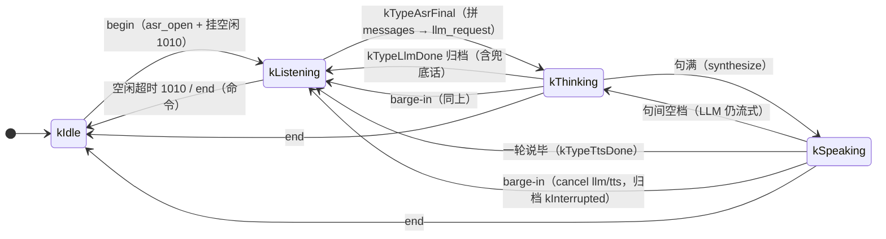
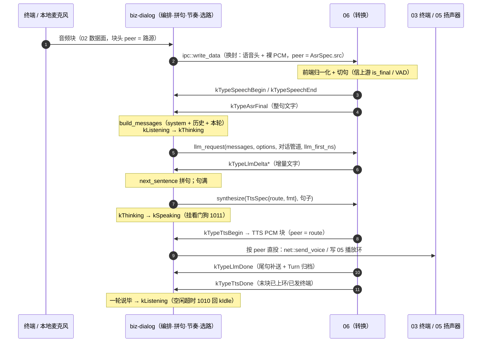
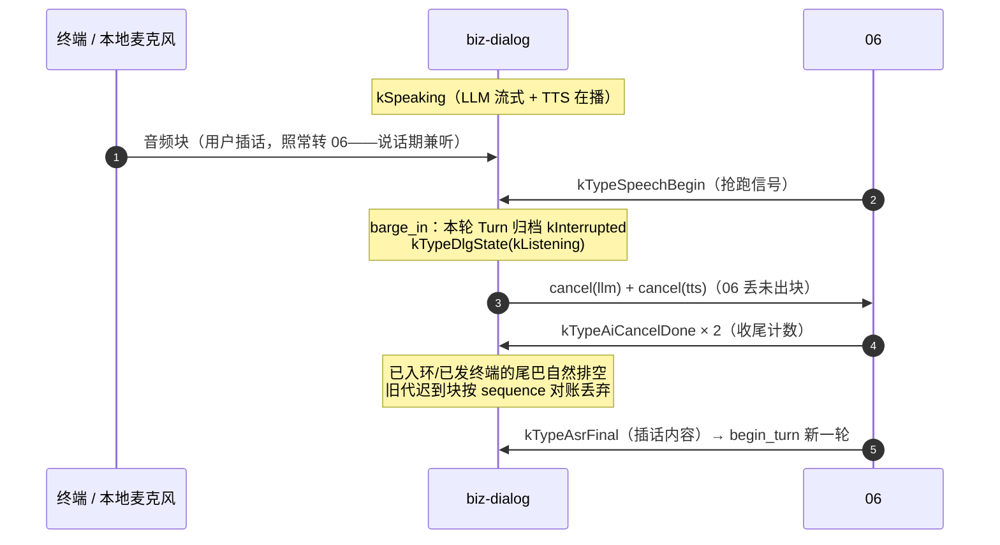

# 对话分支（biz-dialog）

> 自底向上第四层（M2 业务层，与 biz-bionic 并列）：对话域，一份文档、住主进程（01 线程池驱动）——**一轮对话的编排与决策的唯一归属**：四步流水线编排、会话上下文（prompt / 人设 / 多轮历史）、增量拼句、打断与会话节奏、选路与混音。**不干转换、不碰字节、不碰设备、不看 PCM**：转换归 [06](./06-ai.md)，字节与连接归 [03](./03-network.md)，声卡归 [05](./05-device-io.md)，机制本体归 [01](./01-dispatcher.md)/[02](./02-ipc.md)/[04](./04-timer.md)，仿生归 [07](./07-bionic.md) 与 biz-bionic；本模块只答"听谁的、怎么回、什么时候说"。契约与号段 1000 起（`kBiz`）在本模块定死；共享语音契约 `media.h` 的解释权右半（选路/节奏，左半 `sequence`/`is_final` 的产生归 06）在此（见 [../media.md](../media.md)）；"该回什么话"的业务策略值住 `DialogSpec`，一期常量表。选型（nlohmann/json 拼 messages）见 [../tech-stack.md](../tech-stack.md)。

## 职责

把 06 的三项能力串成一轮完整对话，管"听谁的、怎么回、什么时候说"：

1. **定义契约**：`SessionId`、`DialogSession`/`Turn`/`Route`/`DialogSpec`、会话状态机、号段 1000 起事件与负载与 `dlg::` 门面自由函数；上层只见契约与门面，不见各模块类、不见 PCM。
2. **四步流水线编排**：逐步调用 06 的三项能力串起"音频 → 转文字 → 文字 → Socket(LLM) → 文字 → 转语音 → 语音 → 扬声器/终端"——`asr_open` → `llm_request` → `synthesize` → 直投，衔接每步的事件与状态，一步不落一步不抢。
3. **会话上下文**：system prompt、人设、多轮历史的**持有与拼装**——`build_messages`（system + 历史 + 本轮）随请求下发，06 无状态不存不改；历史保留 N 轮、出队裁剪（多轮记忆的唯一住处）。
4. **增量拼句与会话节奏**：LLM 流式增量（`kTypeLlmDelta`）拼句——切句判据 = 标点 / 长度上限 / 流末，**句满即送 TTS 不等整段**；何时听、何时说、何时停全在本模块。
5. **打断与状态机**：会话状态机（`kIdle`/`kListening`/`kThinking`/`kSpeaking`）驱动四步流转；**说话期兼听**——收 `kTypeSpeechBegin` 即 barge-in：`cancel` LLM/TTS、本轮归档 `kInterrupted`、回倾听。
6. **选路与混音**：语音双路（终端 / 本地声卡）由业务选（`Route`）；音频块**换封转发**——上行选路写 06 环，TTS 块按块头 `peer` 直投 03/05；`media.h` 解释权右半（选路/节奏）在此。
7. **业务策略**："该回什么话"、兜底话、人设语气、会话起止（命令/唤醒/空闲）——策略值住 `DialogSpec`（改值不改代码），不散写进流水线。

**不负责**：音频↔文字、文字↔语音的转换本体与 LLM 报文方言（06）；字节收发、连接生命周期与断线重连（03）；声卡与设备 IO（05）；IPC 协议语义（02）；事件循环、管道、定时机制本体（01/02/04）；触摸、呼吸、体温等仿生（[07](./07-bionic.md) 与 biz-bionic）；PCM 内容本身——只搬运、只选路，不听不看。

## 数据结构

沿用 01 的设计约定（**外壳函数式、类退居资源聚合体**）：门面 = `dlg` 命名空间自由函数操作集（资源引用作第一参数，`create()`/`stop()` 管资源生死），应用层只见契约与门面、不见类；类只做**资源聚合体**（RAII 资源成员，操作全在门面自由函数）与**库薄壳**（RAII + 不可再拆的库封装），原语就是门面函数本身；封装靠文件边界——**头文件** = 契约类型 + 门面声明（应用层唯一可见面），**实现文件** = 类定义 + 内脏自由函数（纯函数 + 编排函数），不用 `private`/`friend`；内脏住 `dlg` 命名空间（不跨模块直调）。机械性动作一律 `with（切面…, 本体）` 包裹（lambda 模拟 AOP around，见 [../with.md](../with.md)），编排函数本体只写业务。

```cpp
// ===== dlg.h：契约类型 + 门面（应用层唯一可见面） =====

// kBiz 号段 1000 起，细分（owner 内政）：1000–1049 对话分支、1050–1099 仿生行为（biz-bionic 预留）。
// 事件定义 = 策略行（policy.h，声明即注册）：满时策略随声明出生，不写分支。
inline constexpr EventDef kTypeDlgState      {1000, kBiz, Qos::kBlock};     // 会话状态迁移（负载 = DlgStateInfo）：投仿生联动 / 终端 / 观测
inline constexpr EventDef kTypeDlgTurnEnd    {1001, kBiz, Qos::kBlock};     // 一轮归档（负载 = Turn）：听写 + 回复 + 结局
inline constexpr EventDef kTypeDlgSentence   {1002, kBiz, Qos::kDropCount}; // 拼句产物（负载 = Sentence）：字幕/观测用，可丢
inline constexpr EventDef kTypeDlgIdleTimer  {1010, kBiz, Qos::kBlock};     // 04 用户事件模板：会话空闲超时（负载 = SessionId）
inline constexpr EventDef kTypeDlgWatchTimer {1011, kBiz, Qos::kBlock};     // 04 用户事件模板：流水线看门狗（负载 = SessionId）

using SessionId = uint64_t;   // 会话号：begin() 发号（单调不复用），0 = 无效

constexpr uint8_t kDlgIdle      = 0;   // 待机：无会话
constexpr uint8_t kDlgListening = 1;   // 倾听：ASR 流开，等整句
constexpr uint8_t kDlgThinking  = 2;   // 思考：LLM 在飞（含拼句等待）
constexpr uint8_t kDlgSpeaking  = 3;   // 说话：TTS 在合成/在播（说话期兼听 barge-in）

constexpr uint8_t kRouteTerminal = 1;  // 语音双路：走终端（03 双向）
constexpr uint8_t kRouteLocal    = 2;  // 语音双路：走本地声卡（05 流式）

struct Route {              // 会话选路（media.h 解释权右半：选路归 M2）
    uint8_t     kind;       // kRouteTerminal / kRouteLocal
    uint32_t    terminal;   // kRouteTerminal：TerminalId（上下行同终端）
    uint32_t    mic;        // kRouteLocal：采集 DeviceId
    uint32_t    spk;        // kRouteLocal：播放 DeviceId
    AudioFormat fmt;        // 会话音轨参数：终端随流声明 / 本地随设备挂接（06 据此归一化）
};

struct DialogSpec {         // 会话业务参数：策略值出处（改值不改代码）
    std::string persona;      // 人设（拼进 system prompt）
    std::string system;       // system prompt 模板，空 = 只用人设
    uint32_t    max_history;  // 多轮记忆保留轮数（出队裁剪）
    uint64_t    llm_first_ns; // LLM 首增量上限（llm_request 的 timeout 实参）
    uint64_t    idle_ns;      // 空闲超时：无输入回待机（04 模板 1010）
    uint64_t    watch_ns;     // 流水线看门狗：送 TTS 后等首块（04 模板 1011）
    uint32_t    sentence_max; // 拼句长度上限（超长强制切句）
};

// 错误码：一轮的业务结局（Turn.status），独立常量空间——不占 EventType 号段，避免撞号。
enum class DlgErr : int32_t {
    kOk          = 0,
    kInterrupted = -1,   // 被打断（barge-in / 命令）
    kAsrFail     = -2,   // 识别失败（AiErr 细目归档日志，不作分支）
    kLlmFail     = -3,   // LLM 失败/超时/断连（说兜底话后归档）
    kTtsFail     = -4,   // 合成失败
    kRouteDown   = -5,   // 语音路不可用（设备死 / 终端下线）
};

struct Turn {               // 一轮对话的档案（kTypeDlgTurnEnd 负载）
    SessionId   session;
    uint32_t    turn_seq;   // 会话内轮次号（从 0 递增）
    std::string heard;      // 用户说了什么（ASR 终稿）
    std::string reply;      // 完整回复（LLM 终稿拼接）
    int32_t     status;     // DlgErr：0 = 正常完成
    uint64_t    t_ns;
};

struct Sentence {           // kTypeDlgSentence 负载：拼句产物（送 TTS 的文本单元）
    SessionId   session;
    TaskId      llm;        // 来源 LLM 任务（对账/打断用）
    std::string text;
    bool        last;       // 流末句（LlmDone 后补送的尾巴）
};

struct DlgStateInfo {       // kTypeDlgState 负载
    SessionId session;
    uint8_t   state;        // kDlgIdle / kDlgListening / kDlgThinking / kDlgSpeaking
    uint32_t  turn_seq;
    uint64_t  t_ns;
};

class Dialog;               // 资源聚合体（定义在实现文件）：应用层只见名字，用指针/引用持有

// ===== 门面：自由函数操作集，资源引用作第一参数 =====
namespace dlg {

std::unique_ptr<Dialog> create(Dispatcher&, Timer&, Ipc&, Net&, Ai&,
                               const DialogSpec&, PipeId events);  // 资源出生（RAII）+ 管道装配：登记 on_dlg_event 为对话管道消费者
SessionId begin(Dialog&, const Route&);   // 开会话：asr_open（src 随路、seg 随路）+ 挂空闲 + 投 kTypeDlgState
void      end(Dialog&, SessionId, int32_t why);   // 结束会话：cancel 在飞、归档、投 kTypeDlgState(kIdle)
void      stop(Dialog&);                  // 资源死：在飞会话归档（kBroken）→ cancel 全部在飞 → 撤 04 模板，
                                          // 之后门面调用一律拒绝（`live`）
}
```

> `Net`/`Ai` 是 03/06 的**客户端桩**（02 承载，见 [03](./03-network.md)/[06](./06-ai.md) 的客户端半边）；音频块经 `Ipc` 数据面直达（`DataBlockView`），M2 不持有块的拷贝。

```cpp
// ===== dlg.cc：内部类型（实现文件） =====

struct SentenceState {      // 拼句缓冲（纯数据，不带方法）：每会话一份
    std::string acc;        // 未满句的增量累积；切句判据 = 标点 / sentence_max / 流末
};

struct DialogSession {      // 会话档案，SessionTable：SessionId → DialogSession（纯数据，不带方法）
    SessionId   id;
    DialogSpec  spec;
    Route       route;
    uint8_t     state = kDlgIdle;
    uint32_t    turn_seq = 0;
    TaskId      asr = 0;    // 在飞 ASR 流（订阅形）/ LLM 请求 / TTS 单：即归属索引（find_session）
    TaskId      llm = 0;
    TaskId      tts = 0;
    SentenceState sentence; // 拼句缓冲
    std::string heard;      // 本轮听写（ASR 终稿）
    std::string reply;      // 本轮回复（LLM 终稿拼接）
    std::deque<Turn> history;   // 多轮记忆：入队出队按 spec.max_history 裁剪
    TimerHandle idle_timer; // 04：空闲超时（模板 1010）
    TimerHandle watch;      // 04：流水线看门狗（模板 1011）
};
struct SessionTable { /* SessionId → DialogSession + TaskId 归属索引；一把锁护增删查 */ };
```

```cpp
// ===== dlg.cc：资源聚合体（实现文件） =====

// 资源聚合体：资源出生与生死归 create/stop，操作全在门面自由函数
class Dialog {
public:
    PipeId       inbox;     // 对话管道：06 任务事件 / 03 消息状态 / 02 数据面块 / 04 模板，统一进这
    PipeId       events;    // 对外投影：kTypeDlgState / kTypeDlgTurnEnd / kTypeDlgSentence
    Dispatcher&  d;         // 01：投递走它
    Timer&       timer;     // 04：空闲与看门狗
    Ipc&         ipc;       // 02：数据面块收发（03/05/06 环）
    Net&         net;       // 03 客户端桩：send_voice / send_message
    Ai&          ai;        // 06 客户端桩：asr_open / llm_request / synthesize / cancel
    SessionTable sessions;  // 会话账本
    SessionId    next_id = 1;
};
```

```cpp
// ===== dlg.cc：内脏自由函数（实现文件，不跨模块直调） =====
namespace dlg {   // 门面 begin/end 的实现体即编排

// ===== 纯函数：查询/变换，无副作用，可直接单测 =====

std::string build_messages(const DialogSession&, std::string_view heard);   // system + 历史 + 本轮 → messages JSON
std::optional<std::string> next_sentence(SentenceState&, std::string_view delta,
                                         uint32_t max_chars);               // 拼句切句：标点 / 上限 / 流末
DialogSession* find_session(Dialog&, TaskId);                              // 在飞任务号 → 会话归属
Event to_event(const Turn&, PipeId, uint64_t);                             // 轮归档 → kTypeDlgTurnEnd
Event make_state_event(const DialogSession&, PipeId, uint64_t);            // 状态迁移 → kTypeDlgState

// ===== 编排函数：带副作用，动词用命令式 =====

void on_dlg_event(Dialog&, const Event&);      // inbox 消费者：with(ev, …) 按 Event.type 分流（见"与 02/03/04/05/06 的对接"）
void on_voice_block(Dialog&, const Event&);    // block：换封转发——上行选路写 06 环 / TTS 块按 peer 直投 03/05
void on_term_msg(Dialog&, const Event&);       // 03 消息/命令 → begin/end/业务策略
void on_term_down(Dialog&, const Event&);      // 终端下线：该终端会话 kRouteDown 归档结束
void on_speech_begin(Dialog&, const Event&);   // 说话期收到 = barge-in 裁决（倾听期 = 起句观测）
void on_speech_end(Dialog&, const Event&);     // 整句边界：等 kTypeAsrFinal（节奏观测）
void on_asr_final(Dialog&, const Event&);      // begin_turn：拼 messages → llm_request
void on_llm_delta(Dialog&, const Event&);      // next_sentence 拼句，句满 → speak
void on_llm_done(Dialog&, const Event&);       // 尾句补送 + Turn 归档（kTypeDlgTurnEnd）
void on_tts_begin(Dialog&, const Event&);      // 首块：撤流水线看门狗
void on_tts_done(Dialog&, const Event&);       // 末块已上环/已发终端：一轮说毕
void on_ai_error(Dialog&, const Event&);       // 任务失败：兜底话 / 归档（DlgErr）
void on_cancel_done(Dialog&, const Event&);    // 撤单回执：打断收尾计数
void on_ai_dead(Dialog&, const Event&);        // 引擎不可用：降级——兜底话后结束会话
void on_dev_dead(Dialog&, const Event&);       // 本地路设备死：降级——切终端路或结束（kRouteDown）
void on_lost(Dialog&, const Event&);           // 数据面丢块：计数（实时流可丢，作废裁决在 06 对账）
void on_idle_timer(Dialog&, SessionId);        // 空闲超时：end（kOk 归档）
void on_watch(Dialog&, SessionId);             // 流水线看门狗：兜底话 / 归档
void begin_turn(Dialog&, DialogSession&, std::string heard);  // 拼 messages → llm_request + 挂看门狗
void speak(Dialog&, DialogSession&, std::string sentence);    // synthesize（TtsSpec 随路）
void barge_in(Dialog&, DialogSession&);        // 打断编排：归档 kInterrupted + cancel llm/tts
void end_session(Dialog&, SessionId, int32_t why);            // 归档 + cancel + 撤模板 + 投 kIdle
}
```

## 接口与流水线

M2 住主进程：01 线程池消费对话管道（`on_dlg_event`），门面经 02 桩调 03/05/06 子进程，音频块走 02 数据面零拷贝——**M2 只换封不碰载荷**（`NetVoiceBlock` ↔ `kKindVoicePcm` 的语音头 + 裸 PCM，布局见 [../media.md](../media.md)）。

### 门面操作集（dlg.h）

| 操作 | 调用线程 | 语义 |
|---|---|---|
| `create(Dispatcher&, Timer&, Ipc&, Net&, Ai&, DialogSpec, events)` | 启动时 | 资源出生（RAII）+ 管道装配：登记 `on_dlg_event` 为对话管道消费者；状态/归档/观测事件投 `events` |
| `begin(Dialog&, Route)` | 任意线程 | 开会话：`ai::asr_open`（`src` = 路源，`seg` = 终端 `kSegUpstream` / 本地 `kSegVad`）+ 挂空闲（1010）+ 投 `kTypeDlgState(kListening)`；返回 `SessionId` |
| `end(Dialog&, SessionId, why)` | 任意线程 | 结束会话：`cancel` 在飞 → `Turn` 归档 → 撤 04 模板 → 投 `kTypeDlgState(kIdle)` |
| `stop(Dialog&)` | 停机时 | 在飞会话 `kBroken` 归档 → `cancel` 全部在飞 → 撤模板注销管道；之后门面调用一律拒绝（`live`） |

### 会话状态机

状态是"当前主活动"：思考与说话可交叠（LLM 流式 + 逐句 TTS），取主活动定状态；**说话期 ASR 流不关**——兼听就是 barge-in 的检测位。



### 对话流水线（一轮四步）



### 打断流水线（barge-in）



### 与 02/03/04/05/06 的对接

| 来源 | 事件 | biz-dialog 怎么处理 |
|---|---|---|
| 02 数据面 | `kTypeIpcDataReady`（上行语音块 / TTS PCM 块，块头 `peer` 定位） | `on_voice_block`：`block` 切面消费——上行换封写 06 环（peer = `AsrSpec.src`），TTS 块按 `peer` 直投 03/05，用完 `release` |
| 02 数据面 | `kTypeIpcDataLost`（seq 对账丢块） | `on_lost`：计数即可——实时流可丢（`kQosRealtime`），整句作废的裁决在 06 入流对账 |
| 03 | `kTypeNetMessage`（event/command） | `on_term_msg`：命令 → `begin`/`end`/人设切换；event → 业务策略（该回什么话） |
| 03 | `kTypeNetDown`（终端下线） | `on_term_down`：该终端会话 `kRouteDown` 归档结束（在飞 `cancel`） |
| 06 | `kTypeSpeechBegin` 510（抢跑信号） | `on_speech_begin`：说话期 = barge-in 裁决；倾听期 = 起句（撤空闲计时） |
| 06 | `kTypeSpeechEnd` 511（整句边界） | `on_speech_end`：节奏观测，等 `kTypeAsrFinal` |
| 06 | `kTypeAsrFinal` 512（整句文字） | `on_asr_final` → `begin_turn`：`build_messages` → `llm_request` |
| 06 | `kTypeLlmDelta` 550（增量） | `on_llm_delta`：`next_sentence` 拼句，句满 → `speak` |
| 06 | `kTypeLlmDone` 551（回包结束） | `on_llm_done`：尾句补送 → `Turn` 归档（`kTypeDlgTurnEnd`）→ 历史入队裁剪 |
| 06 | `kTypeTtsBegin` 580 / `kTypeTtsDone` 581 | 撤看门狗 / 一轮说毕（节奏收口） |
| 06 | `kTypeAiError` 500 / `kTypeAiCancelDone` 501 / `kTypeAiDead` 503 | 兜底话归档 / 打断收尾计数 / 降级——结束会话 |
| 05 | `kTypeDeviceDead` 403（本地路设备死） | `on_dev_dead`：降级——切终端路或结束（`kRouteDown`）；411/412 留观测位 |
| 04 | `kTypeDlgIdleTimer` 1010 / `kTypeDlgWatchTimer` 1011（用户事件模板） | 空闲回待机（`end`）/ 流水线看门狗：兜底话或归档 |

对话管道统一收件、统一裁决——06 任务事件、03 消息、02 数据面块、04 模板都登记到同一管道，`on_dlg_event` 一处分流：

```cpp
void dlg::on_dlg_event(Dialog& g, const Event& ev) {
    with(ev, {   // 机械：按 Event.type 查表分流
        {kTypeIpcDataReady,   [&](const Event& e){ on_voice_block(g, e); }},
        {kTypeIpcDataLost,    [&](const Event& e){ on_lost(g, e); }},
        {kTypeNetMessage,     [&](const Event& e){ on_term_msg(g, e); }},
        {kTypeNetDown,        [&](const Event& e){ on_term_down(g, e); }},
        {kTypeSpeechBegin,    [&](const Event& e){ on_speech_begin(g, e); }},
        {kTypeSpeechEnd,      [&](const Event& e){ on_speech_end(g, e); }},
        {kTypeAsrFinal,       [&](const Event& e){ on_asr_final(g, e); }},
        {kTypeLlmDelta,       [&](const Event& e){ on_llm_delta(g, e); }},
        {kTypeLlmDone,        [&](const Event& e){ on_llm_done(g, e); }},
        {kTypeTtsBegin,       [&](const Event& e){ on_tts_begin(g, e); }},
        {kTypeTtsDone,        [&](const Event& e){ on_tts_done(g, e); }},
        {kTypeAiError,        [&](const Event& e){ on_ai_error(g, e); }},
        {kTypeAiCancelDone,   [&](const Event& e){ on_cancel_done(g, e); }},
        {kTypeAiDead,         [&](const Event& e){ on_ai_dead(g, e); }},
        {kTypeDeviceDead,     [&](const Event& e){ on_dev_dead(g, e); }},
        {kTypeDlgIdleTimer,   [&](const Event& e){ on_idle_timer(g, any_cast<SessionId>(e.payload)); }},
        {kTypeDlgWatchTimer,  [&](const Event& e){ on_watch(g, any_cast<SessionId>(e.payload)); }},
    });
}
```

**寻址约定（SourceId ↔ 路源）**：上行块的归属看块头 `peer`（= `AsrSpec.src` = `Route.terminal`/`Route.mic`），TTS 块看 `peer`（= `TtsSpec.route` = `Route.terminal`/`Route.spk`）——**`peer` 即会话路由标签**，M2 只当流键用，换封时改写为下一跳的流键、不动语音头与 PCM；06/05/03 只搬运不解释（寻址语义归 M2，见 [06](./06-ai.md) 寻址约定）。`find_session(TaskId)` 查 06 事件的会话归属；04 模板负载带 `SessionId`。

### 例子：对话一轮（终端语音 → ASR → LLM → TTS → 回终端）

```cpp
// M2 主进程：装配（只见各模块头文件：契约 + 门面桩）
auto dlg = dlg::create(*d, *timer, *ip, *net, *ai,
                       DialogSpec{.persona = "玩偶小希", .max_history = 8,
                                  .llm_first_ns = 20s, .idle_ns = 60s, .watch_ns = 5s,
                                  .sentence_max = 60}, 观测管道);
SessionId s = dlg::begin(*dlg, Route{.kind = kRouteTerminal, .terminal = T1,
                                     .fmt = {16000, 1, 16, 320}});

// 终端语音块（kTypeIpcDataReady，块头 peer = T1）→ on_voice_block 换封写 06 环（peer = T1）……
// kTypeAsrFinal“介绍一下自己” → begin_turn：build_messages（system + 历史 + 本轮）：
//     ai::llm_request(*ai, LlmRequest{.messages = …, .options = …}, 对话管道, 20s);
// kTypeLlmDelta 拼句“我是小希。”句满 → speak：
//     ai::synthesize(*ai, TtsSpec{.route = T1, .fmt = {16000,1,16,320}}, 句子，对话管道);
// TTS PCM 块（peer = T1）→ net::send_voice(*net, T1, meta, pcm)
// 用户插话：kTypeSpeechBegin 于说话态 → barge_in：ai::cancel(llm); ai::cancel(tts);
```

| 步 | 醒因 | biz-dialog 处理 | 下一动作 |
|---|---|---|---|
| 1 | 终端语音块流入 | `on_voice_block`：换封（`NetVoiceBlock` → 语音头 + 裸 PCM）写 06 环 | 06 前端归一化 + 切句 |
| 2 | `kTypeSpeechBegin`（说话期） | `barge_in`：本轮归档 `kInterrupted`，`cancel` llm/tts | 回 `kListening` |
| 3 | `kTypeAsrFinal`“介绍一下自己” | `begin_turn`：`build_messages` → `llm_request`（挂看门狗） | `kThinking` |
| 4 | `kTypeLlmDelta*` | `next_sentence` 拼句，句满 → `speak`（`synthesize`） | `kSpeaking` |
| 5 | TTS PCM 块回流 | 按 `peer` 直投：`net::send_voice`（终端）/ 写 05 播放环（本地） | 终端/扬声器出声 |
| 6 | `kTypeLlmDone` | 尾句补送 → `Turn` 归档（`kTypeDlgTurnEnd`） | 历史入队（`max_history` 裁剪） |
| 7 | `kTypeTtsDone`（末块已上环） | 撤看门狗，一轮说毕 | `kListening`（空闲超时 1010 回 `kIdle`） |

## 规则

- **风格**：沿用 01 约定——外壳函数式、类退居资源聚合体：门面 = `dlg` 自由函数（头文件），内脏分纯/编排住 `dlg`（实现文件，不跨模块直调）；类只做资源聚合体与库薄壳，原语就是门面函数；契约/账本是纯结构体，不带方法。
- **门面准入**：新操作先问能否用既有门面组合实现——能则写成门面语法糖（参数适配、无新不变量），不能才新增门面原语；门面只增原语，不增类方法（演进防火墙）。
- **机械性切面**：与业务无关且重复的机械动作一律 `with（切面…, 本体）` 包裹（切面 = `Aspect` 数据形：state 挂机械状态与策略行，见 [../with.md](../with.md)）——门面 `live`、数据面块 `block`（用完必 release）、inbox 分流 `with(ev, …)`；**本模块无自立在飞单**——RPC 往返走 02 裁决（`rpc` 桩壳）、任务生命周期归 06 账本、定时归 04 语义账本，单据不另立（演进防火墙）。
- **号段**：kBiz 占 1000 起——1000–1049 对话分支（1000 状态 / 1001 轮归档 / 1002 拼句观测 / 1010–1011 04 用户事件模板），1050–1099 仿生行为（biz-bionic 预留）；新增类型在本节扩展并出行（`EventDef` 声明即注册，策略随行出生，见 [../policy.md](../policy.md)）。
- **会话上下文**：prompt、人设、多轮历史只在 M2——06 无状态，`messages`（system + 历史 + 本轮）拼好随请求下发；历史保留 `max_history` 轮、出队裁剪；换人设、换 LLM 对端不动流水线（方言归 06 适配层）。
- **拼句与节奏**：增量拼句归 M2——`next_sentence` 是纯函数（切句判据 = 标点 / `sentence_max` 强切 / 流末），**句满即送 TTS 不等整段**；`sequence`/`is_final` 解释权右半（选路/节奏）归本模块，左半（产生）归 06（见 [../media.md](../media.md)）；节奏的近似口径 = `kTypeTtsDone`（末块已上环/已发终端）即一轮说毕，播尽精确计时留 411 回执观测位。
- **打断（barge-in）**：说话态收 `kTypeSpeechBegin` 即打断——`ai::cancel` LLM/TTS（06 丢未出块），本轮 `Turn` 归档 `kInterrupted`，回倾听；已入环/已发终端的尾巴自然排空（环深百 ms 内），严格 flush 记 03/05 优化预留；旧代迟到块按 `sequence` 对账丢弃并计数（`settle` 精神）。
- **选路与混音**：语音双路（终端/本地）由业务选（`Route`），`seg` 随路（终端信上游 `is_final`、本地 VAD 自切）；音频块**换封不换载**——只改块头流键，语音头与 PCM 不解释不修改；一期单源直投不混音，混音位（多源叠加，如提示音 + TTS）收在转发口、预留。
- **背压**：不写分支、写行——满时策略 = 契约块的 `EventDef` 行（状态/归档/模板 `kBlock`，观测 `kDropCount`），语音块转发 = [../media.md](../media.md) 块 qos 声明制（`kQosRealtime` 丢旧留新 + 计数）；环满 `write_data` 返 `false` 即丢该拍并计数，不阻塞对话管道。
- **错误**：不写分支——任务失败按源归档 `DlgErr`（`AiErr` 细目透传日志、不作分支），处置是业务策略：LLM 失败说兜底话、引擎不可用降级结束会话、本地路死切终端路或 `kRouteDown` 归档；`intercept` 切面查行（`ErrPolicy`，见 [../policy.md](../policy.md)），库错误不抛上层。
- **超时**：不写"挂不挂"的分支——LLM 首增量上限 = `llm_request` 的 `timeout` 实参（06 结案 `kTimeout`）；空闲（1010）与流水线看门狗（1011）挂 04（用户事件模板），到期原样投对话管道，本模块不看堆、不碰 timerfd。
- **线程安全**：对话管道消费**单线程裁决**——状态机迁移、拼句、历史销账、打断全在此串行（同 02/03/06 的 inbox 裁决点）；门面任意线程可调（`begin`/`end` 投回对话管道排队裁决）；`SessionTable` 一把锁多写单读。
- **生命周期**：`SessionId` 单调发号不复用；`DialogSession` 生死随 `begin`/`end`，在飞任务号即归属索引；数据面块视图走 `block`（用完 `release`）；禁裸 `new/delete`；库类型（json 对象、PCM 缓冲）不出模块边界。
- **stop()**：在飞会话 `kBroken` 归档 → `cancel` 全部在飞（asr/llm/tts）→ 撤 04 模板 → 注销对话管道；之后门面调用一律拒绝（`live`）。
- **优化预留**：多会话并发（`SessionTable` 已留形，一期单活跃会话）；主动说话（`say` 语法糖：直通 `synthesize`，不经 LLM——问候/提示音）；混音（多源叠加）；严格打断（03/05 播放 flush）；人设/prompt/对话策略脚本化（Lua，见 [../tech-stack.md](../tech-stack.md) sol2）；字幕流（`kTypeDlgSentence` 转正投终端）；本地唤醒词（kWordDetect）；播尽才回倾听（411 回执驱动）。
